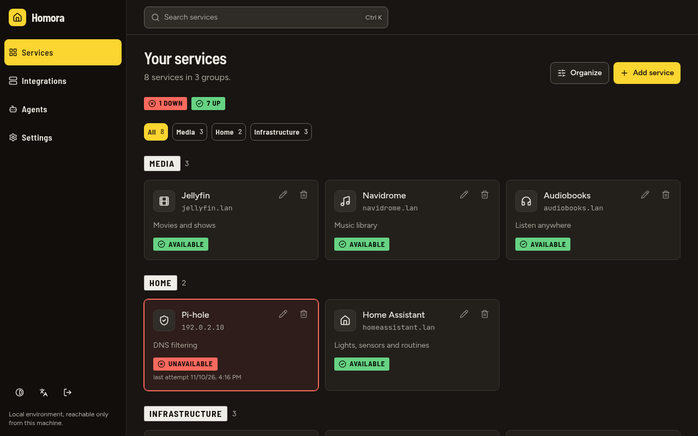

# Homora

**English** · [Português (Brasil)](README.pt-BR.md)

A self-hosted home page to organize your services and keep an eye on your homelab. It is useful on its own, without Proxmox or any AI agent. Optional integrations and AI agents can add more, and agents can only _propose_ changes: you review each proposal before it takes effect.

**Status:** early, local-first development. This README separates what exists today from what is only planned.



## What works today

- A dashboard of service cards with groups, drag-and-drop ordering (Organize mode), a column count per group (1 to 6, kept in exports), search (`Ctrl K` or `/`) and a status per service (available, login required, redirect, not found, no response or not checked) with the HTTP code and latency.
- Card icons as an emoji, a built-in icon name (`lucide:server`), a bundled brand logo (`brand:plex`, 163 homelab and self-hosted apps, served locally with no external requests) or an image URL. The service form suggests the logo that matches the service name.
- English and Portuguese (Brazil) interface. The language follows your browser and can be switched with the language button.
- Export your groups and cards to YAML or JSON, and import from Homora, [Homepage](https://github.com/gethomepage/homepage) (`services.yaml`, `bookmarks.yaml`) or [Dashy](https://github.com/Lissy93/dashy) (`conf.yml`), always with a preview. See [Import and export](#import-and-export).
- A check method per service (HTTP request or ping) and a check interval per service (30 to 3600 seconds), also kept in exports.
- Optional Docker discovery: suggests cards from container labels (`homora.url`, or Homepage's `homepage.href`), with a review step. See [Docker discovery](#docker-discovery).
- Local administrator account, SQLite storage with migrations, backup and restore scripts.
- Widgets inside cards: attach a widget (Proxmox, Jellyfin, Home Assistant, Uptime Kuma or AdGuard Home data) to a card on the Integrations page. Each widget shows its own loading or error state, and a failing connection does not affect the other cards.
- An optional top bar (turn it on in Settings) with the date, the time and CPU, memory and disk usage from the Proxmox widget.
- Experimental read-only integrations (Proxmox, Jellyfin, Home Assistant, Uptime Kuma, AdGuard Home) and a local MCP server where AI agents get scoped, revocable tokens and can propose card changes that you approve in the interface.

Not available yet: OIDC or multi-user access, custom CSS and themes, and a validated setup for exposing Homora beyond your own machine. The plan lives in [docs/estrategia.md](docs/estrategia.md) and [docs/evolucao.md](docs/evolucao.md) (in Portuguese).

## Install with Docker

Requirements: Docker with Compose.

```bash
git clone https://github.com/JhonatanMedeiros/homora.git
cd homora
docker compose up -d --build
```

Open <http://localhost:8080> and create an administrator password (at least 8 characters). The port is bound to `127.0.0.1` and your data lives in the `homora-data` volume.

The bind address comes from `HOMORA_BIND_IP` (default `127.0.0.1`). Override it, for example `HOMORA_BIND_IP=0.0.0.0`, only when a reverse proxy on the same private network terminates HTTPS — see the note below.

Once release images are published, you can skip the build:

```bash
HOMORA_VERSION=<version> docker compose -f compose.release.yml up -d
```

Images are built for `linux/amd64` and `linux/arm64` from base images pinned by digest.

> **Do not expose Homora to a network you do not control.** It is designed for local use. Until the first administrator account exists, anyone who can reach the port can create it, so do the first setup from the machine itself, before exposing anything. Compose provides no HTTPS by itself. See [Deployment scenarios](#deployment-scenarios) for what was tested; it does not make public exposure safe by itself.

## Deployment scenarios

| Scenario                                        | How                                                                                                                                    | Status                                                                 |
| ----------------------------------------------- | -------------------------------------------------------------------------------------------------------------------------------------- | ---------------------------------------------------------------------- |
| This machine only                               | `docker compose up -d --build`; the port stays on `127.0.0.1`.                                                                         | Default and best tested.                                               |
| Private network, plain HTTP                     | Not supported by design: only `localhost` may use HTTP, so changes made from other machines over HTTP are refused by the origin check. | Use the HTTPS proxy below.                                             |
| HTTPS reverse proxy on the same private network | See below.                                                                                                                             | Validated once with a local nginx proxy and a self-signed certificate. |
| Public internet                                 | Not supported.                                                                                                                         | Do not do this.                                                        |

With a reverse proxy that terminates HTTPS in front of Homora:

1. Keep the Homora port on a private network and publish only the proxy. Do not publish the backend (port 3000); in Compose it is not published.
2. Set `HOMORA_ALLOWED_ORIGINS` to the public origin, for example `https://homora.example.home` (a comma-separated list; HTTPS only, plus `localhost`).
3. Make the proxy forward `Host` and send the real client address in `X-Forwarded-For` (for example `proxy_set_header X-Forwarded-For $proxy_add_x_forwarded_for;` in nginx).
4. Set `HOMORA_TRUSTED_PROXY` to the proxy's address or network, for example `172.18.0.0/16` for a proxy container on the Compose network. This lets the per-client login limit (5 wrong passwords per client in 15 minutes) tell clients apart. Without it, every client behind your proxy shares one counter, so someone else's failed attempts can lock you out.
5. Do not disable origin validation. The session cookie is `HttpOnly`, `SameSite=Strict` and gets `Secure` when you sign in from an HTTPS origin.

`HOMORA_TRUST_PROXY=true` (already set in the Compose files) makes the backend read the client address from `X-Forwarded-For`; set it only if every request reaches the backend through a proxy that overwrites that header, as the bundled nginx does.

## Upgrade

1. Back up first (see [Backup and restore](#backup-and-restore)).
2. Update your checkout (`git pull`) or pick the new `HOMORA_VERSION`.
3. Run `docker compose up -d --build` (or `docker compose -f compose.release.yml pull && docker compose -f compose.release.yml up -d`).

The `homora-data` volume is preserved and database migrations run on startup inside a transaction. There is no automated downgrade: if a migration fails, keep the original volume and restore a backup into a working copy before resuming. Try the upgrade on a copy of your data if the installation holds anything important.

## Import and export

Open **Settings**. Download your groups, cards and their order as YAML or JSON (`GET /api/config/export`). The file never contains passwords, tokens, connections or IDs, so it is safe to keep in version control.

To import, pick the file format (Homora, Homepage or Dashy) and a file. Homora shows a preview of what will be added, what already exists and what was ignored, and writes nothing until you confirm. Import only adds: nothing is overwritten or removed. Imported cards are not allowed to monitor your private network unless you tick that option for a Homora file you trust.

Icons from other dashboards are kept only when Homora has an equivalent (an image URL, an emoji, a brand logo or one of the built-in icons); the others are left empty with a warning. Widgets, monitoring settings and Docker links from Homepage and Dashy are not imported. The formats were checked against those projects' documentation; real files may vary.

## Backup and restore

Create a consistent copy of the database (existing files are never overwritten):

```bash
pnpm backup data/homora.sqlite backups/homora.sqlite
```

The database holds your cards and encrypted connection credentials. The encryption key and the administrator account live in `.key` and `.auth` files next to the database, and the original Proxmox integration also uses `.proxmox`. Copy those separately into a protected backup and restore them with the same derived names. Without the key you must configure credentials again; without `.auth` the account cannot be recovered. To restore, stop Homora, keep the current database and use the backup as the source of a new file, for example `pnpm backup backups/homora.sqlite data/restored.sqlite`. Point `HOMORA_DATABASE_PATH` at it and restart.

With Docker Compose, use a new protected directory on the host (the commands do not overwrite backups):

```bash
mkdir -p backups/backup-2026-11-10
docker compose exec backend node scripts/backup.mjs /app/data/homora.sqlite /app/data/backup.sqlite
docker compose cp backend:/app/data/backup.sqlite backups/backup-2026-11-10/homora.sqlite
docker compose cp backend:/app/data/homora.sqlite.auth backups/backup-2026-11-10/homora.sqlite.auth
docker compose cp backend:/app/data/homora.sqlite.key backups/backup-2026-11-10/homora.sqlite.key
docker compose cp backend:/app/data/homora.sqlite.proxmox backups/backup-2026-11-10/homora.sqlite.proxmox
```

`.auth` and `.proxmox` may not exist on every installation; skip a copy if the file is missing. Keep the key as protected as the database, and do a test restore before relying on a backup.

## Sessions, password reset and secret rotation

- **Sessions** live in memory for eight hours and end when the backend restarts. The cookie is `HttpOnly`, `SameSite=Strict` and, when you sign in from an HTTPS origin, `Secure`. State-changing requests are accepted only from an allowed origin. Five wrong passwords from one client address block that address for 15 minutes (the counter is in memory too).
- **Forgot the password:** stop the backend, delete `<database>.auth` (for Compose, `/app/data/homora.sqlite.auth` in the volume), start it again and open Homora to create a new account. Cards and encrypted connections are kept. Until the first account is created, anyone who can reach the interface from an allowed origin can claim it, so do this on a private network. Restarting also ends every old session.
- **Rotating connection secrets:** rotating the encryption key itself is not supported, and removing `<database>.key` while encrypted connections exist makes them unreadable (Homora will not create a new key over them). To rotate what matters in practice, create a new token at the source (Proxmox, Home Assistant, and so on), enter it again on the connection in Integrations, then revoke the old token. Agent tokens can be replaced in the Agents page ("Generate new token") or revoked.
- Treat the database, `.key`, `.auth` and backups as one secret set: anyone holding the key and the database can read the stored credentials.

## Docker discovery

Off by default. It suggests cards from labels on running containers and adds nothing until you review and confirm on the **Settings** page.

```yaml
services:
  jellyfin:
    labels:
      homora.url: http://192.168.1.10:8096
      homora.name: Jellyfin # optional, defaults to the container name
      homora.group: Media # optional, defaults to "Docker"
      homora.description: Movies and shows # optional
      homora.icon: brand:jellyfin # optional
```

The Homepage labels `homepage.href`, `homepage.name`, `homepage.group`, `homepage.description` and `homepage.icon` also work, and `homora.*` wins when both are set. Labels never turn on monitoring of private addresses; you choose that for the cards you add.

The Docker socket gives privileged access to the daemon, so Homora never mounts it. Enable discovery with a restricted proxy that only answers "list containers":

```bash
docker compose -f compose.yml -f compose.docker-discovery.yml up -d --build
```

This starts `tecnativa/docker-socket-proxy` (read-only socket, containers only, no published port) and sets `HOMORA_DOCKER_HOST=http://docker-proxy:2375` for the backend. Outside Compose, `HOMORA_DOCKER_HOST` also accepts `unix:///var/run/docker.sock`, which gives the backend the socket directly; prefer the proxy. Run this only on a host you trust.

## Proxmox and other integrations

Set up Proxmox on the Integrations page with an account and token that have read-only access. Credentials are encrypted at rest with a key stored separately in the same directory; this does not protect against someone who can read both files. For a private CA, import the CA's public certificate (PEM) in the form and use **Test connection** before saving; TLS validation stays on. Service limits and requirements are in [docs/integracoes.md](docs/integracoes.md). The adapters were validated with mocks, not against real Jellyfin, Home Assistant, Uptime Kuma or AdGuard Home instances.

## MCP and AI agents

After `pnpm build`, start the local MCP server with `node apps/backend/dist/mcp-server.js`. It uses stdio and offers `list_services`, `list_proxmox_resources` and `propose_service_card`. Set `HOMORA_AGENT_TOKEN` for the MCP process to a token issued in the Agents page, with the minimum scopes needed (`services:read`, `proxmox:read`, `proposals:create`). The MCP process reads the local database and vault directly and is not protected by the web session, so run it only with a client and system user you trust. Proposals need an authenticated human review in the interface. Agents must treat names and other returned data as untrusted.

## Development

Requirements: Node.js 24 (see `.nvmrc`) and pnpm 12.4.2.

```bash
nvm use
corepack enable
pnpm install --frozen-lockfile
pnpm dev
```

Sign-in uses `/login` and returns to the requested local route after authentication. The dashboard uses `/`; management sections use `/manage/services`, `/manage/integrations`, `/manage/agents`, and `/manage/settings`, with browser history support. Service forms use `/manage/services/new` and `/manage/services/:id/edit`; unknown routes show a not-found page. When hosting the frontend separately, configure the server to return `index.html` for these routes.

Open <http://localhost:5173>. Vite forwards `/api` to the local Fastify backend on port 3000. `pnpm dev` uses the isolated `data/homora-dev.sqlite` database and seeds example services on first creation. Changes persist between runs; deleted examples are not recreated. Example addresses are illustrative and private-network monitoring is not enabled. The first run still requires creating an administrator password. Outside development, the default database is `data/homora.sqlite` and can be configured with `HOMORA_DATABASE_PATH`; `pnpm dev` always uses its isolated database.

The monorepo uses pnpm and Turborepo: React, Vite, Tailwind CSS and shadcn/ui on the frontend; Node.js, TypeScript and Fastify on the backend; shared contracts; Drizzle ORM with SQLite. Run `pnpm check` (lint, format, types and tests) and `pnpm build` before sending changes. Commits follow Conventional Commits (`feat: ...`), enforced by Husky and Commitlint. See [CONTRIBUTING.md](CONTRIBUTING.md) and [docs/padroes.md](docs/padroes.md).

## Documentation

Most engineering documents are in Portuguese.

- [Glossary](GLOSSARY.md) · [Product](docs/produto.md) · [Architecture and security](docs/arquitetura.md) · [Engineering standards](docs/padroes.md)
- [Integrations](docs/integracoes.md) · [Strategy versus Homepage and Dashy](docs/estrategia.md)
- [Delivery plan](docs/plano.md) · [Evolution plan and progress](docs/evolucao.md)
- [Guidance for AI agents](AGENTS.md) · [Contributing](CONTRIBUTING.md) · [Security policy](SECURITY.md)

## License

[MIT](LICENSE). Third-party licenses are summarized in [THIRD_PARTY_NOTICES.md](THIRD_PARTY_NOTICES.md).
