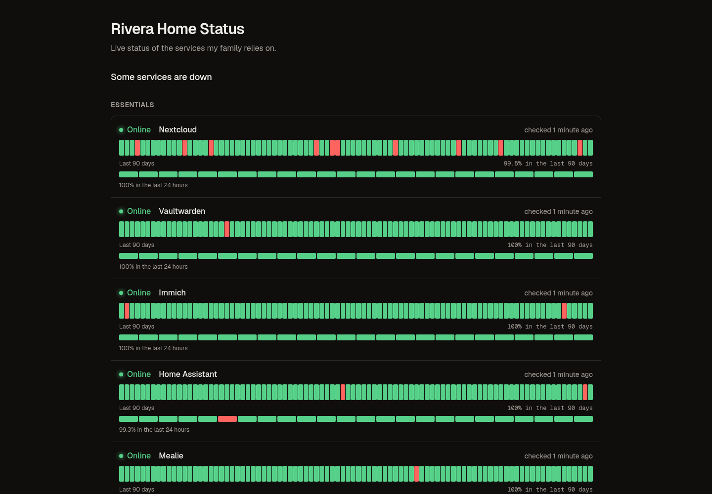
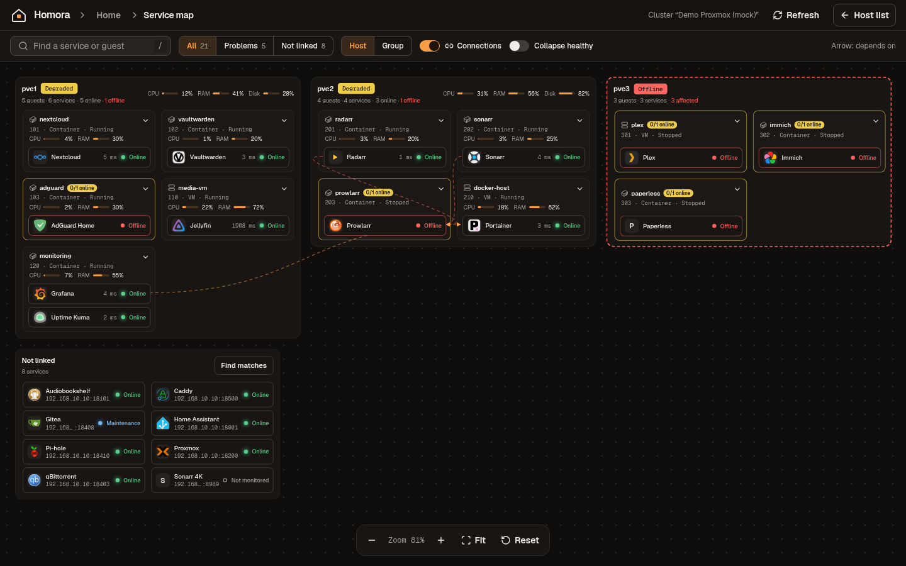
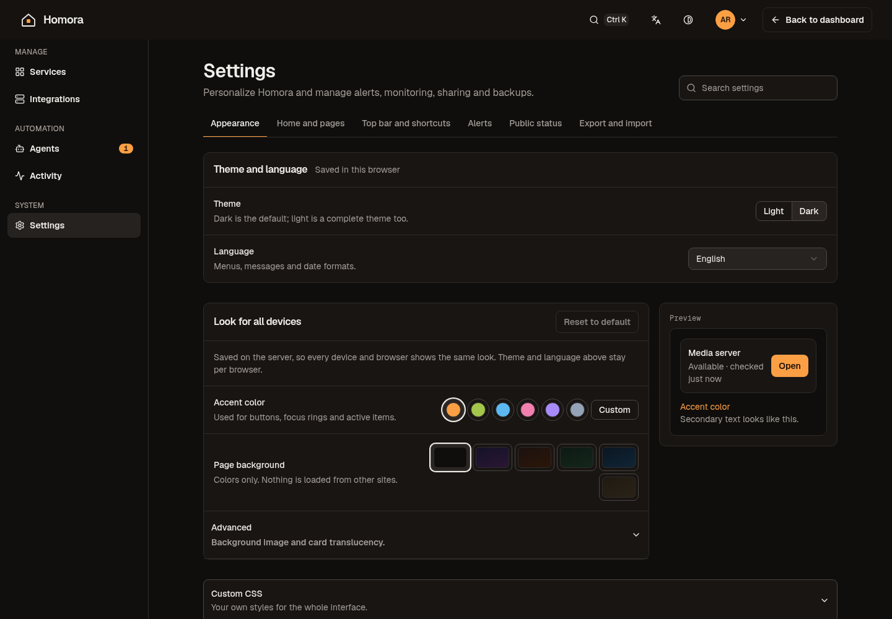

<div align="center">

# Homora

**A self-hosted home page for your homelab: organize your services, see what is up, and let AI agents help without handing them the keys.**

[Quick start](#quick-start) · [Features](#features) · [Screenshots](#a-closer-look) · [Use cases](#use-cases) · [Documentation](#documentation) · [Português (Brasil)](README.pt-BR.md)


</div>

> **Status: early, local-first development.** Homora is useful today as a dashboard with monitoring, but it
> is not yet a hardened internet-facing product. This README separates what exists from what is planned;
> see [What is not available yet](#what-is-not-available-yet).
>
> The screenshots in this repository come from a demo installation with synthetic data
> ([how they are made](docs/screenshots/README.md)).

## Why Homora

Most homelabs end up with a dozen web interfaces on a dozen ports. Homora gives them one front door and
answers the question you actually have when something feels off: **what is down, since when, and why?**

- **Useful on its own.** No Proxmox, no cloud account and no AI agent required. Everything else is optional.
- **Monitoring built in.** Every card is checked on a schedule, with latency, uptime history, incidents,
  maintenance windows and alerts.
- **Agents propose, you decide.** Connect an AI agent over MCP with scoped, revocable tokens. It can suggest
  cards, groups and widgets, but nothing changes until you approve the exact proposal, and every step is audited.
- **Local-first and private.** SQLite on your disk, brand icons served locally, no telemetry, and
  credentials encrypted at rest.
- **Bring your setup with you.** Import from [Homepage](https://github.com/gethomepage/homepage) or
  [Dashy](https://github.com/Lissy93/dashy), always with a preview, and export to YAML or JSON whenever you like.

## Quick start

You need Docker with Compose.

```bash
git clone https://github.com/JhonatanMedeiros/homora.git
cd homora
docker compose up -d --build
```

Open <http://localhost:8080>, create the administrator account (a name, an email used only as your sign-in
name, and a password of at least 8 characters), then press **Add service**. Your data lives in the
`homora-data` Docker volume, and the port is bound to `127.0.0.1` by default.

> **Do not expose Homora to a network you do not control.** Until the first account exists, anyone who can
> reach the port can create it, so do the first setup from the machine itself. Read
> [Deployment and upgrades](docs/user-guide/deployment.md) before putting a reverse proxy in front of it.

New here? Follow [Getting started](docs/user-guide/getting-started.md), a ten-minute tour from the first card
to your first alert.

## Features

### Organize

- **Groups, pages and cards** with drag-and-drop ordering, 1 to 6 columns per group, tabs for pages (keys `1` to `9`)
  and tags to filter.
- **Short addresses:** optionally assign a unique alias such as `/go/plex` to a service. Sign-in is required; the address follows the current service URL. Changing or removing the alias invalidates bookmarks. Reusing it for another service sends old bookmarks to that service.
- **Two layouts:** a dense list or detailed cards with descriptions and uptime bars. Group, Host and Map views.
- **Icons your way:** an emoji, a built-in icon (`lucide:server`), one of **164 bundled homelab brand logos**
  (`brand:plex`, served locally with no external requests) or an image URL. The form suggests the logo that
  matches the service name.
- **Command palette** (`Ctrl K` or `/`) to jump to any card, filter with `status:down` or `group:Media`, and
  reach every settings page. Single-key shortcuts (`?` lists them) can be turned off.
- **Personal look:** accent color, gradients, card translucency, a background image and custom CSS (with a
  safe mode in case you lock yourself out). Light and dark themes, English and Portuguese (Brazil).

### Monitor

- **Seven check types:** HTTP(S), ping, TCP, DNS, TLS certificate expiry, keyword in the page and a value in a JSON response.
- **Honest status.** Online, Offline, Degraded, Maintenance or Waiting, with latency and the reason a check
  failed (not found, server error, no response, certificate expired).
- **History that answers questions:** uptime over 24 hours, 7, 30 and 90 days, latency charts (p50 and p95), a
  90-day heatmap, incident log, mean time to recover and a 99.9% availability target with its error budget.
- **Alerts without noise:** thresholds before an incident opens, and Telegram, ntfy, Discord or webhook
  notifications, localized per channel.
- **Maintenance windows** that pause checks and keep planned work out of your statistics.
- **Public status page** (off by default): a minimal read-only `/status` for family or teammates. It never exposes URLs or internals.

### Connect

- **Read-only integrations** for Proxmox, Jellyfin, Home Assistant, Uptime Kuma, AdGuard Home, Pi-hole,
  Speedtest Tracker, Portainer, NetBird, Tailscale, Cloudflare and Coolify, shown as **widgets inside cards
  and on pages**. A failing connection never affects other cards.
- **Service-to-host map:** link a card to the VM or container it runs on, record dependencies, and see what may be
  affected when a host goes down. Homora suggests links from evidence and never writes to Proxmox.
- **Docker discovery:** suggests cards from container labels (`homora.url`, or Homepage's `homepage.href`), on this host or on remote hosts
  through a small agent. Nothing is added without your review.
- **Top bar and page widgets:** a clock, plus CPU, memory and disk from a Proxmox connection.

### Delegate to AI agents, safely

- **MCP server** over local stdio or stateless Streamable HTTP, compatible with Claude Code, Codex, Claude
  Desktop, Cursor and VS Code.
- **Scoped, revocable tokens.** Grant only what an agent needs (for example `services:read` and `proposals:create`).
- **Proposals, not actions.** Agents suggest a change; you see the exact diff, approve or reject it, and it
  expires if ignored. Agents never see credentials and cannot write to external infrastructure.
- **Complete audit trail** of sign-ins, proposals, approvals and settings changes in the Activity page.

New MCP scopes are granted explicitly; existing tokens do not gain them automatically:

| Scope                                 | Capability                                           |
| ------------------------------------- | ---------------------------------------------------- |
| `probes:read`, `probes:propose`       | Read and propose standalone monitors                 |
| `incidents:read`, `incidents:propose` | Read incidents and propose acknowledgements or mutes |
| `organization:propose`                | Propose pages, tags, favorites and resource links    |
| `notifications:read`                  | Read channel metadata without credentials            |

See the [complete agent capability inventory](docs/agent-capabilities.md) for all scopes and tools.

### Own your data

- **Import** from Homora, Homepage (`services.yaml`, `bookmarks.yaml`) and Dashy (`conf.yml`) with a preview that
  writes nothing until you confirm. **Export** to YAML or JSON.
- **Backup and restore** scripts, SQLite migrations that run inside a transaction, and multi-arch images
  (`linux/amd64`, `linux/arm64`) built from digest-pinned base images.
- **Sign-in options:** password, optional two-step verification (TOTP with recovery codes) and passkeys.

## A closer look

<table>
  <tr>
    <td width="50%">
      <a href="docs/screenshots/dashboard-cards.png"></a>
      <br><b>Cards layout.</b> Descriptions, 24-hour uptime bars and latency at a glance.
    </td>
    <td width="50%">
      <a href="docs/screenshots/dashboard-light.png"></a>
      <br><b>Light theme.</b> A complete light theme, not an afterthought.
    </td>
  </tr>
  <tr>
    <td width="50%">
      <a href="docs/screenshots/command-palette.png"></a>
      <br><b>Command palette.</b> Search, filters such as <code>status:down</code>, and quick navigation.
    </td>
    <td width="50%">
      <a href="docs/screenshots/service-detail.png"></a>
      <br><b>Service detail.</b> Uptime per period, latency percentiles, incidents and failure reasons.
    </td>
  </tr>
  <tr>
    <td width="50%">
      <a href="docs/screenshots/service-form-monitoring.png"></a>
      <br><b>Check methods.</b> HTTP(S), ping, TCP, DNS, TLS, keyword and JSON.
    </td>
    <td width="50%">
      <a href="docs/screenshots/agents.png"></a>
      <br><b>Agent proposals.</b> Review the exact change before anything is applied.
    </td>
  </tr>
  <tr>
    <td width="50%">
      <a href="docs/screenshots/public-status.png"></a>
      <br><b>Public status page.</b> Optional, read-only, and limited to what you mark as public.
    </td>
    <td width="50%">
      <a href="docs/screenshots/integrations.png"></a>
      <br><b>Integrations.</b> Connections, card widgets and Docker discovery in one place.
    </td>
  </tr>
  <tr>
    <td width="50%">
      <a href="docs/screenshots/host-view.png"></a>
      <br><b>Host view.</b> Services grouped by the guest they run on, with impact from failing dependencies.
    </td>
    <td width="50%">
      <a href="docs/screenshots/host-map.png"></a>
      <br><b>Service map.</b> See what runs where, and what a stopped guest takes with it.
    </td>
  </tr>
  <tr>
    <td width="50%">
      <a href="docs/screenshots/organize-mode.png"></a>
      <br><b>Organize mode.</b> Add, edit, remove, reorder or move services, all on the Home.
    </td>
    <td width="50%">
      <a href="docs/screenshots/settings-appearance.png"></a>
      <br><b>Make it yours.</b> Accent colors, backgrounds, translucency and custom CSS.
    </td>
  </tr>
</table>

Homora is responsive and works on a phone too:

<p align="center">
  
</p>

## Use cases

| You want to...                                      | Homora gives you...                                                                                      |
| --------------------------------------------------- | -------------------------------------------------------------------------------------------------------- |
| Stop remembering ports and bookmarks                | One page with groups, pages, search and shortcuts, plus an import from Homepage or Dashy.                |
| Know when something breaks, before your family does | Checks on every card, alerts to your phone and an optional public status page.                           |
| Understand an outage                                | Incident log, failure reasons, latency history and a map of what depends on which host.                  |
| Add services you already run in Docker              | Label-based discovery with a review step, locally or from remote hosts.                                  |
| Let an AI assistant tidy your dashboard             | An MCP agent proposes groups and cards; you approve each change and can revoke the token at any time.    |
| Keep a Proxmox cluster in view                      | Read-only widgets for VMs, containers, CPU, memory and disk, and cards linked to the guests they run on. |

More scenarios, with the steps to set each one up, are in [Use cases](docs/user-guide/use-cases.md).

## Supported integrations

Proxmox VE · Jellyfin · Home Assistant · Uptime Kuma · AdGuard Home · Pi-hole · Speedtest Tracker · Portainer ·
NetBird · Tailscale · Cloudflare · Coolify

All twelve are **read-only and experimental**: they were validated with mocks and documented sample responses,
not against live multi-version installations. The status of each one is in the
[integration reference](docs/integrations.md#integration-status). Want another service? Integrations are
declarative and testable; see [how to write one](docs/adapters.md).

## Safe by design

- Credentials are **encrypted at rest** and never returned to the browser, to MCP clients or to logs.
- Network checks follow a **destination policy**: loopback and special address ranges are always blocked, and
  private LAN addresses are monitored only when you allow them per service.
- Sessions use `HttpOnly`, `SameSite=Strict` cookies, state-changing requests are origin-checked, and sign-in
  attempts are rate limited per client.
- Agents have **no infrastructure actions at all**, only reviewable proposals.
- The optional status page is closed by default and exposes only service name, group, state and uptime.

Read the [security policy](SECURITY.md) and the [architecture and security model](docs/architecture.md).

## What is not available yet

OIDC or multi-user access, and a validated setup for exposing Homora beyond your own network (only an HTTPS
reverse proxy on a private network was validated, once). Real-world validation of the integrations is also
pending. The roadmap lives in [docs/strategy.md](docs/strategy.md) and [docs/evolution.md](docs/evolution.md).

## Documentation

**User guide**

| Guide                                                                             | What it covers                                                                  |
| --------------------------------------------------------------------------------- | ------------------------------------------------------------------------------- |
| [Getting started](docs/user-guide/getting-started.md)                             | Install, first sign-in, your first card, and where everything lives.            |
| [Dashboard](docs/user-guide/dashboard.md)                                         | Pages, groups, layouts, search, shortcuts, organize mode and service details.   |
| [Services and monitoring](docs/user-guide/services-and-monitoring.md)             | Card fields, check types, thresholds, incidents, uptime, maintenance and hosts. |
| [Notifications and status page](docs/user-guide/notifications-and-status-page.md) | Telegram, ntfy, Discord, webhooks and the public status page.                   |
| [Integrations and widgets](docs/user-guide/integrations-and-widgets.md)           | Connections, card widgets, page widgets and the top bar.                        |
| [Docker discovery](docs/user-guide/docker-discovery.md)                           | Labels, remote agents and the restricted Docker proxy.                          |
| [AI agents and MCP](docs/user-guide/agents-and-mcp.md)                            | Tokens, scopes, proposals, review and client setup.                             |
| [Appearance and personalization](docs/user-guide/appearance.md)                   | Themes, accent colors, backgrounds, custom CSS and safe mode.                   |
| [Import, export and backup](docs/user-guide/import-export-backup.md)              | Moving from Homepage or Dashy, exporting, backing up and restoring.             |
| [Accounts and security](docs/user-guide/accounts-and-security.md)                 | Sessions, two-step verification, passkeys and account recovery.                 |
| [Deployment and upgrades](docs/user-guide/deployment.md)                          | Docker, HTTPS reverse proxy, environment variables and upgrades.                |
| [Use cases](docs/user-guide/use-cases.md)                                         | Step-by-step recipes for common homelab goals.                                  |

**Reference and project**

- [Glossary](GLOSSARY.md) · [Product](docs/product.md) · [Architecture and security](docs/architecture.md) · [Engineering standards](docs/standards.md)
- [Integration reference](docs/integrations.md) · [Writing an integration](docs/adapters.md) · [Agent capability inventory](docs/agent-capabilities.md) · [Ten-minute agent demo](docs/agent-demo.md)
- [Strategy versus Homepage and Dashy](docs/strategy.md) · [Delivery plan](docs/plan.md) · [Evolution plan and progress](docs/evolution.md) · [Decision records](docs/decisions)
- [Guidance for AI agents](AGENTS.md) · [Contributing](CONTRIBUTING.md) · [Security policy](SECURITY.md)

## Development

Requirements: Node.js 24 (see `.nvmrc`) and pnpm 12.4.2.

```bash
nvm use
corepack enable
pnpm install --frozen-lockfile
pnpm dev
```

Open <http://localhost:5173>. Vite forwards `/api` to the Fastify backend on port 3000. `pnpm dev` uses the
isolated `data/homora-dev.sqlite` database and seeds example services on first creation; the first run still
requires creating an administrator account. Example addresses are illustrative, and private-network monitoring is
not enabled for them.

The monorepo uses pnpm and Turborepo: React, Vite, Tailwind CSS and shadcn/ui on the frontend; Node.js,
TypeScript and Fastify on the backend; shared contracts; Drizzle ORM with SQLite. Run `pnpm check` (lint, format,
types and tests) and `pnpm build` before sending changes. Commits follow Conventional Commits (`feat: ...`),
enforced by Husky and Commitlint. See [CONTRIBUTING.md](CONTRIBUTING.md) and [docs/standards.md](docs/standards.md).

Routes: the dashboard is `/`, sign-in is `/login`, management sections are `/manage/probes`,
`/manage/integrations`, `/manage/agents`, `/manage/activity` and `/manage/settings`, service forms are
`/manage/services/new` and `/manage/services/:id/edit`, and a service's detail page is `/services/:id`. When
hosting the frontend separately, configure the server to return `index.html` for these routes.

## Contributing

Bug reports, ideas and pull requests are welcome. Start with [CONTRIBUTING.md](CONTRIBUTING.md); integrations
and widgets have their own [guide](docs/adapters.md), which applies equally to people and AI agents.

## License

[MIT](LICENSE). Third-party licenses are summarized in [THIRD_PARTY_NOTICES.md](THIRD_PARTY_NOTICES.md).
