<div align="center">

# Homora

**Uma página inicial self-hosted para o seu homelab: organize seus serviços, veja o que está no ar e deixe agentes de IA ajudarem sem entregar as chaves a eles.**

[Início rápido](#início-rápido) · [Recursos](#recursos) · [Capturas de tela](#um-olhar-mais-de-perto) · [Casos de uso](#casos-de-uso) · [Documentação](#documentação) · [English](README.md)

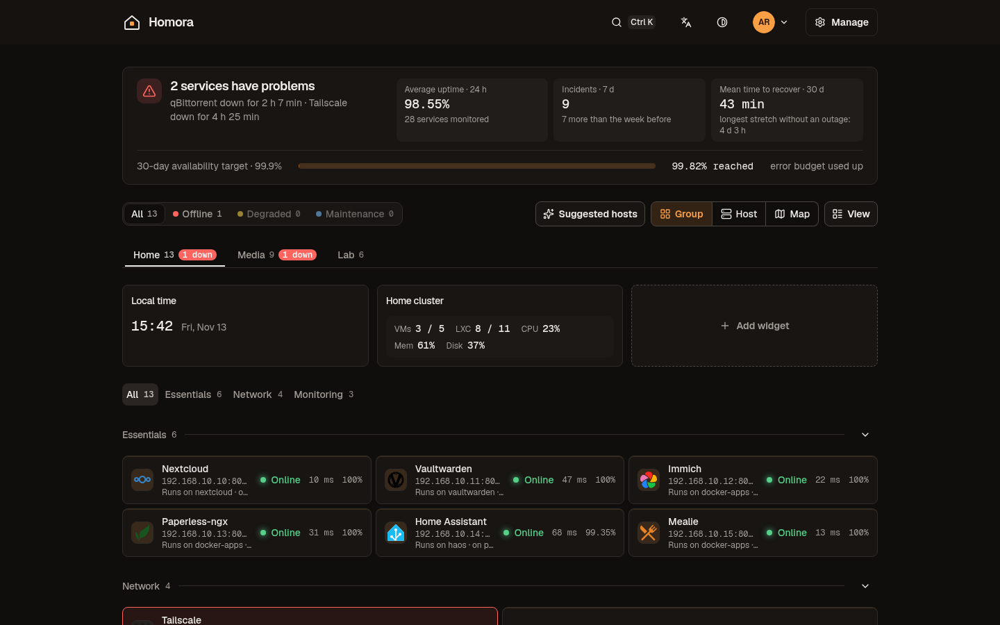

</div>

> **Estado: versão inicial, desenvolvida com foco local.** Hoje o Homora é útil como painel com monitoramento, mas
> ainda não é um produto pronto para ficar exposto na internet. Este README separa o que existe do que é apenas
> planejado; veja [O que ainda não está disponível](#o-que-ainda-não-está-disponível).
>
> As capturas de tela deste repositório vêm de uma instalação de demonstração com dados sintéticos
> ([como são feitas](docs/screenshots/README.md)).
>
> **Nota sobre o idioma:** a interface oferece inglês e português do Brasil. O site de documentação inclui
> guias em português; as referências técnicas detalhadas permanecem em inglês.

Aliases curtos opcionais como `/go/plex` exigem login e acompanham a URL atual do serviço. Alterar ou remover o alias invalida favoritos; reutilizá-lo para outro serviço fará antigos favoritos abrirem o novo serviço.

## Por que o Homora

A maioria dos homelabs acaba com uma dúzia de interfaces web em uma dúzia de portas. O Homora dá a elas uma porta de
entrada única e responde à pergunta que você realmente tem quando algo parece errado: **o que caiu, desde quando e por quê?**

- **Útil sozinho.** Não exige Proxmox, conta em nuvem nem agente de IA. Todo o resto é opcional.
- **Monitoramento embutido.** Cada card é verificado periodicamente, com latência, histórico de disponibilidade,
  incidentes, janelas de manutenção e alertas.
- **Agentes propõem, você decide.** Conecte um agente de IA por MCP com tokens restritos e revogáveis. Ele pode sugerir
  cards, grupos e widgets, mas nada muda até você aprovar a proposta exata, e cada passo fica registrado.
- **Local e privado.** SQLite no seu disco, logos servidos localmente, sem telemetria e credenciais criptografadas em repouso.
- **Novidades no sistema.** O menu do perfil mostra as notas e destaca versões estáveis mais recentes.
  Enquanto você estiver conectado, o Homora consulta o GitHub, que recebe o IP público do servidor.
- **Traga sua configuração.** Importe configurações compatíveis com pré-visualização e exporte para YAML ou JSON quando quiser.

## Início rápido

Você precisa do Docker com Compose.

```bash
git clone https://github.com/JhonatanMedeiros/homora.git
cd homora
docker compose up -d --build
```

Abra <http://localhost:8080>, crie a conta de administrador (um nome, um e-mail usado apenas como nome de acesso e uma
senha de pelo menos 8 caracteres) e clique em **Adicionar primeiro serviço**. Seus dados ficam no volume Docker `homora-data` e a
porta fica ligada a `127.0.0.1` por padrão.

O Homora também é publicado como uma única imagem multiarquitetura (amd64 e arm64):

```bash
docker run -d --name homora --restart unless-stopped \
  -p 127.0.0.1:8080:8080 -v homora-data:/app/data \
  ghcr.io/jhonatanmedeiros/homora:latest
```

> **Não exponha o Homora a uma rede que você não controla.** Até a primeira conta existir, qualquer pessoa que alcance a
> porta pode criá-la; por isso faça a configuração inicial na própria máquina. Leia
> [Deployment and upgrades](docs/user-guide/deployment.md) antes de colocar um proxy reverso na frente.

Primeira vez por aqui? Siga [Getting started](docs/user-guide/getting-started.md), um roteiro de dez minutos do primeiro
card ao primeiro alerta.

## Recursos

### Organizar

- **Grupos, páginas e cards** com ordenação por arrastar e soltar, de 1 a 6 colunas por grupo, abas para páginas
  (teclas `1` a `9`) e tags para filtrar.
- **Dois layouts:** lista densa ou cards detalhados, com descrição e barras de disponibilidade. Visões Grupo, Host e Mapa.
- **Ícones do seu jeito:** emoji, ícone embutido (`lucide:server`), um dos **164 logos de apps de homelab** incluídos
  (`brand:plex`, servidos localmente, sem requisições externas) ou uma URL de imagem. O formulário sugere o logo que
  corresponde ao nome do serviço.
- **Paleta de comandos** (`Ctrl K` ou `/`) para ir a qualquer card, filtrar com `status:down` ou `group:Media` e chegar a
  qualquer página de configurações. Atalhos de uma tecla (`?` lista todos) podem ser desativados.
- **Visual pessoal:** cor de destaque, gradientes, translucidez dos cards, imagem de fundo e CSS personalizado (com modo
  seguro, caso você se tranque para fora). Temas claro e escuro, em inglês e português do Brasil.

### Monitorar

- **Sete tipos de verificação:** HTTP(S), ping, TCP, DNS, validade do certificado TLS, palavra-chave na página e um valor
  em uma resposta JSON.
- **Status honesto.** No ar, Fora do ar, Degradado, Manutenção ou Aguardando, com latência e o motivo da falha (não
  encontrado, erro do servidor, sem resposta, certificado expirado).
- **Histórico que responde perguntas:** disponibilidade em 24 horas, 7, 30 e 90 dias, gráficos de latência (p50 e p95),
  mapa de calor de 90 dias, registro de incidentes, tempo médio de recuperação e meta de 99,9% com seu orçamento de erro.
- **Alertas sem ruído:** limites antes de abrir um incidente e notificações por Telegram, ntfy, Discord ou webhook, no
  idioma de cada canal.
- **Janelas de manutenção** que pausam as verificações e mantêm o trabalho planejado fora das suas estatísticas.
- **Página pública de status** (desativada por padrão): um `/status` mínimo, somente leitura, para família ou equipe.
  Nunca expõe URLs nem detalhes internos.

### Conectar

- **Integrações somente leitura** com Proxmox, Jellyfin, Home Assistant, Uptime Kuma, AdGuard Home, Pi-hole, Speedtest
  Tracker, Portainer, NetBird, Tailscale, Cloudflare, Healthchecks e Coolify, exibidas como **widgets dentro dos cards e nas páginas**.
  Uma conexão com falha nunca afeta os outros cards.
- **Mapa serviço-host:** vincule um card à VM ou ao contêiner em que ele roda, registre dependências e veja o que pode ser
  afetado quando um host cai. O Homora sugere vínculos a partir de evidências e nunca escreve no Proxmox.
- **Descoberta Docker:** sugere cards a partir de labels de contêineres (`homora.url` ou o `homepage.href` do Homepage),
  neste host ou em hosts remotos por meio de um pequeno agente. Nada é adicionado sem a sua revisão.
- **Barra superior e widgets de página:** um relógio, além de CPU, memória e disco de uma conexão Proxmox.

### Delegar a agentes de IA, com segurança

- **Servidor MCP** por stdio local ou Streamable HTTP sem estado, compatível com Claude Code, Codex, Claude Desktop,
  Cursor e VS Code.
- **Tokens restritos e revogáveis.** Conceda só o necessário (por exemplo `services:read` e `proposals:create`).
- **Propostas, não ações.** O agente sugere uma mudança; você vê o diff exato, aprova ou rejeita, e ela expira se for
  ignorada. Agentes nunca veem credenciais e não escrevem em infraestrutura externa.
- **Trilha de auditoria completa** de acessos, propostas, aprovações e mudanças de configuração na página Atividade.

Os novos escopos MCP são concedidos explicitamente; tokens existentes não os recebem automaticamente:

| Escopo                                | Capacidade                                             |
| ------------------------------------- | ------------------------------------------------------ |
| `probes:read`, `probes:propose`       | Ler e propor monitores independentes                   |
| `incidents:read`, `incidents:propose` | Ler incidentes e propor reconhecimento ou silêncio     |
| `organization:propose`                | Propor páginas, tags, favoritos e vínculos de recursos |
| `notifications:read`                  | Ler metadados de canais sem credenciais                |

Veja o [inventário completo de capacidades](docs/agent-capabilities.md) para todos os escopos e ferramentas.

### Seus dados são seus

- **Importe** do Homora, do Homepage (`services.yaml`, `bookmarks.yaml`) e do Dashy (`conf.yml`) com uma pré-visualização
  que não grava nada até você confirmar. **Exporte** para YAML ou JSON.
- **Scripts de backup e restauração**, migrações SQLite executadas dentro de uma transação e imagens multiarquitetura
  (`linux/amd64`, `linux/arm64`) construídas a partir de imagens base fixadas por digest.
- **Opções de acesso:** senha, verificação em duas etapas opcional (TOTP com códigos de recuperação) e passkeys.

## Um olhar mais de perto

<table>
  <tr>
    <td width="50%">
      <a href="docs/screenshots/dashboard-cards.png">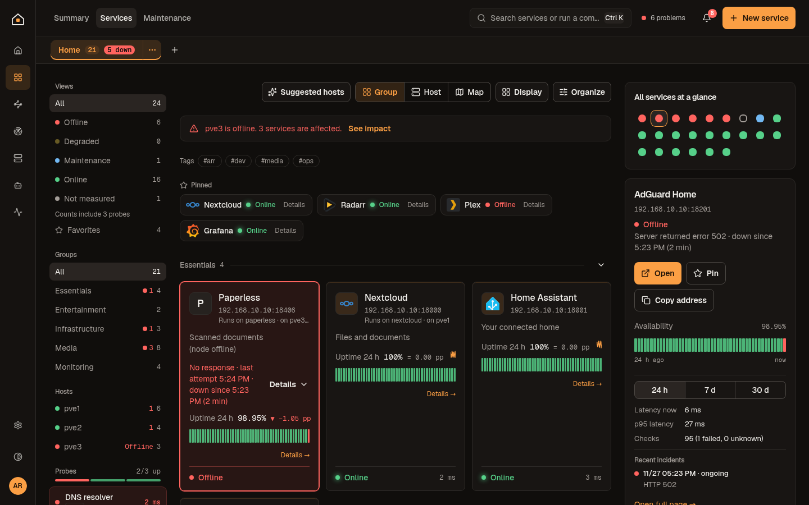</a>
      <br><b>Layout de cards.</b> Descrições, barras de 24 horas e latência de relance.
    </td>
    <td width="50%">
      <a href="docs/screenshots/dashboard-light.png">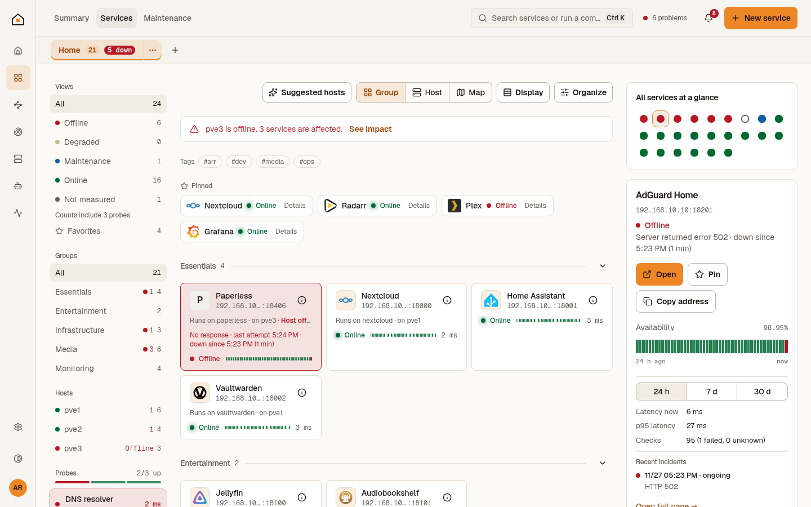</a>
      <br><b>Tema claro.</b> Um tema claro completo, não um improviso.
    </td>
  </tr>
  <tr>
    <td width="50%">
      <a href="docs/screenshots/command-palette.png">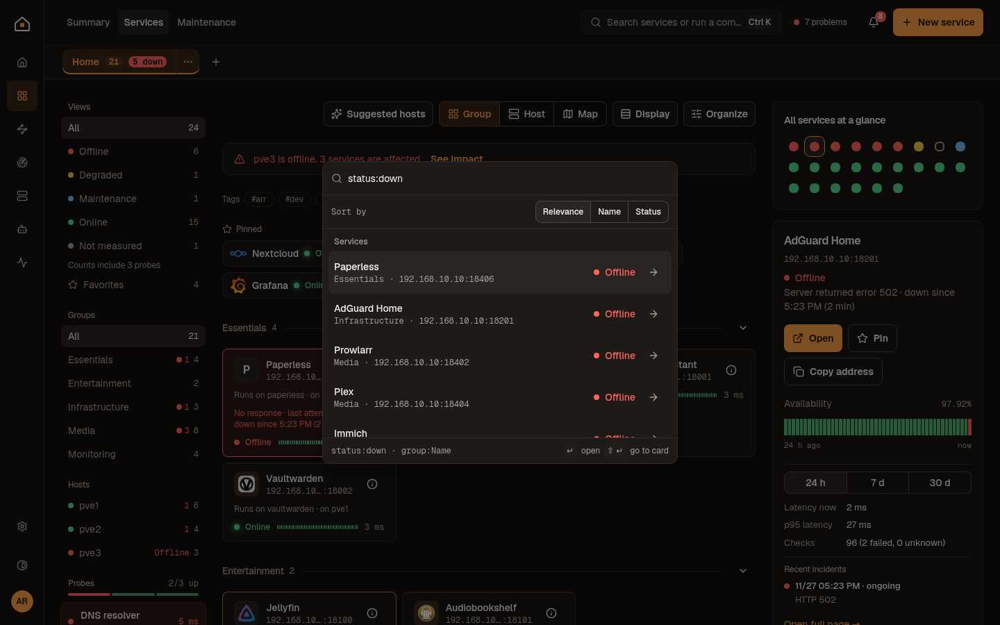</a>
      <br><b>Paleta de comandos.</b> Busca, filtros como <code>status:down</code> e navegação rápida.
    </td>
    <td width="50%">
      <a href="docs/screenshots/service-detail.png"></a>
      <br><b>Detalhe do serviço.</b> Disponibilidade por período, percentis de latência, incidentes e motivos de falha.
    </td>
  </tr>
  <tr>
    <td width="50%">
      <a href="docs/screenshots/service-form-monitoring.png">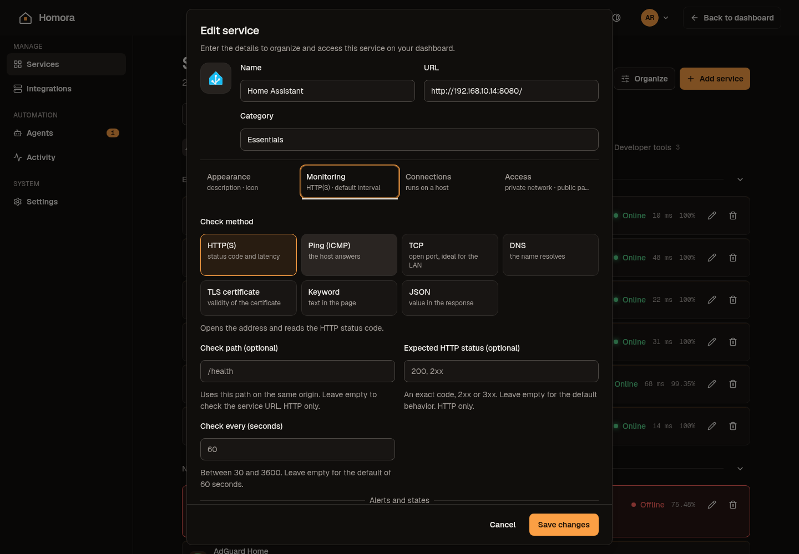</a>
      <br><b>Métodos de verificação.</b> HTTP(S), ping, TCP, DNS, TLS, palavra-chave e JSON.
    </td>
    <td width="50%">
      <a href="docs/screenshots/agents.png">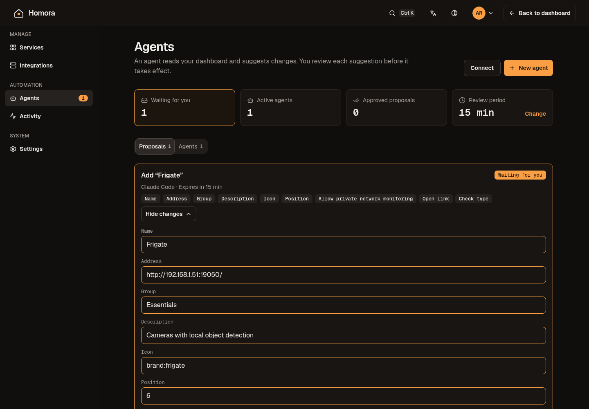</a>
      <br><b>Propostas de agentes.</b> Revise a mudança exata antes de qualquer aplicação.
    </td>
  </tr>
  <tr>
    <td width="50%">
      <a href="docs/screenshots/public-status.png">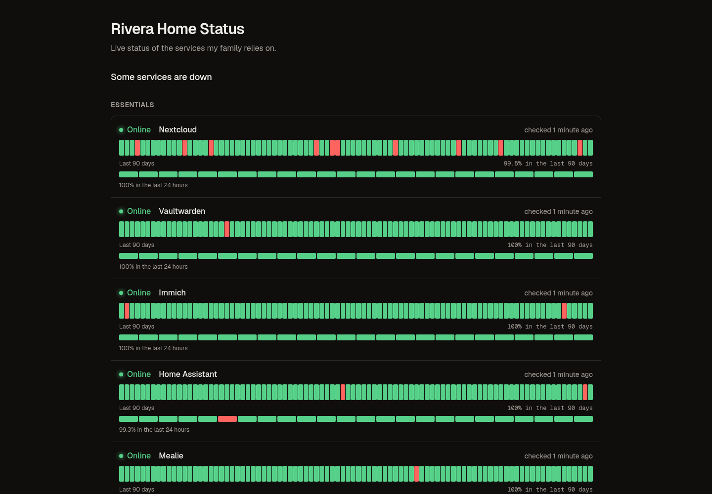</a>
      <br><b>Página pública de status.</b> Opcional, somente leitura e limitada ao que você marcar como público.
    </td>
    <td width="50%">
      <a href="docs/screenshots/integrations.png"></a>
      <br><b>Integrações.</b> Conexões, widgets de cards e descoberta Docker em um só lugar.
    </td>
  </tr>
  <tr>
    <td width="50%">
      <a href="docs/screenshots/host-view.png">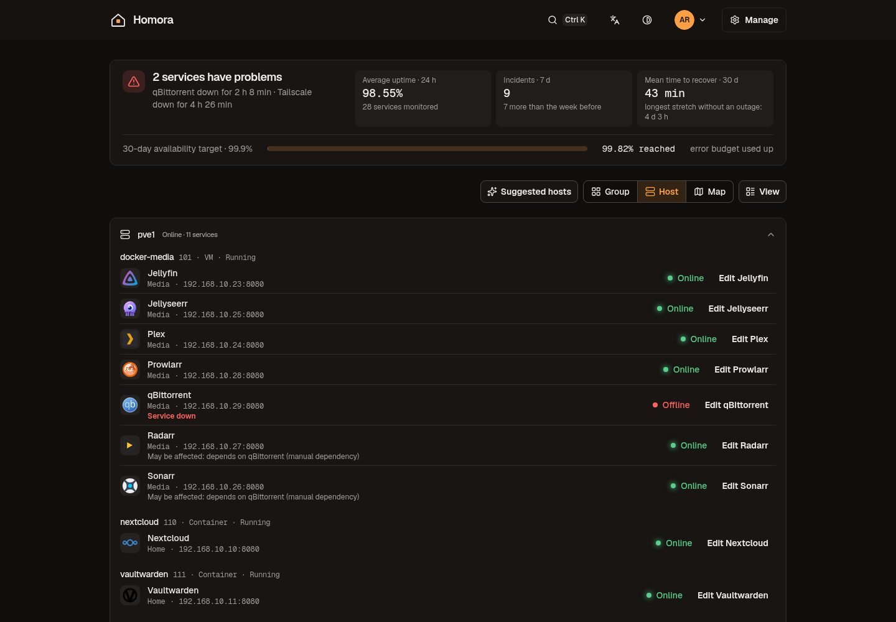</a>
      <br><b>Visão Host.</b> Serviços agrupados pelo convidado em que rodam, com o impacto de dependências com falha.
    </td>
    <td width="50%">
      <a href="docs/screenshots/host-map.png">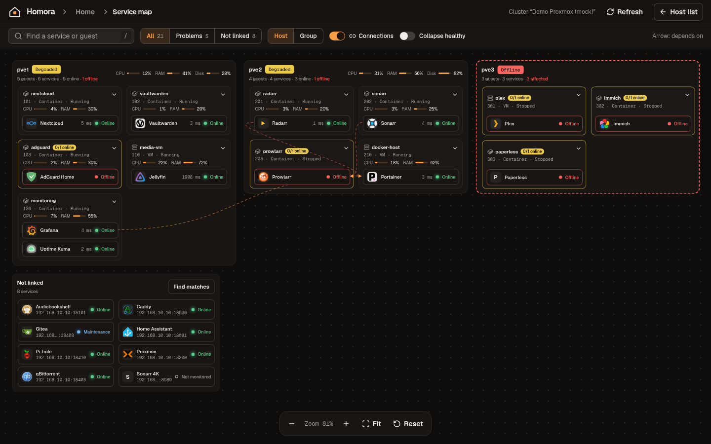</a>
      <br><b>Mapa de serviços.</b> Veja o que roda onde e o que um convidado parado leva junto.
    </td>
  </tr>
  <tr>
    <td width="50%">
      <a href="docs/screenshots/organize-mode.png">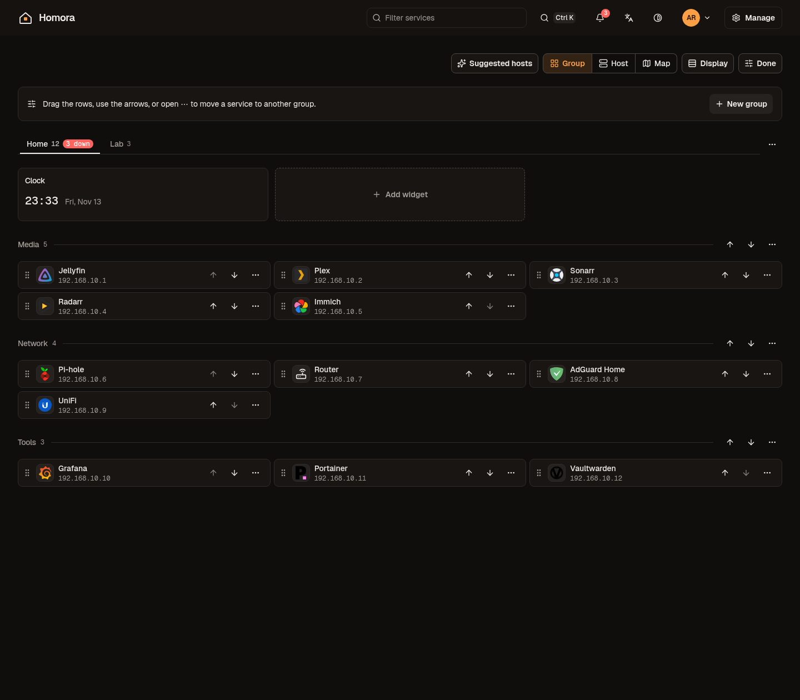</a>
      <br><b>Modo organizar.</b> Adicione, edite, remova, reordene ou mova serviços, tudo na Home.
    </td>
    <td width="50%">
      <a href="docs/screenshots/settings-appearance.png">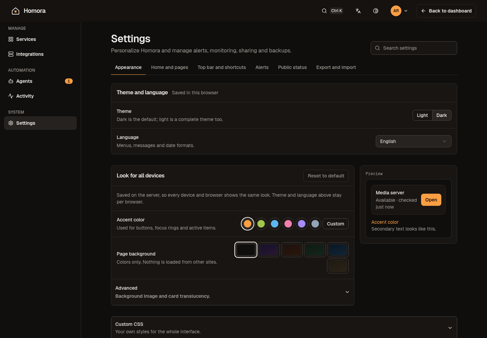</a>
      <br><b>Deixe com a sua cara.</b> Cores de destaque, fundos, translucidez e CSS personalizado.
    </td>
  </tr>
</table>

O Homora é responsivo e também funciona no celular:

<p align="center">
  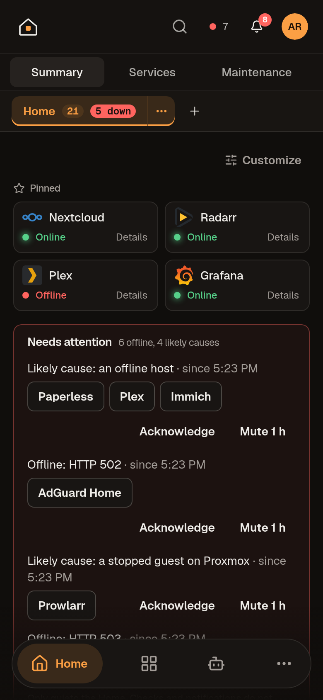
</p>

## Casos de uso

| Você quer...                                  | O Homora oferece...                                                                                                |
| --------------------------------------------- | ------------------------------------------------------------------------------------------------------------------ |
| Parar de lembrar portas e favoritos           | Uma página com grupos, páginas, busca e atalhos, além de importação de configurações.                              |
| Saber quando algo quebra antes da sua família | Verificações em cada card, alertas no celular e uma página pública de status opcional.                             |
| Entender uma queda                            | Registro de incidentes, motivos de falha, histórico de latência e um mapa do que depende de cada host.             |
| Adicionar serviços que você já roda no Docker | Descoberta por labels com etapa de revisão, localmente ou a partir de hosts remotos.                               |
| Deixar um assistente de IA arrumar o painel   | Um agente MCP propõe grupos e cards; você aprova cada mudança e pode revogar o token a qualquer momento.           |
| Manter um cluster Proxmox à vista             | Widgets somente leitura de VMs, contêineres, CPU, memória e disco, e cards vinculados aos convidados em que rodam. |

Mais cenários, com o passo a passo de cada um, em [Use cases](docs/user-guide/use-cases.md).

## Integrações compatíveis

Proxmox VE · Jellyfin · Home Assistant · Uptime Kuma · AdGuard Home · Pi-hole · Speedtest Tracker · Portainer ·
NetBird · Tailscale · Cloudflare · Healthchecks · Coolify

As doze são **somente leitura e experimentais**: foram validadas com mocks e respostas de exemplo documentadas, não com
instalações reais de várias versões. O estado de cada uma está na
[referência de integrações](docs/integrations.md#integration-status). Quer outro serviço? As integrações são
declarativas e testáveis; veja [como escrever uma](docs/adapters.md).

## Seguro por projeto

- As credenciais são **criptografadas em repouso** e nunca voltam ao navegador, a clientes MCP ou aos logs.
- As verificações de rede seguem uma **política de destino**: loopback e faixas especiais são sempre bloqueados, e
  endereços da LAN privada só são monitorados quando você permite, serviço a serviço.
- As sessões usam cookies `HttpOnly` e `SameSite=Strict`, requisições que alteram estado têm a origem verificada e as
  tentativas de acesso têm limite por cliente.
- Agentes **não têm nenhuma ação sobre a infraestrutura**, apenas propostas revisáveis.
- A página de status opcional vem fechada por padrão e expõe apenas nome do serviço, grupo, estado e disponibilidade.

Leia a [política de segurança](SECURITY.md) e o [modelo de arquitetura e segurança](docs/architecture.md).

## O que ainda não está disponível

OIDC ou acesso multiusuário, e uma configuração validada para expor o Homora fora da sua rede (apenas um proxy reverso
HTTPS em rede privada foi validado, uma vez). A validação das integrações em ambientes reais também está pendente. O plano
está em [docs/strategy.md](docs/strategy.md) e [docs/evolution.md](docs/evolution.md).

## Documentação

Leia online em **[homora-dash.vercel.app](https://homora-dash.vercel.app)** ou execute o site localmente com `pnpm docs:dev`; consulte a [configuração e hospedagem](docs/maintainers/documentation.md).

O site inclui guias em português e referências detalhadas em inglês.

**Guia do usuário**

| Guia                                                                              | O que cobre                                                                                     |
| --------------------------------------------------------------------------------- | ----------------------------------------------------------------------------------------------- |
| [Getting started](docs/user-guide/getting-started.md)                             | Instalação, primeiro acesso, seu primeiro card e onde fica cada coisa.                          |
| [Dashboard](docs/user-guide/dashboard.md)                                         | Páginas, grupos, layouts, busca, atalhos, modo organizar e detalhes de serviço.                 |
| [Services and monitoring](docs/user-guide/services-and-monitoring.md)             | Campos do card, tipos de verificação, limites, incidentes, disponibilidade, manutenção e hosts. |
| [Notifications and status page](docs/user-guide/notifications-and-status-page.md) | Telegram, ntfy, Discord, webhooks e a página pública de status.                                 |
| [Integrations and widgets](docs/user-guide/integrations-and-widgets.md)           | Conexões, widgets de card, widgets de página e a barra superior.                                |
| [Docker discovery](docs/user-guide/docker-discovery.md)                           | Labels, agentes remotos e o proxy Docker restrito.                                              |
| [AI agents and MCP](docs/user-guide/agents-and-mcp.md)                            | Tokens, escopos, propostas, revisão e configuração dos clientes.                                |
| [Appearance and personalization](docs/user-guide/appearance.md)                   | Temas, cores de destaque, fundos, CSS personalizado e modo seguro.                              |
| [Import, export and backup](docs/user-guide/import-export-backup.md)              | Importar, exportar, fazer backup e restaurar.                                                   |
| [Accounts and security](docs/user-guide/accounts-and-security.md)                 | Sessões, verificação em duas etapas, passkeys e recuperação de conta.                           |
| [Deployment and upgrades](docs/user-guide/deployment.md)                          | Docker, proxy reverso HTTPS, variáveis de ambiente e atualizações.                              |
| [Use cases](docs/user-guide/use-cases.md)                                         | Receitas passo a passo para objetivos comuns de homelab.                                        |

**Referência e projeto**

- [Glossário](GLOSSARY.md) · [Produto](docs/product.md) · [Arquitetura e segurança](docs/architecture.md) · [Padrões de engenharia](docs/standards.md)
- [Referência de integrações](docs/integrations.md) · [Como escrever uma integração](docs/adapters.md) · [Inventário de capacidades dos agentes](docs/agent-capabilities.md) · [Demonstração de agentes em dez minutos](docs/agent-demo.md)
- [Estratégia do produto](docs/strategy.md) · [Plano de entrega](docs/plan.md) · [Plano de evolução](docs/evolution.md) · [Registros de decisão](docs/decisions)
- [Orientações para agentes de IA](AGENTS.md) · [Como contribuir](CONTRIBUTING.md) · [Política de segurança](SECURITY.md)

## Desenvolvimento

Requisitos: Node.js 24 (veja `.nvmrc`) e pnpm 12.4.2.

```bash
nvm use
corepack enable
pnpm install --frozen-lockfile
pnpm dev
```

Abra <http://localhost:5173>. O Vite encaminha `/api` ao backend Fastify na porta 3000. O `pnpm dev` usa o banco isolado
`data/homora-dev.sqlite` e cria serviços de exemplo na primeira execução; a primeira execução ainda exige criar uma conta
de administrador. Os endereços de exemplo são ilustrativos e o monitoramento de rede privada não está ativado para eles.

O monorepo usa pnpm e Turborepo: React, Vite, Tailwind CSS e shadcn/ui no frontend; Node.js, TypeScript e Fastify no
backend; contratos compartilhados; Drizzle ORM com SQLite. Rode `pnpm check` (lint, formatação, tipos e testes) e
`pnpm build` antes de enviar mudanças. Os commits seguem Conventional Commits (`feat: ...`), validados por Husky e
Commitlint. Veja [CONTRIBUTING.md](CONTRIBUTING.md) e [docs/standards.md](docs/standards.md).

Rotas: o painel é `/`, o acesso é `/login`, as seções de gestão são `/manage/probes`, `/manage/integrations`,
`/manage/agents`, `/manage/activity` e `/manage/settings`, os formulários de serviço são `/manage/services/new` e
`/manage/services/:id/edit`, e a página de detalhes de um serviço é `/services/:id`. Ao hospedar o frontend separadamente,
configure o servidor para devolver `index.html` nessas rotas.

## Contribuir

Relatos de bugs, ideias e pull requests são bem-vindos. Comece por [CONTRIBUTING.md](CONTRIBUTING.md); integrações e
widgets têm um [guia próprio](docs/adapters.md), que vale igualmente para pessoas e agentes de IA.

## Licença

[MIT](LICENSE). As licenças de terceiros estão resumidas em [THIRD_PARTY_NOTICES.md](THIRD_PARTY_NOTICES.md).
