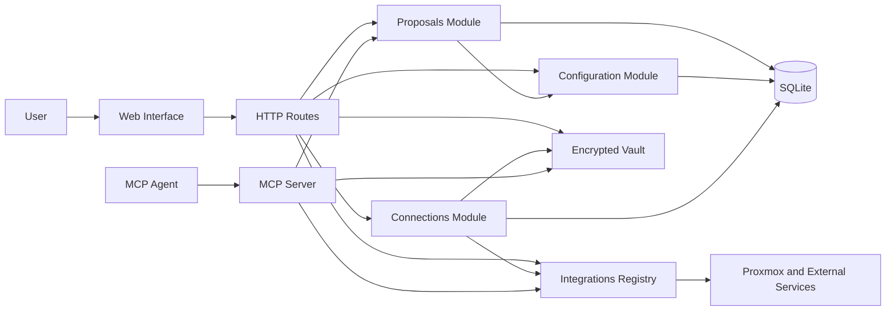

# Homora Architecture

Homora follows a modular monolith pattern: a web application, a Node API, and an
SQLite database, distributed as a cohesive set of packages and processes. This
structure keeps single-user installation simple without precluding module extraction
if concrete requirements emerge.

Project comparisons and integrations roadmap are documented in
[integrations](integracoes.md). The diagram below represents currently implemented paths;
differences between HTTP and MCP execution models are detailed further down.

## Components and Direction

- Web interface: dashboard, settings, proposal review, and agent management.
- HTTP API: web session authentication (Better Auth, single administrator account), Zod validation of request bodies, parameters,
  and query strings, composing routes by capability. Card and group business rules are
  delegated to the configuration module; connections employ a dedicated module for
  configuration, credentials, persistence, and observations.
- Adapters: validate configuration and query external systems. The central registry
  exposes metadata and execution; each integration encapsulates credential structures
  and specific rate/size limits.
- Current MCP: local stdio process with scoped token authentication that accesses SQLite
  and the credential vault directly. MCP tools validate inputs with Zod; provides queries
  and proposal creation without going through HTTP routes or web session cookies. Never
  persists card, group, or widget changes without human approval. Connection suggestions open a human-completed form and do not create a connection; integration queries do not return credentials.
- Persistence: SQLite, migrations, and database restore scripts are implemented.
  Credentials for connection adapters are encrypted at rest with an isolated key file;
  an old Proxmox credential file is retained after its transactional migration. Automatic key
  rotation and defense against host compromise are not yet implemented.

## Initial Domain Model

Service (name, URL, icon, group), group (name and position), integration (type, config, and secret reference), observation (status and timestamp), proposal (author, diff operations, base configuration version, expiration, and status), and audit event (actor, action, result, and timestamp).

## Security

- Mandatory authentication for web UI and MCP; dedicated identities for agents, least privilege scopes, and revocation. Never assume local network is inherently trusted.
- MCP may query and create proposals; persistent configuration modifications occur only after authenticated human review of the exact proposal. Stale, expired, or previously applied proposals are rejected. Never permit agent self-approval or unmediated external integration writes.
- Proxmox integration with least-privilege token and strict TLS certificate validation; guide users through importing trusted CAs. Never accept credentials in agent prompts or leak them via tool returns.
- SSRF mitigation: validate destinations and redirects server-side, constrain ports and hosts, block sensitive local ranges, and re-resolve/pin DNS on connection. Private network access must be explicitly authorized per service/connection, as it is foundational for homelab setups.
- Supported production deployment binds to loopback by default. Additional origins must be explicitly listed in `HOMORA_ALLOWED_ORIGINS`; HTTP origins are accepted only on localhost. When using a reverse proxy, the proxy must terminate HTTPS and protect the API. The default UI bind remains loopback, and `HOMORA_BIND_IP` allows exposing it solely to a reverse proxy on the same private network without altering origin validation. The application does not trust `X-Forwarded-For`/`X-Forwarded-Proto` for authorization decisions; do not configure untrusted proxies or rely on forwarded headers to determine identity or security.
- Integration destination and monitoring policy requires an exact origin (scheme and port included in configured URL), resolves DNS once, pins the authorized IP, rejects mixed DNS answers and redirects, enforces TLS validation, and sets strict timeouts and payload limits. RFC1918 and ULA are blocked by default; connection adapters require per-connection opt-in and service monitoring requires per-service opt-in. Special network ranges are blocked unconditionally even with this permission. The special ranges list does not guarantee coverage of all local network topologies or policies.
- Web authentication uses Better Auth (email and password) on the application's SQLite database: `user`, `account`, `session` and `verification` tables are versioned Drizzle migrations, and a backend test checks them against what the library requires. Passwords are hashed by the library (scrypt); sessions are stored in the database with an 8-hour lifetime and survive restarts. Session cookies (`homora.session_token`) are signed with a secret from `HOMORA_SESSION_SECRET` or a 0600 file created next to the database, use HttpOnly and SameSite=Strict, and get Secure when the request origin is HTTPS. State-changing operations require explicit allowed origins (checked by the API and by Better Auth's `trustedOrigins`). Sign-in is limited to 10 attempts per client in 15 minutes, counted in memory per client address; the API overwrites an internal header with the address Fastify resolved (honoring `HOMORA_TRUST_PROXY`) so clients cannot choose their own bucket, and behind an untrusted proxy this may aggregate users under the proxy's IP. Telemetry is disabled.
- Only `sign-in/email`, `sign-out` and `get-session` of Better Auth are reachable; public sign-up is closed and a database hook refuses any second account. Health status, first-run account setup and sign-in are unauthenticated to allow initial setup. Setup is rejected once an account exists and, until then, open to anyone who can reach the interface from an allowed origin (a known trade-off). Proposal reviews record the signed-in account as the reviewer. Account recovery is local: `pnpm auth:reset`.
- Integration credentials are encrypted with AES-256-GCM using an encryption key in a separate file. `.key`, `.proxmox` and the session secret are created with file mode 0600; backup and disaster recovery requires preserving and securing these files together. There is no automated key rotation or host-compromise protection. Protect the SQLite database file, backups, and persistent volumes using operating system permissions.
- Secrets are excluded from application logs, backups, and audit trails by default; logs have configurable retention. Backups must be encrypted if they contain credentials.
- CSRF protection, secure sessions, request rate limiting, and input validation; never execute arbitrary shell commands or scripts received from AI agents.
- Content fetched from external services is untrusted: never interpret external responses as prompt instructions for agents. Test prompt injection defenses and authorization boundaries regularly.

## Deployment and Open Decisions

React, TypeScript, Node.js, SQLite, and Docker Compose are the active implementation choices.
Compose uses a persistent volume and publishes to loopback. Upgrade and recovery procedures
have documented validation, but reproducible releases and validated network exposure profiles
remain open roadmap items. A Proxmox Community Helper script can be considered once stable
releases exist.

## Current Implementation

- `apps/frontend` contains the React/Vite web application. `apps/backend` contains the Fastify
  API, stdio MCP process, authentication, integrations, network policy, and domain services.
  `packages/shared` exports shared TypeScript contracts and Zod validation; `packages/db` contains
  Drizzle/SQLite schemas, initialization, and migrations.
- `app.ts` composes global server hooks and route modules. Routes for authentication, service/group
  configuration, agents/proposals, Proxmox, and connections reside in `routes/`. `input-schemas.ts`
  validates HTTP contracts and MCP tool inputs before invoking domain logic.
  `service-configuration.ts` encapsulates card/group domain invariants, transactional updates,
  and optimistic version concurrency across HTTP, MCP, and proposal approval.
- `integration-connections.ts` orchestrates connection settings, credential encryption,
  persistence, observation caching, and adapter dispatch; route handlers parse requests and
  translate results into HTTP status and JSON responses.
- `integration-registry.ts` registers metadata and execution handlers for Jellyfin, Home
  Assistant, Uptime Kuma, AdGuard Home, and Proxmox. All connection adapters use the shared
  network transport with destination policy. Legacy Proxmox credentials are copied once into
  encrypted connection storage; the bridge row and widget references are preserved.
- MCP runs in a separate process and accesses SQLite/vault directly. It authenticates agent tokens
  with granular scopes, offering queries and proposal creation. It intentionally bypasses the HTTP
  stack and web cookies.
- Group, card-order, and widget proposals capture a fingerprint of groups, cards, widgets,
  and connections, including encrypted references without displaying them. They validate the
  operation in a savepoint and repeat validation inside the approval transaction. The legacy
  vault is included when proposing a Proxmox widget. MCP returns proposals only to their author.
- The observations migration shares the web monitor's latest results with the MCP process.
  Each result is tied to the service check settings; changed settings or stale results are
  reported as unknown. The backend clears old observations at startup and publishes completed
  cycles; an MCP status query does not start checks.
- SQLite is the primary persistent store. Schema changes are versioned migrations; session
  sessions and the administrator account live in the database; sign-in rate-limit counters and
  certain observation caches are maintained in memory.

## Assessment and Architectural Priorities

The architectural baseline is appropriate for an early-stage product: modular boundaries
between frontend, backend, and shared packages are well-established, external integrations
remain in the backend, the database is backed by migrations, and automated unit/integration
tests cover critical paths. Strict TypeScript, pnpm workspaces, Turborepo, ESLint, Prettier,
Vitest, and CI provide solid engineering hygiene. Microservices or additional generic
frameworks are unnecessary.

Key areas of attention focus on consistency and safe evolution:

1. Zod validation at HTTP boundaries stops malformed payloads from reaching domain rules.
   Maintain stable external error messages and validate serialized data read back from the database.
2. The connections module encapsulates credential management, persistence, and observation
   behind clean HTTP handlers. Preserve test coverage over observable flows and refactor only
   when doing so increases cohesion.
3. MCP and HTTP share core card configuration logic, but MCP maintains direct local database/vault
   access and its own token auth. Scope changes and proposal lifecycles must consider both
   interfaces; public schemas must remain strictly secret-free.
4. Extract large pages or hooks into smaller units when doing so reduces cognitive load and
   simplifies test boundaries.
5. Legacy Proxmox files remain sensitive after migration. The migration marker prevents deleted
   connections from being re-imported, and legacy HTTP routes are disabled after migration.
6. Integration kinds are currently declared across execution catalogs, backend schemas, and UI.
   Keep these types explicit; centralize this contract when future adapters make duplication
   tangible, rather than introducing complex generic code generators now.

For ongoing contribution and review rules, consult [Engineering Standards](padroes.md).
Structural changes affecting boundaries, persistence, security, or deployment must be recorded
in an Architecture Decision Record (ADR) alongside documentation updates.
