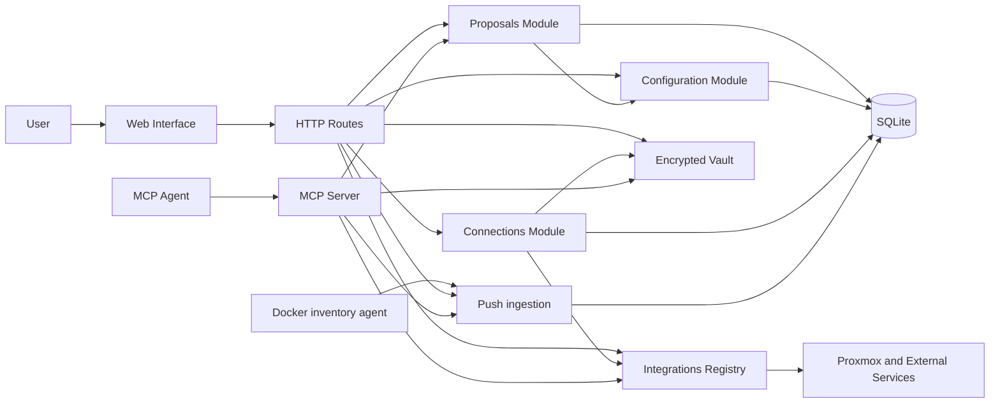

# Homora Architecture

Homora follows a modular monolith pattern: a web application, a Node API, and an
SQLite database, distributed as a cohesive set of packages and processes. This
structure keeps single-user installation simple without precluding module extraction
if concrete requirements emerge.

Project comparisons and integrations roadmap are documented in
[integrations](integracoes.md). The diagram below represents currently implemented paths;
differences between HTTP and MCP execution models are detailed further down.

## Components and Direction

- Web interface: dashboard, settings, proposal review, and agent management.
- HTTP API: web session authentication (Better Auth, single administrator account), Zod validation of request bodies, parameters,
  and query strings, composing routes by capability. Card and group business rules are
  delegated to the configuration module; connections employ a dedicated module for
  configuration, credentials, persistence, and observations. See [ADR 0004](decisoes/0004-better-auth-web-authentication.md) for web authentication.
- Adapters: validate configuration and query external systems. The central registry
  exposes metadata and execution; each integration encapsulates credential structures
  and specific rate/size limits.
- Current MCP: local stdio process and stateless Streamable HTTP endpoint with scoped token authentication. The stdio process accesses SQLite
  and the credential vault directly. MCP tools validate inputs with Zod; provides queries
  and proposal creation without going through HTTP routes or web session cookies. Never
  persists card, group, or widget changes without human approval. Connection suggestions open a human-completed form and do not create a connection; integration queries do not return credentials.
- Persistence: SQLite, migrations, and database restore scripts are implemented.
  Credentials for connection adapters are encrypted at rest with an isolated key file;
  an old Proxmox credential file is retained after its transactional migration. Automatic key
  rotation and defense against host compromise are not yet implemented.

## Docker push discovery

A remote Docker agent reads the local Unix socket and pushes only supported discovery
labels to the backend. The ingestion endpoint uses a source-specific hashed token,
not the web session or MCP identity. The SQLite source record stores the latest bounded
inventory and receipt time. Sources expire after five minutes; rotations discard the
inventory. Card import reads a source snapshot and checks its version, freshness and
revocation within the same SQLite write transaction that applies the reviewed cards.
MCP reads the shared inventory directly and can only create reviewable proposals. Once
created, a proposal remains independently reviewable if its source is later revoked.
The local Docker source remains independent. The Docker socket remains privileged,
and the agent requires a private HTTPS path with certificate verification. See
[ADR 0003](decisoes/0003-docker-push-discovery.md) and the README for limits and setup.

## Initial Domain Model

Service (name, URL, icon, group), group (name and position), integration (type, config, and secret reference), observation (status and timestamp), proposal (author, diff operations, base configuration version, expiration, and status), and audit event (actor, action, result, and timestamp).

## Security

- Mandatory authentication for web UI and MCP; dedicated identities for agents, least privilege scopes, and revocation. Never assume local network is inherently trusted.
- MCP may query and create proposals; persistent configuration modifications occur only after authenticated human review of the exact proposal. Stale, expired, or previously applied proposals are rejected. Never permit agent self-approval or unmediated external integration writes.
- Proxmox integration with least-privilege token and strict TLS certificate validation; guide users through importing trusted CAs. Never accept credentials in agent prompts or leak them via tool returns.
- SSRF mitigation: validate destinations and redirects server-side, constrain ports and hosts, block sensitive local ranges, and re-resolve/pin DNS on connection. Private network access must be explicitly authorized per service/connection, as it is foundational for homelab setups. The instance setting `new_services_allow_private` (`app_settings`, missing = off, `GET`/`PUT /api/service-defaults`, audited as `service-defaults-update`) only seeds `allowPrivate` for `POST /api/services` when the request omits it; the form sends the value explicitly. It is not read on update, import, Docker discovery (local or push) or proposals, and toggling it never rewrites stored services.
- Supported production deployment binds to loopback by default. Additional origins must be explicitly listed in `HOMORA_ALLOWED_ORIGINS`; HTTP origins are accepted only on localhost. When using a reverse proxy, the proxy must terminate HTTPS and protect the API. The default UI bind remains loopback, and `HOMORA_BIND_IP` allows exposing it solely to a reverse proxy on the same private network without altering origin validation. The application does not trust `X-Forwarded-For`/`X-Forwarded-Proto` for authorization decisions; do not configure untrusted proxies or rely on forwarded headers to determine identity or security.
- Integration destination and monitoring policy requires an exact origin (scheme and port included in configured URL), resolves DNS once, pins the authorized IP, rejects mixed DNS answers and redirects, enforces TLS validation, and sets strict timeouts and payload limits. RFC1918 and ULA are blocked by default; connection adapters require per-connection opt-in and service monitoring requires per-service opt-in. Special network ranges are blocked unconditionally even with this permission. The special ranges list does not guarantee coverage of all local network topologies or policies.
- Web authentication uses Better Auth (email and password) on the application's SQLite database: `user`, `account`, `session` and `verification` tables are versioned Drizzle migrations, and a backend test checks them against what the library requires. Passwords are hashed by the library (scrypt); sessions are stored in the database with an 8-hour lifetime and survive restarts. Session cookies (`homora.session_token`) are signed with a secret from `HOMORA_SESSION_SECRET` or a 0600 file created next to the database, use HttpOnly and SameSite=Strict, and get Secure when the request origin is HTTPS. State-changing operations require explicit allowed origins (checked by the API and by Better Auth's `trustedOrigins`). Sign-in is limited to 10 attempts per client in 15 minutes, counted in memory per client address; the API overwrites an internal header with the address Fastify resolved (honoring `HOMORA_TRUST_PROXY`) so clients cannot choose their own bucket, and behind an untrusted proxy this may aggregate users under the proxy's IP. Telemetry is disabled.
- Only `sign-in/email`, `sign-out` and `get-session` of Better Auth are reachable; public sign-up is closed and a database hook refuses any second account. Health status, first-run account setup and sign-in are unauthenticated to allow initial setup. Setup is rejected once an account exists and, until then, open to anyone who can reach the interface from an allowed origin (a known trade-off). Proposal reviews record the signed-in account as the reviewer. Account recovery is local: `pnpm auth:reset`.
- The signed-in administrator manages their own account through Homora's own routes (`/api/account`, `/api/account/password`, `/api/account/sessions`), not through extra Better Auth paths: profile name, password change (current password required, throttled to 10 attempts per account in 15 minutes) and active sessions, which are listed without their tokens and ended by id. The email is read-only for now.
- The Activity feed (`GET /api/activity`) reads `audit_events`, extended with `detail` and `ip_address`: sign-ins and sign-outs, failed sign-ins, password changes, session revocations, profile changes, proposal creation/review/expiry and agent identity events. A failed sign-in stores only the client address and the attempt count, never the typed email or password. Events are kept for 365 days. Each event exposes `proposalId` when it refers to a proposal; the UI links it to the Agents tab. Audit writes never fail the audited action.
- Integration credentials are encrypted with AES-256-GCM using an encryption key in a separate file. `.key`, `.proxmox` and the session secret are created with file mode 0600; backup and disaster recovery requires preserving and securing these files together. There is no automated key rotation or host-compromise protection. Protect the SQLite database file, backups, and persistent volumes using operating system permissions.
- Appearance is a server setting (`app_settings`), validated for contrast on write. The optional background image is processed by `sharp` (type sniffing, no animation, pixel limit, metadata stripped), stored next to the database and served behind the session with `nosniff`. Custom CSS is validated (no imports, external URLs or script features, 20 KB) and served same-origin as a stylesheet; `?safe=1` and `pnpm css:reset` recover from a broken one. No CSP header is shipped yet. Pages (`pages`, `service_groups.page_id`) group the Home into tabs; see [ADR 0009](decisoes/0009-appearance-and-pages.md).
- Secrets are excluded from application logs, backups, and audit trails by default; logs have configurable retention. Backups must be encrypted if they contain credentials.
- CSRF protection, secure sessions, request rate limiting, and input validation; never execute arbitrary shell commands or scripts received from AI agents.
- Content fetched from external services is untrusted: never interpret external responses as prompt instructions for agents. Test prompt injection defenses and authorization boundaries regularly.

## Deployment and Open Decisions

React, TypeScript, Node.js, SQLite, and Docker Compose are the active implementation choices.
Compose uses a persistent volume and publishes to loopback. Upgrade and recovery procedures
have documented validation, but reproducible releases and validated network exposure profiles
remain open roadmap items. A Proxmox Community Helper script can be considered once stable
releases exist.

## Current Implementation

- `apps/frontend` contains the React/Vite web application. `apps/backend` contains the Fastify
  API, stdio MCP process, authentication, integrations, network policy, and domain services.
  `packages/shared` exports shared TypeScript contracts and Zod validation; `packages/db` contains
  Drizzle/SQLite schemas, initialization, and migrations.
- `app.ts` composes global server hooks and route modules. Routes for authentication, service/group
  configuration, agents/proposals, Proxmox, and connections reside in `routes/`. `input-schemas.ts`
  validates HTTP contracts and MCP tool inputs before invoking domain logic.
  `service-configuration.ts` encapsulates card/group domain invariants, transactional updates,
  and optimistic version concurrency across HTTP, MCP, and proposal approval.
- `integration-connections.ts` orchestrates connection settings, credential encryption,
  persistence, observation caching, and adapter dispatch; route handlers parse requests and
  translate results into HTTP status and JSON responses.
- `integration-registry.ts` builds the registry from `integrationDefinitions`
  (`packages/integrations/src/integration-manifest.ts`). Simple read-only integrations are
  **manifests**, validated at startup (`integration-manifest.ts`) and run by one interpreter
  (`manifest-adapter.ts`); Proxmox and Coolify are code adapters registered by hand. Type enums, stored
  config keys, proposal schemas, the connection form, widget text and the catalog endpoint derive
  from the same definitions ([ADR 0009](decisoes/0009-declarative-integration-adapters.md)).
  `adapter-contract.ts` is the test every adapter must pass ([adapters](adapters.md)). All connection adapters use the shared
  network transport with destination policy. Legacy Proxmox credentials are copied once, at
  backend startup, into encrypted connection storage; the bridge row and widget references are
  preserved. Nothing outside the migrator reads the legacy file.
- The stdio MCP runs in a separate process and accesses SQLite/vault directly. The stateless HTTP MCP runs in the backend at `/mcp`, authenticates a Bearer token on every request, validates host and origin, and applies a per-client request limit. Both use the same tools and proposal rules. It authenticates agent tokens
  with granular scopes, offering queries and proposal creation. It intentionally bypasses the HTTP
  stack and web cookies.
- Group, card-order, and widget proposals capture a fingerprint of groups, cards, widgets,
  and connections, including encrypted references without displaying them. They validate the
  operation in a savepoint and repeat validation inside the approval transaction. A Proxmox
  widget proposal requires an existing Proxmox connection. MCP returns proposals only to their author.
- Cards may link to a Proxmox guest (`host_*` columns on `services`, ids only); `proxmox-inventory.ts` and `GET /api/connections/:id/guests` expose guest names to authenticated sessions only. Neither the public status page nor MCP returns them. See [ADR 0008](decisoes/0008-service-to-host-map.md).
- Host suggestions (`host-suggestions.ts`) and the `hosts:read` / `hosts:propose` MCP scopes are described in ADR 0008. A `host-link` managed proposal sets only Homora's link; its evidence is computed by the server at proposal time.
- Manual dependencies between cards (`service_dependencies`, acyclic, audited) feed the impact hints; MCP reads them with `list_service_dependencies` under `services:read`. See ADR 0008.
- The opt-in anonymous status page is described in [ADR 0006](decisoes/0006-public-read-only-status-page.md).
- The observations migration shares the web monitor's latest results with the MCP process.
- MCP agent identity and audit queries require separate `agents:read` and `audit:read` grants. Audit queries omit IP addresses and details and are bounded by the 365-day retention window. An agent may withdraw only its own unexpired pending proposal, atomically recording the withdrawal; this does not apply configuration changes.
- See [ADR 0007](decisoes/0007-service-observation-history-and-uptime.md) for observation history and uptime.
- Observations are appended with a settings signature and observation time, deduplicated and retained for 30 days (the signature is a 16-character hash prefix; at the default 60 s interval a service accumulates roughly 12 MB of history per month); monitor publication cleans old rows. A batch creates at most 20 proposals in one transaction, subject to 100 unexpired pending proposals per identity. A human reviews and decides the complete batch together. Approval checks every original fingerprint before applying all changes in one transaction and increments the configuration version once; conflicts roll back the entire batch. Partially decided legacy batches cannot be approved and their remaining proposals can be discarded.
- `agents:propose` enables identity proposals. Requested scopes must be a subset of the proposer's current scopes at creation. The reviewed diff never contains credentials; approval creates or rotates the token in the review transaction and returns it once with `no-store`. Changes to identities are audited under the human reviewer. See [ADR 0002](decisoes/0002-governed-agent-proposals.md).
  Each result is tied to the service check settings; changed settings or stale results are
  reported as unknown. The backend clears old observations at startup and publishes completed
  cycles; an MCP status query does not start checks.
- A configuration change probes only services that are new or whose check settings changed (the
  monitor keeps the signature each result was measured under); it never re-probes the whole
  inventory. Publication writes only rows that changed, and idle cycles write nothing. The
  all-services uptime response is built in slices that yield to the event loop, cached for 10 s
  per range and configuration version, and shared as one `Buffer`, because the body reaches tens
  of MB on thousands of services. Import parsing refuses documents with more than 20,000 flow
  collections before the YAML parser runs.
- SQLite is the primary persistent store. Schema changes are versioned migrations; session
  sessions and the administrator account live in the database; sign-in rate-limit counters and
  certain observation caches are maintained in memory.

## Assessment and Architectural Priorities

The architectural baseline is appropriate for an early-stage product: modular boundaries
between frontend, backend, and shared packages are well-established, external integrations
remain in the backend, the database is backed by migrations, and automated unit/integration
tests cover critical paths. Strict TypeScript, pnpm workspaces, Turborepo, ESLint, Prettier,
Vitest, and CI provide solid engineering hygiene. Microservices or additional generic
frameworks are unnecessary.

Key areas of attention focus on consistency and safe evolution:

1. Zod validation at HTTP boundaries stops malformed payloads from reaching domain rules.
   Maintain stable external error messages and validate serialized data read back from the database.
2. The connections module encapsulates credential management, persistence, and observation
   behind clean HTTP handlers. Preserve test coverage over observable flows and refactor only
   when doing so increases cohesion.
3. MCP and HTTP share core card configuration logic, and stdio MCP maintains direct local database/vault
   access and its own token auth. Scope changes and proposal lifecycles must consider both
   interfaces; public schemas must remain strictly secret-free.
4. Extract large pages or hooks into smaller units when doing so reduces cognitive load and
   simplifies test boundaries.
5. Legacy Proxmox files remain sensitive after migration. The migration marker prevents deleted
   connections from being re-imported, and the legacy HTTP routes were removed.
6. Integration kinds, fields and display text used to be declared by hand in the registry, schemas
   and UI. They now come from one definition per integration (ADR 0009); only code adapters
   (Proxmox) still carry their own execution and Proxmox-specific rendering.

For ongoing contribution and review rules, consult [Engineering Standards](padroes.md).
Structural changes affecting boundaries, persistence, security, or deployment must be recorded
in an Architecture Decision Record (ADR) alongside documentation updates.

Proposal review deadlines default to 15 minutes and are configurable from 1 to 120 minutes in SQLite. Changes affect new proposals only and are shared by the web API and both MCP transports. An authenticated administrator can recreate an expired proposal or its complete expired batch; the original diff is revalidated, no change is applied, and recreation and TTL changes are audited. Recreated proposals retain the original agent attribution; the audit records the human requester and source proposal.

Notification delivery is a separate outbound POST capability. Channel credentials and webhook URLs are encrypted with the integration vault key; saved credentials are not returned by the API. The shared destination policy resolves and pins an authorized address for each request, forbids redirects and validates TLS. Webhook private-network access is an explicit per-channel opt-in. A bounded, in-memory queue isolates delivery from the monitor; transition state is stored separately from the startup-cleared observation cache. Delivery is best effort: shutdown can discard queued messages and retries can duplicate them. See [ADR 0005](decisoes/0005-status-transition-notifications.md).
