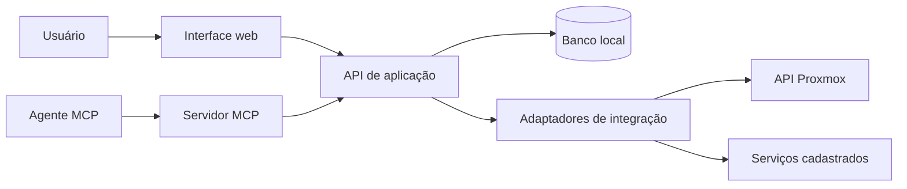

# Arquitetura proposta

Decisões iniciais, sujeitas a validação durante a implementação. Um monólito modular reduz a complexidade operacional inicial.

A comparação de projetos e a proposta de evolução das integrações estão em
[integrações](integracoes.md). O diagrama abaixo descreve a arquitetura alvo;
em particular, o MCP existente ainda acessa o banco e o cofre local diretamente.

## Componentes

- Interface web: painel, configuração, aprovação de propostas e histórico.
- API: autenticação, autorização, validação, regras de negócio e armazenamento. A interface e o MCP usam as mesmas regras.
- Adaptadores: contrato comum para capacidades, configuração, teste de conexão e coleta; isolamento de falhas, limites de tempo e cache.
- MCP: ferramentas tipadas para consultar e propor configurações; não recebe acesso direto ao banco nem retorna segredos.
- Persistência: SQLite é candidato para instalação individual; migrações e backup precisam ser testados. Credenciais criptografadas com chave externa ao banco e instruções de recuperação; detalhes criptográficos serão definidos antes da implementação.

## Modelo inicial

Serviço (nome, URL, ícone, grupo), grupo (nome e ordem), integração (tipo, configuração e referência a segredo), observação (estado e data), proposta (autor, operações, versão da configuração, expiração e estado) e evento de auditoria (ator, ação, resultado e horário).

## Segurança

- Autenticação obrigatória para interface e MCP; identidades separadas para agentes, permissões mínimas e revogação. Não presumir que rede local é confiável.
- MCP somente leitura por padrão. Escritas criam propostas com diff legível, escopo, autor e prazo. Aprovação humana autenticada cobre a versão exata; rejeitar alterações obsoletas, expiradas ou já aplicadas. Não permitir autoaprovação pelo agente.
- Proxmox com token restrito e TLS validado; orientar a instalação de certificados confiáveis. Não aceitar credenciais em prompts ou retorná-las em ferramentas.
- Evitar SSRF: verificar destinos e redirecionamentos no servidor, restringir redes e portas configuradas pelo administrador, bloquear destinos sensíveis e revalidar DNS na conexão. O acesso à rede privada deve ser autorizado explicitamente, pois é necessário ao homelab.
- A implantação atualmente suportada por padrão é local em loopback. Origens adicionais são configuradas explicitamente em `HOMORA_ALLOWED_ORIGINS`; origens HTTP só são aceitas em localhost. Para proxy reverso, o proxy deve terminar HTTPS e isolar a API. A aplicação não confia em `X-Forwarded-For`/`X-Forwarded-Proto`; portanto não configure proxies não confiáveis nem use cabeçalhos encaminhados para decidir identidade ou segurança.
- A política de destinos de integrações exige origem exata, com protocolo e porta incluídos na URL configurada, resolve DNS uma vez, fixa o IP autorizado, rejeita respostas DNS mistas e redirecionamentos, usa TLS validado e impõe timeout e limite de resposta. Redes privadas exigem permissão por conexão; faixas especiais são bloqueadas mesmo com essa permissão. A lista de faixas especiais não é uma garantia de cobertura de toda rede ou política local.
- A senha local é derivada com scrypt e salt aleatório; sessões aleatórias são mantidas somente em memória por oito horas e invalidadas ao reiniciar. Cookies usam HttpOnly e SameSite=Strict; a sessão emitida por origem HTTPS também usa Secure. Operações que alteram estado exigem uma origem explicitamente permitida. Limite de login é em memória e baseado no endereço que o backend vê; atrás de proxy, isso pode agrupar usuários no endereço do proxy.
- Credenciais de integração são cifradas com AES-256-GCM e chave aleatória em arquivo separado. `.auth`, `.key` e `.proxmox` são criados com modo 0600; a recuperação exige preservar os arquivos correspondentes e protegê-los juntos. Não há rotação automática da chave nem proteção contra comprometimento do host, processo ou cópia conjunta da chave e dados. Proteja também o arquivo SQLite, backups e volume persistente com permissões do sistema operacional.
- Segredos fora de logs, backup e auditoria por padrão; logs com retenção configurável. Backups criptografados quando incluírem segredos.
- Proteção contra CSRF, sessões seguras, limites de requisição e validação de entrada; não executar comandos arbitrários ou scripts recebidos de agentes.
- Conteúdo obtido de serviços é dado não confiável: nunca interpretá-lo como instrução para o agente. Testar injeção de prompt e falhas de autorização.

## Implantação e escolhas pendentes

Primeiro alvo: serviço em container com volume persistente, utilizável em um LXC ou host próprio. Avaliar TypeScript para interface e backend e Docker Compose para distribuição; não são decisões definitivas. Um script Community Scripts pode ser estudado posteriormente, após haver releases, instalação reproduzível e atualização com backup.
