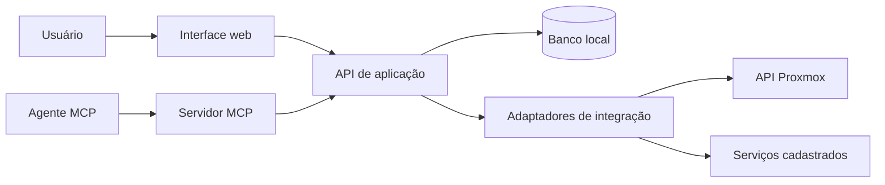

# Arquitetura proposta

Decisões iniciais, sujeitas a validação durante a implementação. Um monólito modular reduz a complexidade operacional inicial.

## Componentes

- Interface web: painel, configuração, aprovação de propostas e histórico.
- API: autenticação, autorização, validação, regras de negócio e armazenamento. A interface e o MCP usam as mesmas regras.
- Adaptadores: contrato comum para capacidades, configuração, teste de conexão e coleta; isolamento de falhas, limites de tempo e cache.
- MCP: ferramentas tipadas para consultar e propor configurações; não recebe acesso direto ao banco nem retorna segredos.
- Persistência: SQLite é candidato para instalação individual; migrações e backup precisam ser testados. Credenciais criptografadas com chave externa ao banco e instruções de recuperação; detalhes criptográficos serão definidos antes da implementação.

## Modelo inicial

Serviço (nome, URL, ícone, grupo), grupo (nome e ordem), integração (tipo, configuração e referência a segredo), observação (estado e data), proposta (autor, operações, versão da configuração, expiração e estado) e evento de auditoria (ator, ação, resultado e horário).

## Segurança

- Autenticação obrigatória para interface e MCP; identidades separadas para agentes, permissões mínimas e revogação. Não presumir que rede local é confiável.
- MCP somente leitura por padrão. Escritas criam propostas com diff legível, escopo, autor e prazo. Aprovação humana autenticada cobre a versão exata; rejeitar alterações obsoletas, expiradas ou já aplicadas. Não permitir autoaprovação pelo agente.
- Proxmox com token restrito e TLS validado; orientar a instalação de certificados confiáveis. Não aceitar credenciais em prompts ou retorná-las em ferramentas.
- Evitar SSRF: verificar destinos e redirecionamentos no servidor, restringir redes e portas configuradas pelo administrador, bloquear destinos sensíveis e revalidar DNS na conexão. O acesso à rede privada deve ser autorizado explicitamente, pois é necessário ao homelab.
- Segredos fora de logs, backup e auditoria por padrão; logs com retenção configurável. Backups criptografados quando incluírem segredos.
- Proteção contra CSRF, sessões seguras, limites de requisição e validação de entrada; não executar comandos arbitrários ou scripts recebidos de agentes.
- Conteúdo obtido de serviços é dado não confiável: nunca interpretá-lo como instrução para o agente. Testar injeção de prompt e falhas de autorização.

## Implantação e escolhas pendentes

Primeiro alvo: serviço em container com volume persistente, utilizável em um LXC ou host próprio. Avaliar TypeScript para interface e backend e Docker Compose para distribuição; não são decisões definitivas. Um script Community Scripts pode ser estudado posteriormente, após haver releases, instalação reproduzível e atualização com backup.
