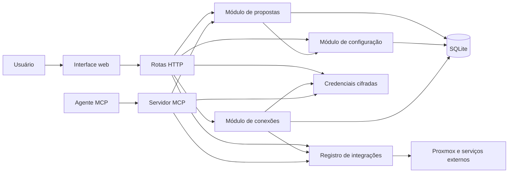

# Arquitetura do Homora

Homora segue um monólito modular: uma aplicação web, uma API Node e um banco
SQLite, distribuídos como um conjunto pequeno de processos/pacotes. Essa forma
mantém a instalação pessoal simples sem impedir que módulos sejam extraídos se
houver uma necessidade concreta.

A comparação de projetos e a direção para integrações estão em
[integrações](integracoes.md). O diagrama representa os caminhos implementados;
as diferenças entre os processos HTTP e MCP estão descritas abaixo.

## Componentes e direção

- Interface web: painel, configuração, revisão de propostas e gestão dos agentes.
- API HTTP: autenticação da sessão web, validação Zod dos corpos, parâmetros e
  queries, e composição das rotas por capacidade. Regras de cards/grupos são
  delegadas ao módulo de configuração; conexões usam um módulo próprio de
  configuração, credenciais, persistência e observações.
- Adaptadores: validam configurações e coletam dados externos. O registro
  central expõe metadados e execução; cada integração mantém seu formato de
  credencial e limites específicos.
- MCP atual: processo local stdio com token e escopos, que abre banco e cofre
  diretamente. Ferramentas validam entradas com Zod; oferece consultas e criação
  de propostas, sem atravessar as rotas HTTP nem usar a sessão web. Não grava
  cards sem aprovação humana e não retorna segredos.
- Persistência: SQLite, migrações e recuperação estão implementados. Credenciais
  de algumas integrações ficam cifradas no banco com chave lateral; Proxmox usa
  arquivo legado. Rotação automática e proteção contra comprometimento do host
  ainda não existem.

## Modelo inicial

Serviço (nome, URL, ícone, grupo), grupo (nome e ordem), integração (tipo, configuração e referência a segredo), observação (estado e data), proposta (autor, operações, versão da configuração, expiração e estado) e evento de auditoria (ator, ação, resultado e horário).

## Segurança

- Autenticação obrigatória para interface e MCP; identidades separadas para agentes, permissões mínimas e revogação. Não presumir que rede local é confiável.
- O MCP pode consultar e criar propostas; alteração persistente de cards ocorre
  após revisão humana autenticada da proposta exata. Propostas obsoletas,
  expiradas ou já aplicadas são rejeitadas. Não permitir autoaprovação pelo
  agente nem escrita direta em integrações.
- Proxmox com token restrito e TLS validado; orientar a instalação de certificados confiáveis. Não aceitar credenciais em prompts ou retorná-las em ferramentas.
- Evitar SSRF: verificar destinos e redirecionamentos no servidor, restringir redes e portas configuradas pelo administrador, bloquear destinos sensíveis e revalidar DNS na conexão. O acesso à rede privada deve ser autorizado explicitamente, pois é necessário ao homelab.
- A implantação atualmente suportada por padrão é local em loopback. Origens adicionais são configuradas explicitamente em `HOMORA_ALLOWED_ORIGINS`; origens HTTP só são aceitas em localhost. Para proxy reverso, o proxy deve terminar HTTPS e isolar a API. O bind padrão da interface continua em loopback e `HOMORA_BIND_IP` permite expô-la apenas a um proxy reverso na mesma rede privada, sem alterar a validação de origem. A aplicação não confia em `X-Forwarded-For`/`X-Forwarded-Proto`; portanto não configure proxies não confiáveis nem use cabeçalhos encaminhados para decidir identidade ou segurança.
- A política de destinos de integrações e do monitoramento exige origem exata, com protocolo e porta incluídos na URL configurada, resolve DNS uma vez, fixa o IP autorizado, rejeita respostas DNS mistas e redirecionamentos, usa TLS validado e impõe timeout e limite de resposta. RFC1918 e ULA são bloqueadas por padrão; conexões de integração precisam de opt-in por conexão e o monitoramento precisa de opt-in por serviço. Faixas especiais são bloqueadas mesmo com essa permissão. A lista de faixas especiais não é uma garantia de cobertura de toda rede ou política local.
- A senha local é derivada com scrypt e salt aleatório; sessões aleatórias são mantidas somente em memória por oito horas e invalidadas ao reiniciar. Cookies usam HttpOnly e SameSite=Strict; a sessão emitida por origem HTTPS também usa Secure. Operações que alteram estado exigem uma origem explicitamente permitida. Limite de login é em memória e baseado no endereço que o backend vê; atrás de proxy, isso pode agrupar usuários no endereço do proxy.
- Status, configuração inicial e login são endpoints sem sessão para permitir
  primeiro acesso. A configuração só é aceita enquanto não existe uma conta;
  logout é idempotente e apenas invalida o cookie apresentado.
- Credenciais de integração são cifradas com AES-256-GCM e chave aleatória em arquivo separado. `.auth`, `.key` e `.proxmox` são criados com modo 0600; a recuperação exige preservar os arquivos correspondentes e protegê-los juntos. Não há rotação automática da chave nem proteção contra comprometimento do host, processo ou cópia conjunta da chave e dados. Proteja também o arquivo SQLite, backups e volume persistente com permissões do sistema operacional.
- Segredos fora de logs, backup e auditoria por padrão; logs com retenção configurável. Backups criptografados quando incluírem segredos.
- Proteção contra CSRF, sessões seguras, limites de requisição e validação de entrada; não executar comandos arbitrários ou scripts recebidos de agentes.
- Conteúdo obtido de serviços é dado não confiável: nunca interpretá-lo como instrução para o agente. Testar injeção de prompt e falhas de autorização.

## Implantação e escolhas pendentes

React, TypeScript, Node.js, SQLite e Docker Compose já são escolhas
implementadas. Compose usa volume persistente e publicação local em loopback.
Upgrade e recuperação têm instruções e validações documentadas, mas releases e
exposição em rede continuam sem perfil operacional validado. Um script
Community Scripts pode ser estudado após haver releases confiáveis.

## Implementação atual

- `apps/frontend` contém a interface React/Vite. `apps/backend` contém a API
  Fastify, o processo MCP stdio, autenticação, integrações, política de rede e
  serviços de domínio. `packages/shared` publica validação/contratos TypeScript;
  `packages/db` contém esquema, inicialização e migrações Drizzle/SQLite.
- `app.ts` compõe hooks globais e módulos de rota. As rotas de autenticação,
  configuração de cards/grupos, agentes/propostas, Proxmox e conexões ficam em
  `routes/`. `input-schemas.ts` valida contratos HTTP e entradas de ferramentas
  MCP antes de chamar as regras de domínio. `service-configuration.ts`
  centraliza invariantes de cards/grupos, transações e versão para HTTP, MCP e
  aprovação de propostas.
- `integration-connections.ts` coordena configuração de conexões, credenciais,
  persistência, cache de observações e execução dos adaptadores; as rotas
  correspondentes interpretam pedidos e traduzem resultados em status e
  respostas. O frontend tem uma tela de agentes em `Agents.tsx`; `App.tsx` ainda
  concentra o painel e `Connections.tsx` ainda reúne a interface de conexões.
- `integration-registry.ts` registra metadados e execução dos adaptadores
  Jellyfin, Home Assistant, Uptime Kuma, AdGuard Home e Proxmox. As quatro
  conexões novas usam o transporte com política de destino; Proxmox usa seu
  cofre legado e transporte próprio, mas aparece no mesmo catálogo e registro
  de execução.
- O MCP executa em processo separado e abre SQLite/cofre diretamente. Ele
  autentica tokens de agente com escopos; oferece consultas e criação de
  propostas. Ele não passa pela API HTTP nem pela sessão web. Essa fronteira é
  intencional por enquanto e precisa ser considerada ao alterar autorização.
- SQLite é fonte persistente. Atualizações de esquema são migrações versionadas;
  estado de sessão e alguns caches de observação são mantidos em memória.

## Avaliação e prioridades arquiteturais

A base é coerente para produto inicial: limites entre frontend, backend e
pacotes compartilhados estão estabelecidos, as integrações externas ficam no
backend, o banco tem migrações e há testes unitários/de integração. TypeScript
estrito, pnpm workspaces, Turborepo, ESLint, Prettier, Vitest e CI dão uma
fundação de consistência. A arquitetura não precisa de microserviços ou de uma
camada genérica adicional agora.

Os principais pontos de atenção são evolução e consistência, não a escolha de
tecnologia:

1. A validação Zod nas rotas HTTP impede que payloads malformados alcancem as
   regras de domínio. Mantenha mensagens externas estáveis e valide novamente
   dados serializados lidos do banco ou cofre.
2. O módulo de conexões agora concentra regras de credencial, persistência e
   observação atrás de rotas HTTP pequenas. Preserve testes pelos fluxos
   observáveis e extraia mais apenas se isso aumentar a locality das regras.
3. MCP e HTTP compartilham regras de configuração de cards, mas o MCP continua
   com acesso local direto ao banco/cofre e autorização própria. Mudanças de
   escopos e propostas precisam considerar os dois processos; contratos públicos
   devem continuar livres de segredos.
4. `App.tsx` ainda reúne o painel e seus fluxos de estado; `Connections.tsx`
   contém uma tela extensa. Extraia telas ou hooks quando isso reduzir o contexto
   necessário para alterar uma capacidade e melhorar seus testes.
5. O registro de execução é compartilhado, mas armazenamento de credenciais e
   configuração Proxmox continuam diferentes das demais integrações. Mantenha
   essa distinção até haver necessidade de produto e migração compatível.
6. Tipos de integração ainda são declarados no catálogo de execução, nos schemas
   do backend e na interface. Mantenha os quatro tipos de conexão explícitos;
   centralize esse contrato quando a próxima integração tornar a duplicação
   concreta, em vez de adicionar geração ou dependência compartilhada agora.

Para regras contínuas de contribuição e revisão, consulte
[Padrões de engenharia](padroes.md). Mudanças estruturais que afetem limites,
persistência, segurança ou implantação devem registrar decisão e consequências
em uma nota curta de arquitetura (ADR), além de atualizar este documento.
