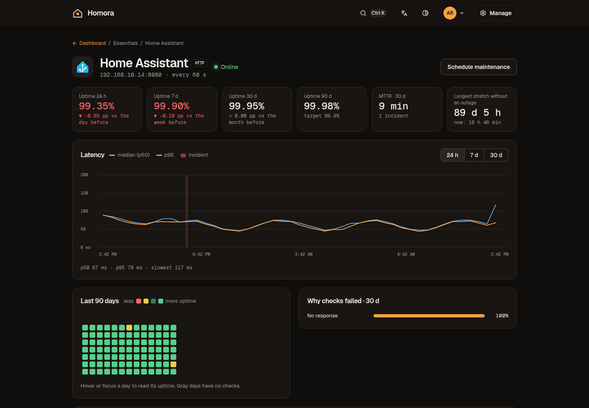

## See Homora in action

The examples below use synthetic data from a demo installation.

<figure>

<figcaption>Investigate service health and incidents. <a href="/user-guide/services-and-monitoring.html">Explore monitoring</a></figcaption>
</figure>
<figure>

<figcaption>Bring information from your tools into Homora. <a href="/user-guide/integrations-and-widgets.html">Explore integrations</a></figcaption>
</figure>

## Start with what you need

- **New to Homora?** Follow [your first steps](user-guide/getting-started.md) to install it and add a service.
- **Moving from another dashboard?** Learn about [import, export and backups](user-guide/import-export-backup.md).
- **Running Homora for others on your network?** Read [deployment and upgrades](user-guide/deployment.md) and [accounts and security](user-guide/accounts-and-security.md) first.
- **Looking to contribute?** Start with the [contributor guide](contributing.md) and [engineering standards](standards.md).

Homora is in early development and intended for local access. The guides identify experimental or unvalidated behavior and distinguish existing features from plans.
