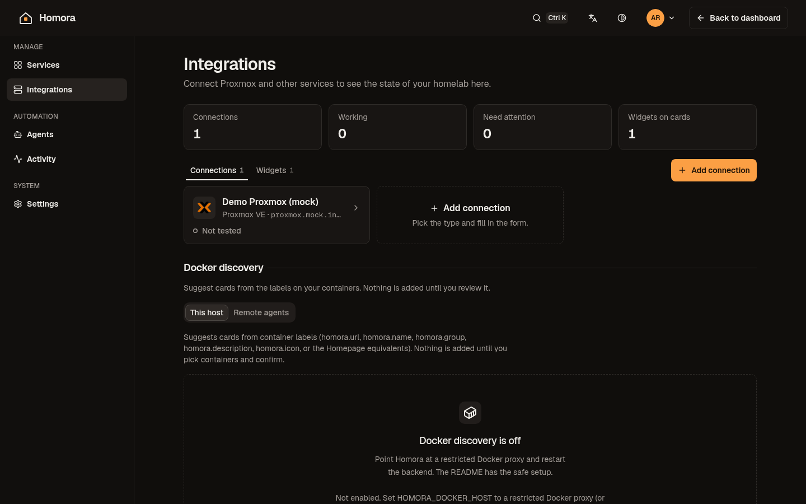

<section class="home-section">

## Running in two minutes

```bash
git clone https://github.com/JhonatanMedeiros/homora.git
cd homora
docker compose up -d --build
```

Then open <http://localhost:8080> and create your administrator account. [Follow the full tour](user-guide/getting-started.md).

</section>

<section class="home-section">

## See it in action

Screenshots use synthetic data from a demo installation.

<div class="home-gallery">
<figure>


<figcaption>Investigate health and incidents. <a href="user-guide/services-and-monitoring.html">Monitoring</a></figcaption>
</figure>
<figure>



<figcaption>Bring your tools into Homora. <a href="user-guide/integrations-and-widgets.html">Integrations</a></figcaption>
</figure>
</div>

</section>

<section class="home-section">

## Find your path

<div class="home-paths">

[**New here** Install Homora and add a first service.](user-guide/getting-started.md)

[**Moving over** Import a configuration and back it up.](user-guide/import-export-backup.md)

[**Sharing with others** Deploy behind HTTPS and secure accounts.](user-guide/deployment.md)

[**Contributing** Set up the project and add an integration.](contributing.md)

</div>

Homora is in early development and meant for local access. The guides mark experimental behavior.

</section>
