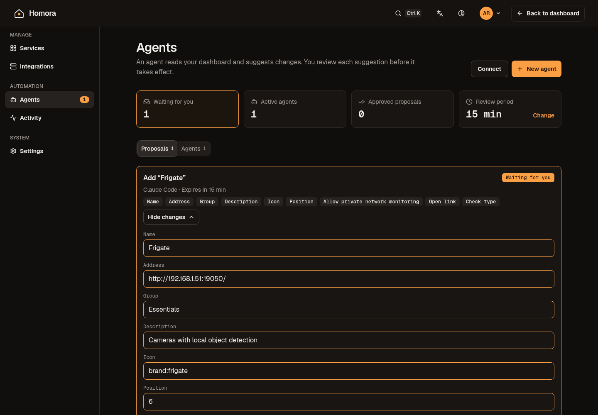
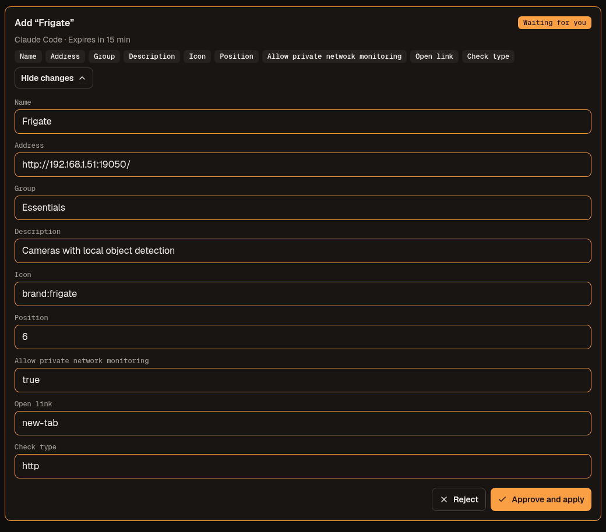

# Agentes de IA e MCP

Agentes são opcionais. Uma identidade possui um token e escopos que determinam o que o agente pode consultar ou propor. O agente não recebe credenciais das integrações e não executa alterações na infraestrutura externa.

## Configure e revise

1. Em **Gerenciar → Agentes**, crie uma identidade com os menores escopos necessários.
2. Guarde o token, mostrado no momento da criação, como uma senha. Configure-o em um cliente MCP confiável.
3. Revise as propostas na interface. Elas só são aplicadas depois da aprovação humana e podem expirar ou ficar desatualizadas.
4. Revogue ou substitua o token quando necessário. A atividade registra decisões e ações relevantes.

O MCP oferece transporte local por `stdio` e HTTP sem estado. Ambos autenticam o token do agente e não dependem da sessão web. O processo `stdio` acessa diretamente o banco e o cofre; use-o somente com um cliente e usuário de sistema confiáveis. Para acesso por outro dispositivo, siga a configuração HTTPS de rede privada em [instalação e atualizações](deployment.md).

Um lote (`propose_batch`) é tudo ou nada: os itens são validados em ordem, então é possível mover grupos para uma página junto com seus widgets. Se um item for inválido, o lote inteiro é rejeitado, nada é alterado e o erro indica o item (`items[n]`), o tipo e o motivo.

Sugestões de configuração de conexão não criam uma conexão automaticamente: o usuário deve abrir o formulário e fornecer credenciais e permissões. Dados recebidos de serviços externos não são instruções confiáveis.

`investigate_incident` exige `incidents:read` e `services:read` e retorna evidências históricas limitadas e lacunas, sem erros brutos ou nomes dos serviços. Incidentes simultâneos são uma hipótese de relação, não um diagnóstico.

São retornadas até cinco hipóteses de sobreposição, com as janelas mais recentes primeiro. Incidentes do mesmo monitor com janelas registradas idênticas compartilham uma hipótese e uma contagem; cada sobreposição preservada continua sendo um fato separado. Indicadores de dados ausentes informam quando hipóteses ou fatos de sobreposição foram omitidos. IDs relacionados e contagens não incluem nomes.

[Leia o guia completo de MCP em inglês](/user-guide/agents-and-mcp) e o [inventário de capacidades em inglês](/agent-capabilities).
