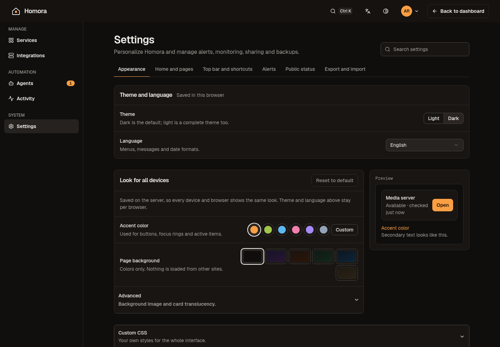

# Aparência e personalização

O Homora oferece temas claro e escuro, idioma inglês ou português brasileiro e opções de personalização do dashboard. Algumas preferências pertencem ao navegador; outras são compartilhadas entre dispositivos.

Nas configurações, ajuste cores, imagem de fundo, transparência e CSS personalizado conforme necessário. Páginas e grupos ajudam a organizar o conteúdo; a barra superior e os atalhos também podem ser configurados.

Se o CSS personalizado dificultar o acesso à interface, use o modo seguro descrito no guia completo. Antes de alterar a aparência de uma instalação compartilhada, lembre-se de que configurações do servidor podem afetar outros dispositivos.

[Leia o guia completo de aparência em inglês](/user-guide/appearance).
