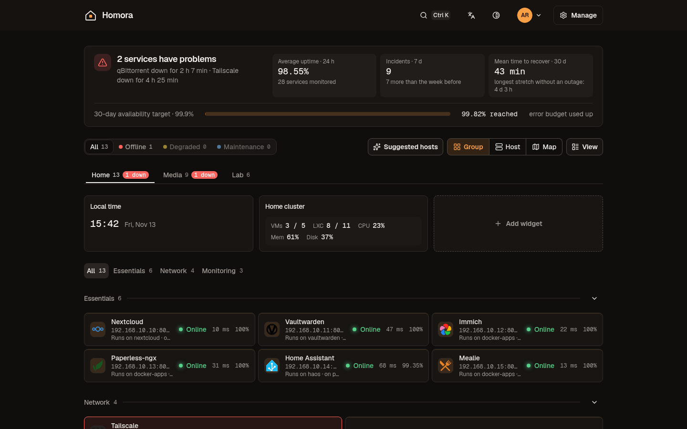
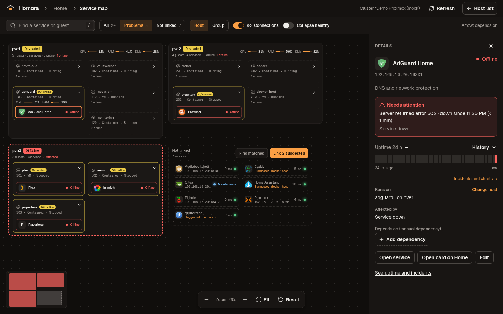

# Dashboard

O Homora tem três visões do seu homelab:

| Visão          | Endereço       | Para que serve                                                              |
| -------------- | -------------- | --------------------------------------------------------------------------- |
| **Resumo**     | `/`            | O Início: o que precisa de atenção, a saúde geral e os serviços fixados.    |
| **Serviços**   | `/services`    | Os cartões em páginas e grupos, com filtros, layouts, mapa e **Organizar**. |
| **Manutenção** | `/maintenance` | Todas as janelas abertas ou agendadas e a forma de agendar uma nova.        |

## Navegação

No computador e no tablet, uma **barra de ícones** à esquerda abre **Início**, **Serviços**, **Mapa**, **Sondas**,
**Integrações**, **Agentes**, **Atividade** e **Configurações**, com o botão de tema e o menu da conta no final. O nome
de cada ícone aparece ao apontar ou focar. O cabeçalho traz **Resumo**, **Serviços** e **Manutenção** nessas visões
(nas outras, o caminho de volta), a paleta de comandos, a pílula de saúde, o sino e **Novo serviço**.

## O Resumo

De cima para baixo: serviços **fixados**; **Precisa de atenção** (causas prováveis do que está fora do ar e o que está
lento, ou o aviso de que nada precisa de atenção, com texto próprio quando há estados desconhecidos ou desatualizados);
os **números de saúde**; os **serviços por estado** (selecionar um estado abre Serviços filtrado); a **meta de
disponibilidade** e a **latência agora**; as **próximas manutenções**; e os widgets da página. A partir de 1280 px, uma
coluna à esquerda mostra visões, grupos, hosts e sondas, e uma à direita mostra **todos os serviços num olhar**, os
detalhes do selecionado e as propostas de agentes aguardando revisão. Em telas menores, os detalhes abrem em um painel.

## Manutenção

Escolha um serviço e **Agendar manutenção**. As janelas aparecem como abertas agora ou agendadas, onde podem ser
encerradas ou canceladas. Com uma janela aberta, as verificações continuam, mas o serviço não abre incidente nem envia
alerta.

## A pílula de saúde

A pílula, no cabeçalho de todas as páginas, responde "está tudo certo?" de relance: um ponto colorido e poucas palavras (**Tudo certo**, **2 problemas**, **Monitoramento parcial**, **Sem dados** ou **Sem medição**). No celular ela se reduz ao ponto e ao número de problemas (um sinal de confirmação quando está tudo bem, um ponto de interrogação quando o estado é desconhecido). Quando o total mistura serviços fora do ar, sondas fora do ar e serviços lentos, o painel diz quantos são de cada tipo. Ao selecioná-la, abre um painel com os serviços fora do ar e há quanto tempo, a disponibilidade média, os incidentes da semana, o tempo médio de recuperação e a meta de disponibilidade, além das **causas prováveis**: o que os serviços provavelmente têm em comum (um convidado parado ou host offline do Proxmox, o mesmo erro começando em até dez minutos ou um endereço que não responde). Cada causa pode ser **reconhecida** ou **silenciada por 1 h**; isso só silencia o Homora, sem alterar verificações, incidentes ou notificações. Quando a maioria das verificações falha pelo mesmo motivo, a pílula diz **Sem medição**, e os cartões, abas e contagens afetados mostram **Sem medição** em vez de fora do ar.

No painel, **Precisa de atenção** vem antes dos números. Ao final, os serviços aparecem como pequenas janelas agrupadas pelo nome do estado e pela quantidade (acima de 40 em um estado, o restante é contado). Se a página deixar de receber estados do Homora, um aviso informa de quando eles são e oferece **Tentar novamente**, e a pílula diz **Desatualizado**. Nas telas grandes, as contagens das visões na lateral também incluem as sondas, e a lateral informa quantas são.

## Navegação e organização

Use a busca ou `Ctrl K` para localizar serviços e configurações. Os filtros ajudam a encontrar itens fora do ar, degradados ou favoritos. Em telas largas, quando há um Proxmox conectado, a lista **Hosts** na lateral mostra cada nó com seu estado e quantos cartões rodam nele; selecioná-lo mostra os cartões daquele nó. O sino mostra eventos de indisponibilidade e recuperação. Páginas separam conjuntos de serviços; grupos organizam os cartões dentro de cada página. No Resumo e em Serviços, as páginas ficam em uma barra própria abaixo do cabeçalho, com a contagem de serviços e quantos estão fora do ar; o botão de lista no fim da barra abre **Todas as páginas** (uma folha na parte de baixo no celular), com busca quando há mais de seis páginas, um menu `⋯` por página e o botão **Adicionar página**.

Em **Serviços → Organizar** (no celular, dentro de **Opções**), adicione, edite, mova ou remova cartões e grupos. É possível alterar a quantidade de colunas e a disposição. A pílula e a navegação por grupos continuam visíveis durante a organização, e um aviso informa quando a ordem exibida é a salva, e não a de **Problemas primeiro**. Os cartões podem ser exibidos em diferentes layouts; as visualizações de host e mapa ajudam a entender relações entre serviços e infraestrutura.

O **Mapa de serviços** é somente leitura e responde, em ordem: está tudo bem, onde está o problema, o que depende dele e como resolver os serviços sem host. A barra tem busca (`/` foca, `Esc` limpa), os filtros **Todos**, **Problemas** e **Sem vínculo** com contagem, **Agrupar por** host ou grupo, **Conexões** (as setas das dependências, lembrado no navegador) e **Recolher saudáveis**, que usa a mesma preferência de Serviços. Cada nó e guest mostra o estado por escrito, um resumo de saúde e medidores de CPU, RAM e disco quando o Proxmox os informa; um medidor ausente é omitido, nunca desenhado como 0 %. **Problemas** recolhe e esmaece o que está saudável sem remover nada, e o painel lateral de um serviço com falha mostra **Precisa de atenção** (motivo, há quanto tempo e por quê), onde ele roda, por onde é alcançado e ações apenas de leitura. Em **Sem vínculo**, **Buscar correspondências** mostra sugestões com a força e a evidência, **Vincular N sugeridas** vincula só as fortes e permite desfazer, e **Marcar como externo** separa serviços que não rodam em nenhum guest (nuvem, VPN). Nada disso reinicia guests nem altera o Proxmox; o ajuste automático (que também amplia o mapa até 120 % em telas largas), o zoom e o minimapa (exibido quando parte do mapa está fora da tela) ajudam a navegar. A visão **Host** mostra a latência mais recente e um botão de lápis para editar cada serviço.

## Busca na web e IA

Em **Configurações → Barra superior e atalhos**, ative separadamente **Busca na web** ou **Perguntar a uma IA**. Ambas vêm desativadas e as preferências ficam somente neste navegador. Ao digitar na paleta, escolha a ação com o nome do buscador ou serviço de IA para abrir uma nova aba. A IA preferida aparece primeiro; as opções são ChatGPT, Claude, v0 e Scira.

Somente o texto livre é incluído na URL, sem os filtros de status e grupo ou dados acrescentados automaticamente pelo Homora. O serviço externo recebe o texto, e a URL pode ficar no histórico ou em outros registros: evite digitar segredos. Pode ser necessário entrar no serviço ou enviar a pergunta preenchida manualmente. Esse atalho não conecta a IA ao Homora nem ao servidor MCP.

## Detalhes e widgets

Abra os detalhes de um serviço para consultar verificações, latência e histórico. Quando um host fora do ar ou um guest parado explica a falha, o painel informa a causa, quantos serviços foram afetados e leva ao mapa. Em um cartão sem monitoramento por falta de permissão, **Revisar a permissão de monitoramento** abre o formulário na aba **Acesso**; endereços de loopback são explicados, pois não podem ser autorizados. Históricos curtos são identificados, e a página do serviço informa quanto tempo foi realmente medido. Marque serviços como favoritos para acessá-los com facilidade. Widgets de página exibem informações como relógio e dados de integrações; widgets de cartão aparecem junto ao serviço.

O widget **Agenda de manutenção** mostra janelas em andamento e futuras no fuso horário do navegador. Escolha um horizonte de 24 horas, 7 dias ou 30 dias, até 10 linhas e filtros opcionais por página e grupo. Janelas em andamento aparecem independentemente de quando começaram. Seleções renomeadas ou removidas permanecem no editor para atualização e não passam a incluir tudo. Falhas de atualização são distintas de uma agenda vazia, e leituras anteriores são identificadas como desatualizadas. Sem filtros, sondas independentes também podem aparecer; selecioná-las abre o gerenciamento de sondas.

No celular, uma barra flutuante em todas as páginas abre **Início**, **Serviços** e **Agentes**; **Mais** reúne
**Manutenção**, **Mapa**, **Sondas**, **Integrações**, **Atividade**, **Configurações** e **Novo serviço**. O menu da
conta fica no cabeçalho. Pressione `?` para consultar os atalhos disponíveis.

[Leia a referência completa do dashboard em inglês](/user-guide/dashboard).

Quando um widget de página oferecer tamanhos, escolha normal ou largo no editor. Nas telas grandes, os widgets de página ficam no painel à direita; nas menores e no Resumo, abaixo do conteúdo, e no celular o bloco **Adicionar widget** aparece em **Organizar**. Largo ocupa duas colunas abaixo dos grupos quando há espaço; no painel lateral e em telas pequenas usa a largura normal. Os tamanhos disponíveis dependem do widget.
