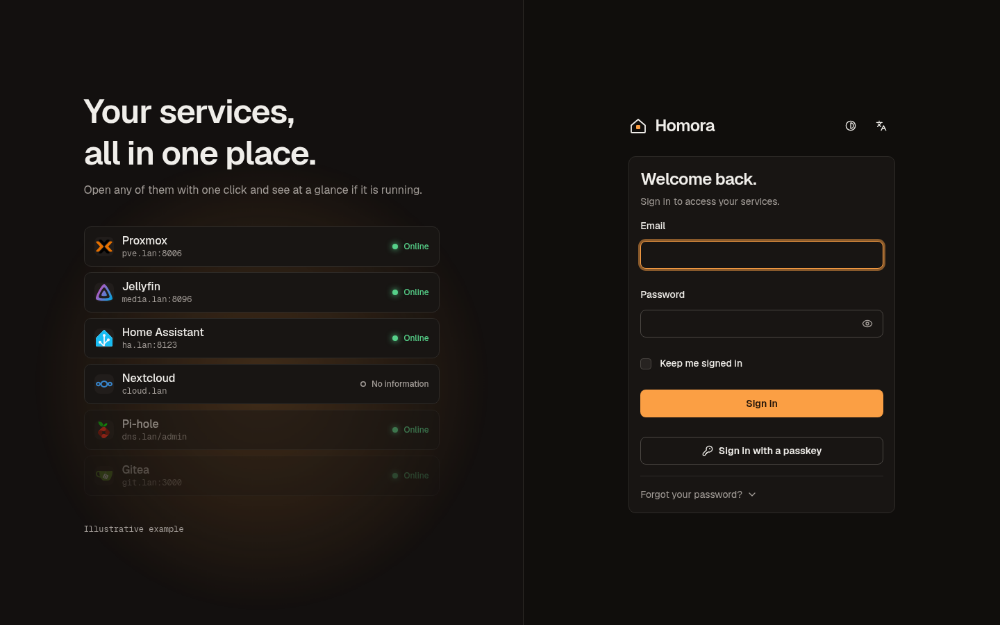
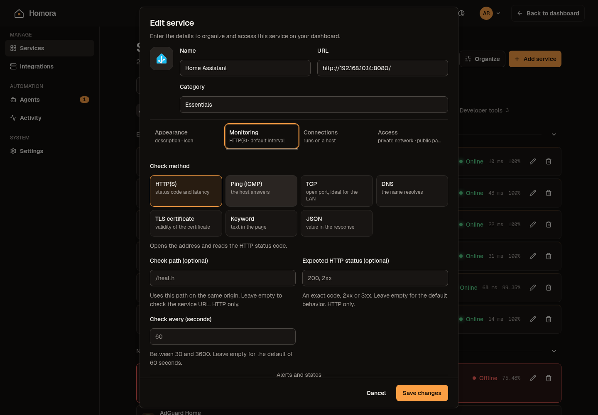

# Primeiros passos

Instale o Homora, crie sua conta e adicione o primeiro serviço. Você não precisa de Proxmox ou de um agente de IA.

## Antes de começar

Você precisa do Docker com Compose em uma máquina sob seu controle e de um navegador moderno.

## Instale

```bash
git clone https://github.com/JhonatanMedeiros/homora.git
cd homora
docker compose up -d --build
```

Acesse <http://localhost:8080>. Por padrão, a porta fica restrita à própria máquina e os dados ficam no volume Docker `homora-data`.

> Faça a configuração inicial na própria máquina. Antes da criação da conta administradora, qualquer pessoa com acesso à porta pode criá-la. Para acesso pela rede privada, consulte [instalação e atualizações](deployment.md). O Homora não é destinado à exposição direta na internet.

## Crie a conta administradora

Na primeira visita, informe nome, e-mail e senha com pelo menos oito caracteres. O e-mail é usado para entrar; o Homora não envia mensagens para ele. A opção de manter a sessão permite permanecer conectado por até 30 dias, em vez de oito horas.



## Adicione um serviço

1. No dashboard, escolha **Adicionar seu primeiro serviço** e informe nome, URL e categoria. Uma categoria nova cria um grupo.
2. Escolha um ícone: marca local, emoji, ícone integrado ou URL de imagem.
3. Para monitorar um endereço de rede privada, autorize explicitamente esse acesso na aba **Acesso** do serviço.
4. Salve. O cartão exibirá o resultado após a verificação; abra os detalhes para ver o histórico.



Se preferir, [importe uma configuração compatível](import-export-backup.md) e revise a prévia antes de confirmar.

## Conheça a interface

O dashboard reúne serviços e grupos. **Organizar** permite alterar sua disposição; `Ctrl K` abre a busca e `?` mostra os atalhos. Em **Gerenciar**, configure integrações, agentes, atividade e configurações. O menu da conta oferece segurança, link para o repositório e **Novidades**.

Para receber alertas, adicione um canal em configurações e use o envio de teste. Veja [alertas e página de status](notifications-and-status-page.md).

O indicador de atualização depende de uma imagem com versão identificada e de uma release estável disponível. Em desenvolvimento local, as notas de exemplo são identificadas e não indicam atualização real. O servidor consulta o GitHub para obter as releases quando você entra e periodicamente enquanto a página permanece aberta.

## Dúvidas comuns

- **Posso usar sem Proxmox?** Sim. Integrações e agentes são opcionais.
- **O cartão não é monitorado?** Verifique a autorização para rede privada e as opções de monitoramento. Endereços de loopback são bloqueados.
- **Esqueci a senha?** Veja [conta e segurança](accounts-and-security.md) para recuperação local.

[Leia o guia completo em inglês](/user-guide/getting-started).

### Mudanças no monitoramento

Em **Gerenciar → Atividade**, selecione **Mostrar mudanças no monitoramento** para consultar
inícios e recuperações de incidentes registrados nas últimas 24 horas ou nos últimos 7 dias. Os
horários usam o fuso do navegador; os links abrem os detalhes do serviço. Selecione um incidente de sonda para consultar seu início e término registrados. A lista mostra até os 100 eventos mais recentes e avisa quando há mais. A visão mostra quando foi atualizada,
oferece um botão para atualizar e avisa quando o resultado tem mais de dois minutos (a verificação
ocorre a cada 30 segundos). Os registros de incidentes não comprovam cobertura histórica completa: uma lista vazia não prova que nada aconteceu. A visão não
infere causas e não inclui mudanças de configuração, histórico de certificados ou recorrência.
