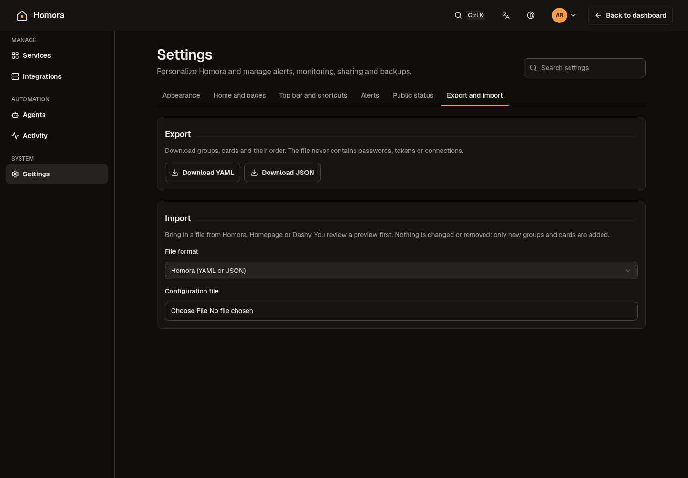

# Importação, exportação e backup

Exportação e backup servem a finalidades diferentes. A exportação gera um arquivo portátil com cartões e organização; o backup preserva o banco de dados e deve ser acompanhado das chaves necessárias.



## Importar e exportar

Nas configurações, exporte grupos, cartões e ordem em YAML ou JSON. Senhas, tokens e conexões não são exportados, mas o arquivo pode conter nomes de conexões e widgets: revise-o antes de compartilhar.

A importação aceita formatos do Homora, Homepage e Dashy. Selecione o formato e o arquivo, revise o que será adicionado ou ignorado e confirme. Não há substituição ou remoção de itens existentes. Widgets, opções de monitoramento e links Docker desses formatos externos não são importados. O monitoramento em rede privada exige autorização explícita.

## Backup e restauração

O banco contém cartões, conta, sessões e credenciais criptografadas. Guarde também a chave `.key`, o segredo de sessão `.session-secret` ou o valor de `HOMORA_SESSION_SECRET`, e, quando existentes, arquivos como `.proxmox` e `.background`. O segredo de sessão é necessário para restaurar a verificação em duas etapas. Proteja esses arquivos como protegeria o próprio banco.

O utilitário cria uma cópia consistente sem sobrescrever um arquivo existente:

```bash
pnpm backup data/homora.sqlite backups/homora.sqlite
```

Para restaurar, pare o Homora, preserve o banco atual e restaure para um novo arquivo; aponte `HOMORA_DATABASE_PATH` para ele. Teste a restauração antes de depender do backup. O [guia completo em inglês](/user-guide/import-export-backup) contém os comandos para copiar o banco e as chaves de uma instalação Docker Compose.
