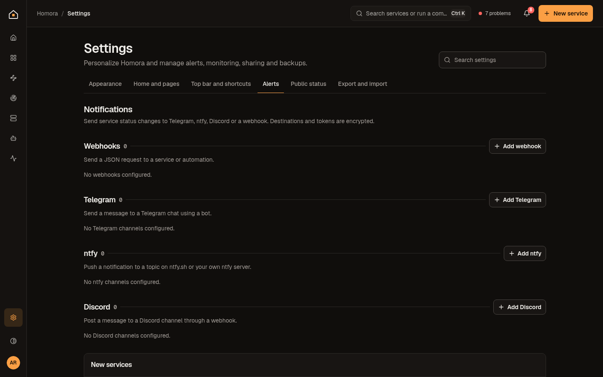

# Alertas e página de status

## Alertas

Em **Configurações → Alertas**, adicione um canal compatível, como Telegram, ntfy, Discord ou webhook HTTPS, e envie uma mensagem de teste. Para Telegram, você precisará de um bot, seu token e o identificador numérico da conversa. Proteja esses dados.

Endereços privados em webhooks exigem autorização explícita; destinos proibidos continuam bloqueados e certificados TLS são validados. Os segredos dos canais são criptografados. Guarde a chave junto ao backup do banco.

As mensagens mostram o motivo, o código HTTP e o tempo de resposta quando disponíveis. Na recuperação, mostram o tempo entre a primeira falha observada e a recuperação confirmada quando conhecido; quedas iniciadas antes deste recurso podem não ter duração. A URL opcional é a do serviço. Webhooks recebem esses dados em JSON, incluindo `outageDurationMs` quando disponível.

Alertas são associados a transições de falha e recuperação; resultados desconhecidos não equivalem a recuperação. Entregas podem ser repetidas em caso de falha e mensagens na fila em memória podem ser perdidas durante o encerramento. O sino também mostra eventos no próprio aplicativo, sem exigir canal externo.

## Página de status

A página `/status` é opcional e somente leitura. Ela começa desativada. Após habilitá-la nas configurações, escolha explicitamente os serviços que deseja mostrar e revise a prévia. Visitantes recebem informações limitadas de disponibilidade, sem URLs ou credenciais. Importações e propostas de agentes não tornam serviços públicos automaticamente.

A página anônima não torna a aplicação adequada para exposição direta à internet. Veja [instalação e atualizações](deployment.md).

[Leia os detalhes e limites em inglês](/user-guide/notifications-and-status-page).
