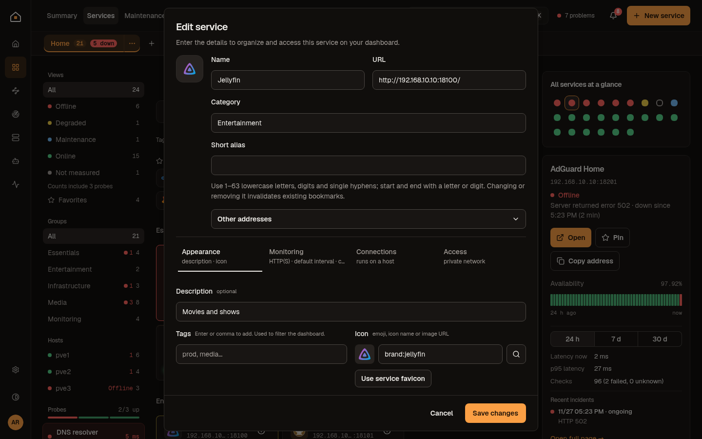

# Serviços e monitoramento

Um serviço representa um endereço que você deseja abrir e, opcionalmente, monitorar. O formulário permite configurar nome, URL, categoria, ícone, aparência, verificações, conexões e acesso à rede.

## Tipos de verificação

O Homora oferece verificações HTTP(S), ping, TCP, DNS, validade de certificado TLS, palavra-chave e valor em resposta JSON. Configure o tipo, destino, intervalo e opções adequadas ao serviço. O endereço aberto no navegador e o destino de monitoramento podem ser diferentes.

Endereços privados exigem autorização explícita no serviço; loopback, link-local e outras faixas proibidas continuam bloqueados. A validação de TLS permanece ativa. Consulte as regras e limites detalhados no [guia em inglês](/user-guide/services-and-monitoring).

## Estados e incidentes

Os cartões mostram estados como disponível, indisponível, degradado, manutenção ou aguardando. A ausência de uma observação confiável não é tratada como sucesso. Os detalhes mostram o motivo, a latência e as verificações recentes.

Configure limites de falhas e recuperação para reduzir alertas por oscilações. Os incidentes, o histórico de disponibilidade e as janelas de manutenção ajudam a entender quando houve um problema e por quanto tempo. A manutenção agendada não é uma confirmação de que o serviço funciona.

Também é possível registrar onde um serviço roda e suas dependências, para visualizá-las nas telas de host e mapa. Um serviço que não roda em nenhum guest (nuvem, VPN) pode ser marcado como **externo** no mapa; ele sai das sugestões e aparece em **Externos**. Vínculos de host, a marca de externo e dependências não vão na exportação e importação. Veja [dashboard](dashboard.md) e [alertas](notifications-and-status-page.md).

[Leia a referência completa de serviços e monitoramento em inglês](/user-guide/services-and-monitoring).
