# Galeria de widgets e integrações

O Homora pode mostrar no seu dashboard informações ao vivo das ferramentas que você já usa e do próprio monitoramento.
Esta página mostra o que está disponível e como adicionar o primeiro widget.

::: tip Sobre as imagens
Todas as imagens desta página vêm de uma instalação de demonstração com **dados inventados**: números, nomes e
endereços são exemplos, não um benchmark, e nenhum serviço ou conta real aparece. Veja
[como as capturas são feitas](../../screenshots/README.md) (em inglês).
:::

## Adicione seu primeiro widget em cinco minutos

Você não precisa de nenhuma integração para começar. Escolha o caminho que preferir.

**Sem conectar nada.** No dashboard, use o bloco tracejado **Adicionar widget**, pesquise na galeria e escolha um widget
que não exige conexão: **Relógio**, **Calendário**, **Contagem regressiva**, **Nota**, **Links rápidos** ou qualquer
[widget de monitoramento](#widgets-de-monitoramento), que lê as verificações do próprio Homora. Ajuste as opções,
confira a prévia e salve.

**Com uma das suas ferramentas** (por exemplo, o Pi-hole):

1. Abra **Integrações** e escolha **Adicionar conexão**.
2. Selecione o tipo e informe nome, endereço e uma credencial somente de leitura. Use HTTPS e autorize **rede
   privada** se a ferramenta estiver na sua rede local.
3. Escolha **Salvar e testar**. O cartão informa se as credenciais funcionaram ou o motivo resumido da falha.
4. De volta ao dashboard, use **Adicionar widget**, escolha o widget oferecido pela conexão e salve. Para mostrá-lo em
   um cartão de serviço, abra **Integrações → Widgets** e associe-o ao cartão.

Cada widget carrega por conta própria, então uma ferramenta fora do ar não quebra o resto da página. Detalhes, limites
e regras de segurança estão em [Integrações e widgets](integrations-and-widgets.md).

## Integrações

As integrações são opcionais e somente de leitura. O Homora consulta e nunca altera nada na outra ferramenta.

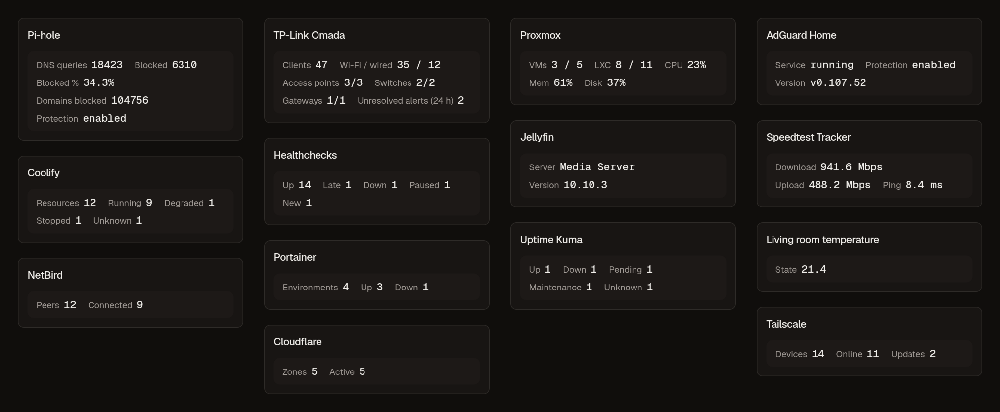

| Integração            | Prévia                                                                               | O que mostra                                                                   |
| --------------------- | ------------------------------------------------------------------------------------ | ------------------------------------------------------------------------------ |
| **Proxmox VE**        | 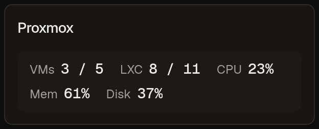                 | VMs e contêineres (em execução e total), CPU, memória e disco                  |
| **Pi-hole**           | 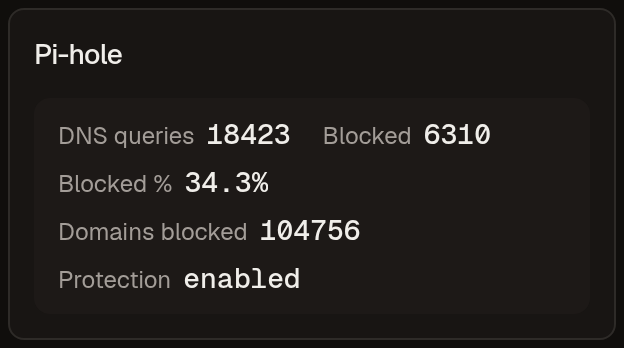                 | Consultas DNS, consultas bloqueadas e percentual, tamanho da lista, proteção   |
| **AdGuard Home**      | 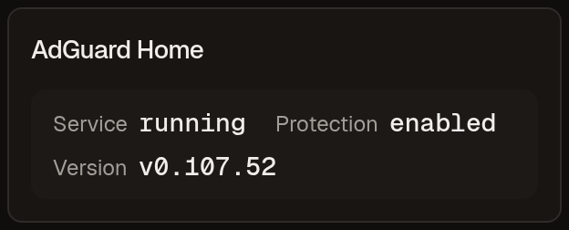            | Se o serviço está rodando, se a proteção está ativa e a versão                 |
| **Jellyfin**          | 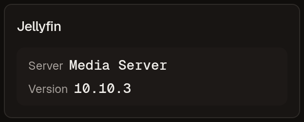                | Nome e versão do servidor                                                      |
| **Home Assistant**    | 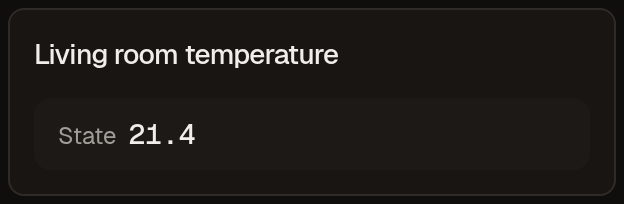 | Uma entidade no cartão ou até 8 estados escolhidos em um widget de página      |
| **Speedtest Tracker** | 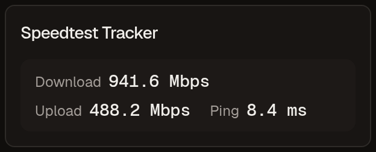       | Último download, upload e ping                                                 |
| **Portainer**         | 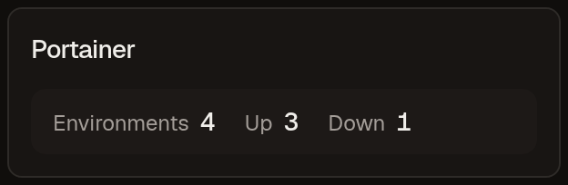               | Ambientes e quantos estão no ar ou fora                                        |
| **NetBird**           | 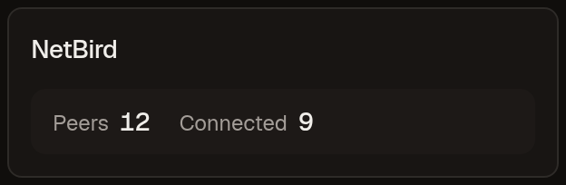                 | Peers e quantos estão conectados                                               |
| **Tailscale**         | 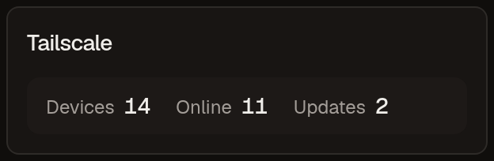               | Dispositivos, quantos estão online e quantos têm atualização                   |
| **Cloudflare**        | 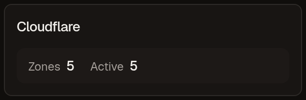              | Zonas e quantas estão ativas                                                   |
| **Healthchecks**      | 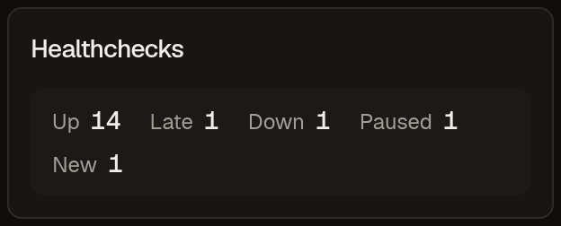            | Verificações de tarefas agendadas: ok, atrasadas, com falha, pausadas ou novas |
| **Coolify**           | 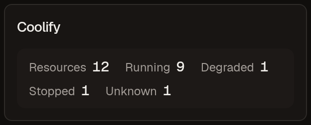                 | Recursos e quantos estão rodando, degradados, parados ou desconhecidos         |
| **TP-Link Omada**     | 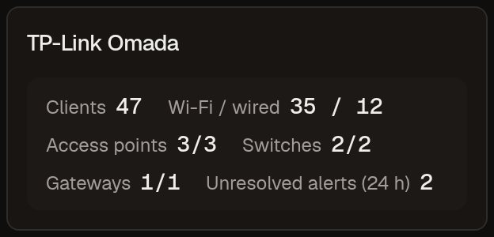           | Clientes, pontos de acesso, switches, gateways e alertas não resolvidos        |
| **Uptime Kuma**       | 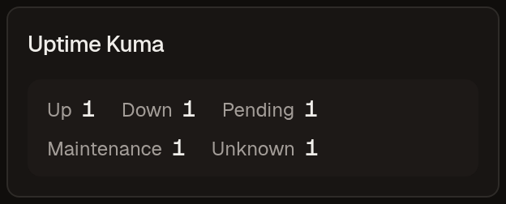             | Contagem de monitores no ar, fora, pendentes, em manutenção ou desconhecidos   |

Algumas integrações também oferecem um widget de lista que nomeia cada item: **Monitores do Uptime Kuma** e **Recursos do
Coolify**.

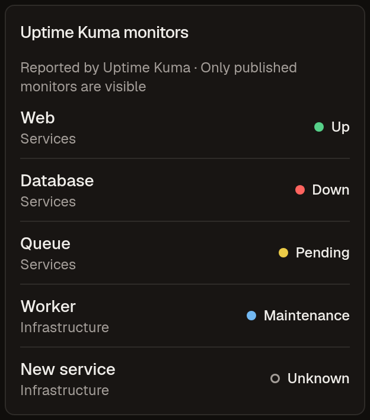
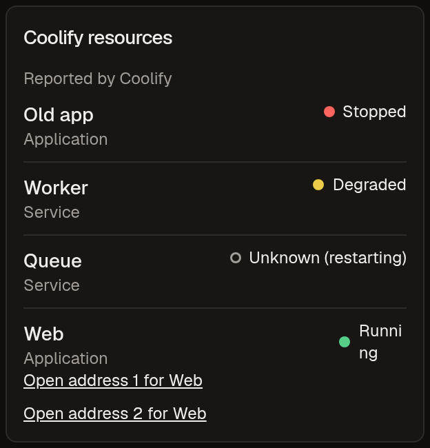

O widget de página **Entidades do Home Assistant** aceita até 8 IDs de entidade e mostra o estado
e o horário da última atualização. Ele usa uma conexão salva; atributos não são enviados ao
navegador. A validação com um serviço real está pendente.

::: warning Confira cada uma no seu ambiente
As integrações foram validadas com mocks e respostas de exemplo documentadas, e a TP-Link Omada é experimental. Os
requisitos e o estado de validação de cada uma estão na [referência de integrações](/integrations#integration-status)
(em inglês).
:::

## Widgets de página que não exigem conexão

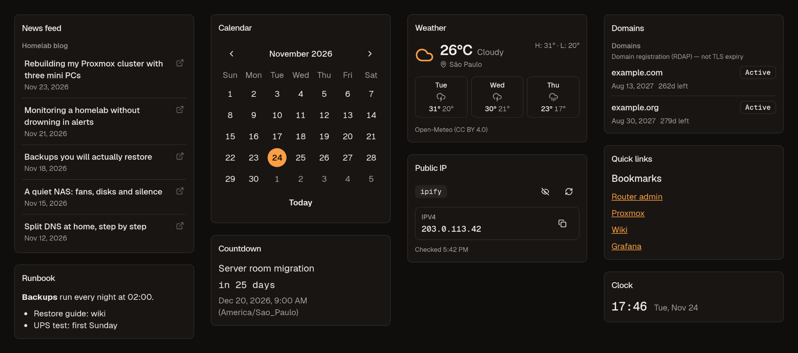

| Widget                   | O que faz                                                       | Bom saber                                            |
| ------------------------ | --------------------------------------------------------------- | ---------------------------------------------------- |
| **Relógio**              | Hora e data, 12 ou 24 horas, segundos opcionais e qualquer fuso | Também disponível na barra superior                  |
| **Calendário**           | O mês atual, com o primeiro dia da semana à sua escolha         | Usa o relógio do dispositivo                         |
| **Contagem regressiva**  | Tempo restante até um evento com nome                           | Escolha o fuso do evento                             |
| **Nota**                 | Texto curto com Markdown básico, até 4.000 caracteres           | Bom para runbooks e lembretes                        |
| **Links rápidos**        | Até 12 links para suas ferramentas                              | Apenas links HTTP(S)                                 |
| **Clima**                | Condições atuais e previsão curta para um local à sua escolha   | Consulta um provedor de clima                        |
| **Feed RSS / Atom**      | Entradas recentes de um feed RSS ou Atom                        | Buscado pelo backend, nunca pelo navegador           |
| **IP público**           | Seu endereço IP público, ocultado por padrão                    | Consulta um serviço externo, por isso exige ativação |
| **Expiração de domínio** | Quando os registros dos seus domínios expiram                   | Expiração do registro, não do certificado TLS        |

Clima, feed de notícias, IP público e expiração de domínio contatam serviços externos a partir do backend do Homora. Leia
as observações em [Integrações e widgets](integrations-and-widgets.md) antes de ativá-los.

## Widgets de monitoramento

Estes widgets usam as verificações que o Homora já executa, então não precisam de conexão nem de credenciais.

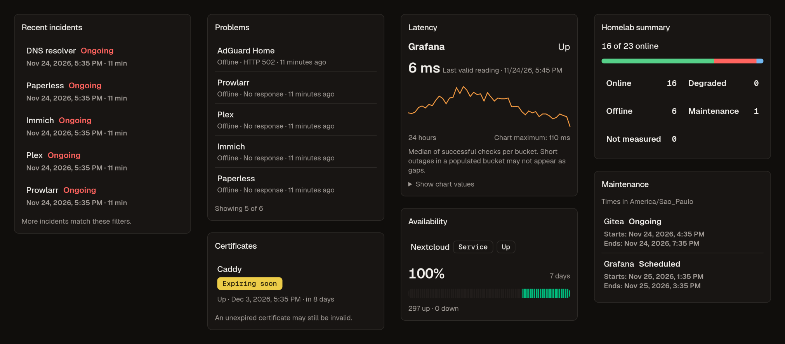

| Widget                        | O que mostra                                                                        |
| ----------------------------- | ----------------------------------------------------------------------------------- |
| **Resumo do homelab**         | Quantos monitores estão no ar, degradados, fora do ar, em manutenção ou sem medição |
| **Problemas atuais**          | Os serviços fora do ar ou lentos agora, os mais antigos primeiro                    |
| **Incidentes recentes**       | Interrupções do último dia, semana ou mês, com as em andamento primeiro             |
| **Disponibilidade**           | Uptime de um serviço em um período, com uma barra dos dias recentes                 |
| **Histórico de latência**     | Gráfico do tempo de resposta de um serviço                                          |
| **Validade dos certificados** | Certificados perto de expirar                                                       |
| **Agenda de manutenção**      | Janelas de manutenção em andamento ou próximas                                      |

A maioria dos widgets de monitoramento pode ser limitada a páginas ou grupos escolhidos.

## Crie o seu

Falta uma ferramenta? Qualquer pessoa pode adicionar uma integração ou um widget. Comece por
[Criar um widget](../create-widget.md) ou pelo [guia do SDK de integrações em inglês](/adapters).

O widget de página **Tarefas do Healthchecks** lista checks individuais e os estados informados por uma conexão existente. Um check bem-sucedido não comprova que um backup pode ser restaurado. A validação em serviço real permanece pendente.
