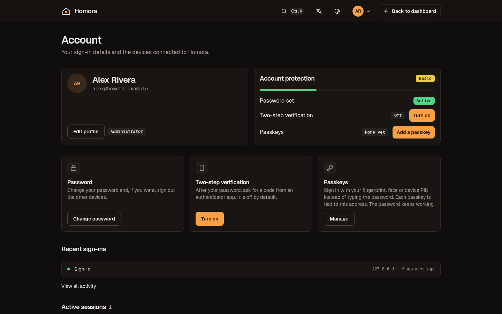

# Accounts, sessions and security

Homora has one local administrator account protected by a password, with optional two-step verification
and passkeys. This guide covers sign-in, session behavior, recovery when you are locked out, and how
secrets are stored. The full security model is in [Architecture and security](../architecture.md) and
the [security policy](../../SECURITY.md).

Manage your password, two-step verification and passkeys from the **Account** page in the avatar menu.

## Sessions, password reset and secret rotation

- **Sessions** are stored in the database and survive a backend restart. Normal sign-in lasts up to eight hours and uses a browser-session cookie. “Keep me signed in” uses a persistent cookie and lasts up to 30 days. Neither session renews automatically; sign in again after expiry. Browser session restoration may preserve session cookies after closing the browser. The cookie (`homora.session_token`) is `HttpOnly`, `SameSite=Strict` and, when you sign in from an HTTPS origin, `Secure`. It is signed with a secret kept in `<database>.session-secret` (created automatically, mode 0600) or taken from `HOMORA_SESSION_SECRET` (at least 32 characters). Changing or losing that secret signs everyone out and, if you turned on two-step verification, makes its stored secret and recovery codes unreadable (see below), so back it up with the database. State-changing requests are accepted only from an allowed origin. Ten sign-in attempts from one client address in 15 minutes block that address until the window ends (the counter is in memory and resets on restart).
- **Forgot the password:** run `pnpm auth:reset` to see the account, then `pnpm auth:reset --yes` to remove the account and every session (with Compose: `docker compose exec backend node scripts/auth-reset.mjs --yes`). Open Homora to create a new account; cards and encrypted connections are kept. Until the first account is created, anyone who can reach the interface from an allowed origin can claim it, so do this on a private network.
- **Two-step verification** is optional and off by default. In **Account**, turn it on with your password, scan the QR code (or type the key) in an authenticator app and confirm a code; you then get ten one-time recovery codes, shown once. Sign-in then asks for a code after the password; five wrong codes end the attempt and ten in a row block it for 15 minutes. Turning it on or off signs out your other devices, and turning it off or generating new recovery codes asks for the password again. Trusted devices, e-mail and SMS are not supported. The authenticator secret and recovery codes are encrypted with the session secret, so keep `<database>.session-secret` (or `HOMORA_SESSION_SECRET`) in the same backup set as the database: a restore without it cannot pass the second step. **Lost the app and the recovery codes, or the secret?** On the server run `pnpm auth:reset --two-factor-only` and then `--yes` (with Compose: `docker compose exec backend node scripts/auth-reset.mjs --two-factor-only --yes`): the account and password stay, the second step is removed and every session ends. There is no remote bypass. Details: [ADR 0016](../decisions/0016-two-factor-authentication.md).
- **Passkeys** are optional and off until you add one. In **Account**, add a passkey with your password and your device's fingerprint, face or PIN; you can add several, rename and remove them, and the sign-in page then offers **Sign in with a passkey** (no password typed, and “Keep me signed in” applies as usual). The password keeps working, and a passkey sign-in does not ask for the authenticator code because the passkey already proves device and fingerprint/PIN. Removing a passkey asks for the password and signs out your other devices. Passkeys only work where the browser offers WebAuthn (HTTPS or `localhost`) and on the address they were created for: by default `http://localhost:<port>` (not `127.0.0.1` or a LAN IP). For the HTTPS proxy, set `HOMORA_PASSKEY_RP_ID` to the domain (for example `example.home`, with `HOMORA_ALLOWED_ORIGINS=https://homora.example.home`); **changing the domain later makes existing passkeys unusable**, so remove them and add new ones. Passkeys are stored as public keys, so they survive a restore with a different session secret. **Lost a device?** Remove its passkey in Account from another device or after signing in with the password; if you cannot sign in, run `pnpm auth:reset --passkeys-only` and then `--yes` on the server (with Compose: `docker compose exec backend node scripts/auth-reset.mjs --passkeys-only --yes`). Details: [ADR 0017](../decisions/0017-passkey-sign-in.md).
- **Rotating connection secrets:** rotating the encryption key itself is not supported, and removing `<database>.key` while encrypted connections exist makes them unreadable (Homora will not create a new key over them). To rotate what matters in practice, create a new token at the source (Proxmox, Home Assistant, and so on), enter it again on the connection in Integrations, then revoke the old token. Agent tokens can be replaced in the Agents page ("Generate new token") or revoked. Revoked agents remain available in a collapsed section for reference; the main list and count show active agents.
- Treat the database, `.key` and backups as one secret set: anyone holding the key and the database can read the stored credentials.
