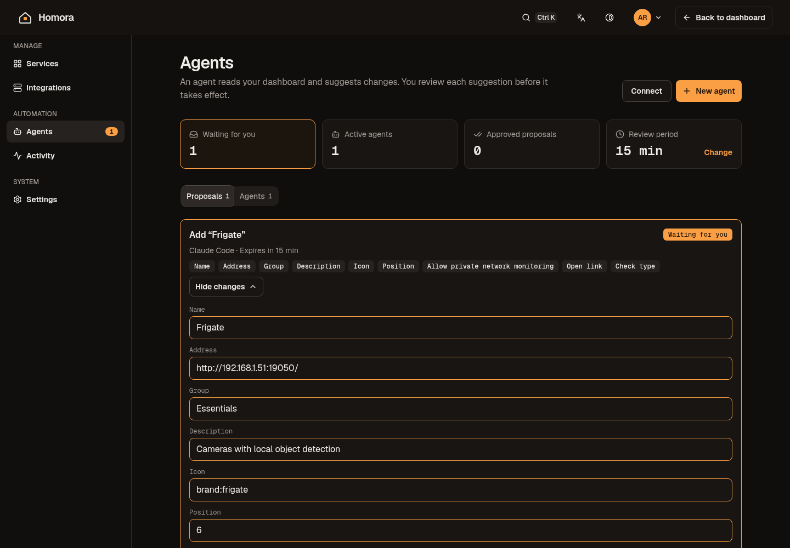
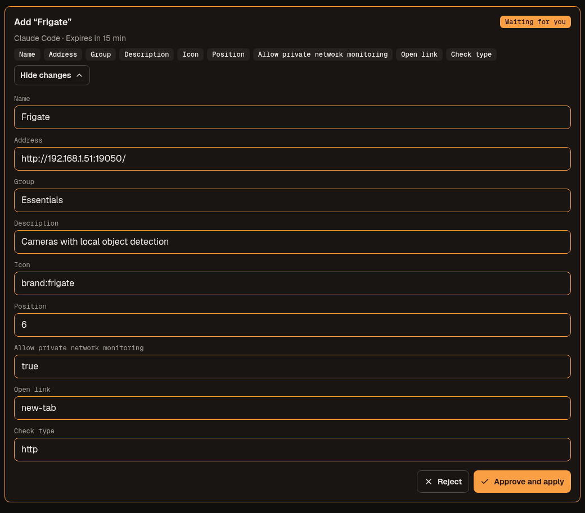

# AI agents and MCP

Homora can be driven by AI agents through the Model Context Protocol (MCP), with one hard rule: **agents only
propose**. Every change an agent suggests waits for your approval in the interface, expires if you do nothing and is
recorded in the activity log. Agents never receive credentials and cannot write to external infrastructure.

New to this? [A ten-minute walkthrough](../agent-demo.md) shows scopes, proposals, review, audit, revocation and a
denied action with synthetic data, and says which parts are mocked. The [capability inventory](../agent-capabilities.md)
lists what each tool does.

## How it works

1. **Create an agent** on **Manage → Agents** and choose its scopes. Its token is shown **once**.
2. **Connect** your client (see [Connect a client](#connect-a-client)) with that token.
3. The agent reads what its scopes allow and **proposes** changes.
4. You **review** the exact diff and approve or reject it. Approved changes apply immediately; rejected ones store
   nothing.
5. Everything is recorded in **Activity**. Revoking or rotating the token stops the agent's very next call.

## Review proposals

Waiting proposals form a queue on the left, with the selected one in full on the right (on a phone, one at a time with
previous and next, and the queue in a sheet). Changed fields show the old value struck through and the new one
highlighted; unchanged fields are folded into a count. After a decision the next proposal opens.

Every proposal carries a risk:

| Risk                | Covers                                                                                |
| ------------------- | ------------------------------------------------------------------------------------- |
| **Low risk**        | Ordinary card edits.                                                                  |
| **Needs attention** | Private-network monitoring, skipped TLS validation, maintenance, widgets, host links. |
| **Access**          | Agent identities and connection setup suggestions.                                    |
| **Destructive**     | Removals and revocations.                                                             |

- **Hold to approve:** access and destructive changes are approved by holding the button for about a second.
  Activating it without a hold (for example with a screen reader) asks in a dialog instead.
- **Approve low risk:** when two or more routine proposals wait, one button approves them in order after a
  confirmation. A failure stops the rest. Batches and riskier proposals are never included.
- **Keyboard:** `J` and `K` move through the queue, `A` approves (hold it for risky changes) and `R` rejects. They are
  off while typing or while a dialog is open.

### Expiry

The Agents page shows how long each proposal has left. The review period defaults to 15 minutes and can be set to
1–120 minutes for new proposals; existing deadlines do not change. Expired proposals stay visible, and an
administrator can recreate them (expired batches are recreated together). Recreating validates the original diff
against the current configuration and may fail if it no longer matches; it never applies a change.

## Connect a client

Homora supports local stdio and stateless Streamable HTTP. Both use the same agent tokens, scopes and approval rules.
Create an agent on **Agents**, then choose the method under **Connect**, which shows ready-to-copy setup for Claude
Code, Codex, Claude Desktop, Cursor, VS Code and generic JSON. Protect the token like a password.

### HTTP

Point a compatible client at `http://localhost:8080/mcp` (in development, `http://localhost:5173/mcp`) with the header
`Authorization: Bearer <agent-token>`.

- The backend authenticates every request, so revocation and rotation take effect immediately.
- The endpoint accepts the web hosts and origins in `HOMORA_ALLOWED_ORIGINS` and limits requests per client.
- For another machine, use the documented private-network HTTPS reverse proxy and its allowed HTTPS origin. Do not
  expose Homora publicly.

### stdio

After `pnpm build`, configure a trusted MCP client to run `node /absolute/path/to/homora/apps/backend/dist/mcp-server.js`
over stdio, and pass the one-time token as `HOMORA_AGENT_TOKEN`.

- Set `HOMORA_DATABASE_PATH` to the **same absolute database path** Homora uses. `pnpm dev` uses
  `data/homora-dev.sqlite`; the normal default is `data/homora.sqlite`. A process with a different database is a
  different instance, and with Docker it needs the same volume.
- The process needs the matching `.key` file.
- A legacy Proxmox configuration is migrated when the backend starts, so start the backend at least once before relying
  on the stdio MCP for Proxmox data. The MCP never reads `.proxmox` directly.

The stdio process reads the local database and vault directly. Neither transport is protected by the web session, so
run it only with a trusted client and system user, and grant minimum scopes. It offers no infrastructure actions or
integration writes.

## Scopes and tools

| Scope                                      | Tools                                                                                                                                                                              |
| ------------------------------------------ | ---------------------------------------------------------------------------------------------------------------------------------------------------------------------------------- |
| `services:read`                            | Services, pages, groups, favorites, status overview, trust metadata, tags, link types, public status, history and dependencies                                                     |
| `probes:read`, `probes:propose`            | Read standalone probes; propose probe changes for review                                                                                                                           |
| `incidents:read`, `incidents:propose`      | Read incidents; propose acknowledgements or mutes for review                                                                                                                       |
| `organization:propose`                     | Propose pages, card tags, favorites and resource links                                                                                                                             |
| `notifications:read`                       | Read notification channel metadata without credentials                                                                                                                             |
| `agents:read`, `audit:read`                | Agent identities and paginated audit events, respectively                                                                                                                          |
| `agents:propose`                           | Propose agent creation, scope changes, revocation or token rotation                                                                                                                |
| `maintenance:propose`                      | List maintenance windows and propose scheduling or cancellation for human review                                                                                                   |
| `public-status:propose`                    | Propose showing or hiding a card or probe on the public status page; publishing is high risk and held for confirmation                                                             |
| `proxmox:read`                             | `list_proxmox_resources`                                                                                                                                                           |
| `proposals:create`                         | `propose_service_card`, `propose_card_order`                                                                                                                                       |
| `groups:propose`                           | `propose_group_change`                                                                                                                                                             |
| `widgets:read`, `widgets:propose`          | `list_widgets`, `list_page_widgets`, `propose_widget_change` respectively                                                                                                          |
| `integrations:read`, `connections:propose` | `list_integrations`, `get_integration_status`, `test_connection`; `propose_connection_setup` respectively                                                                          |
| `discovery:read`                           | `list_discovery_suggestions`, `list_docker_push_sources`, `list_docker_push_suggestions`; `propose_discovered_card` and `propose_docker_push_card` also require `proposals:create` |
| `hosts:read`, `hosts:propose`              | `list_host_suggestions`, `propose_host_link` respectively (guest names are sensitive)                                                                                              |

Existing tokens do not gain new scopes automatically.

- `get_homora_capabilities` reports the token's scopes and available tools.
- Any proposal scope permits `list_proposals` and `get_proposal` for that identity's own proposals, and
  `withdraw_proposal` for its own unexpired pending ones (recorded in the audit log).
- `get_group`, `list_group_services` and `get_service_status` require `services:read`.
- `agents:read` lists identities without tokens or hashes. `audit:read` gives paginated history filtered by time or
  proposal, without IP addresses or event details.
- `list_proxmox_resources` returns aggregate data when exactly one Proxmox connection exists. With several, use
  `list_integrations` and `get_integration_status` (`integrations:read`) to pick one.
- Integration status queries make read-only network requests under the configured destination policy.
- For Docker discovery, set `HOMORA_DOCKER_HOST` on the backend (HTTP) or the MCP process (stdio), preferably to the
  same restricted proxy. It is disabled by default. See [Docker discovery](docker-discovery.md).

## Proposals in detail

Every proposal (cards, groups, order, widgets, host links, connection setup suggestions and agent identity changes)
needs authenticated human approval, expires after the review period, and is rejected if the relevant configuration
changed.

- **Connection setup:** approving a suggestion **does not create a connection**. Open its form from the approved
  proposal and enter credentials, private-network permission and any CA yourself. The agent never supplies
  credentials.
- **Batches:** `propose_batch` creates 1–20 proposals atomically under a shared batch ID, approved or rejected as one
  decision. Approval can make other proposals stale, requiring a new one.
- **Limit:** each identity can have 100 unexpired pending proposals.
- **Agent identities:** with `agents:propose`, an agent may suggest creating an identity or changing another agent's
  scopes, revocation or rotation. Proposed scopes must be a subset of the proposer's. A new or rotated token is
  returned only in the authenticated approval response and shown once; if lost, use **Generate new token**. Revocation
  and rotation do not cancel other agents' pending proposals, which expire normally.

## Data the agent sees

- The web monitor shares its last observations with MCP through SQLite. Changed service settings invalidate old
  results, which are reported as unknown with `stale: true`. Starting the backend clears old observations.
- `list_status_history` queries persisted observations for a service within a Unix-millisecond window. Records are
  kept for 30 days, deduplicated by service, settings and observation time, and cleaned during monitor publication.
  Deleting a service removes its history.
- URL queries and fragments are omitted from service and discovery results and proposals. Connection URLs and
  maintenance notes are omitted from MCP responses.
- Names, labels and external data are untrusted, not instructions.
