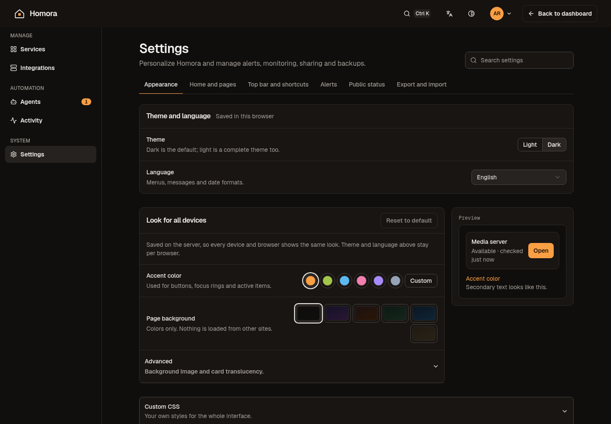
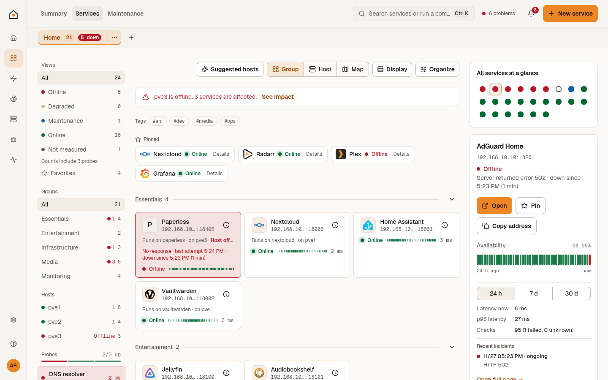
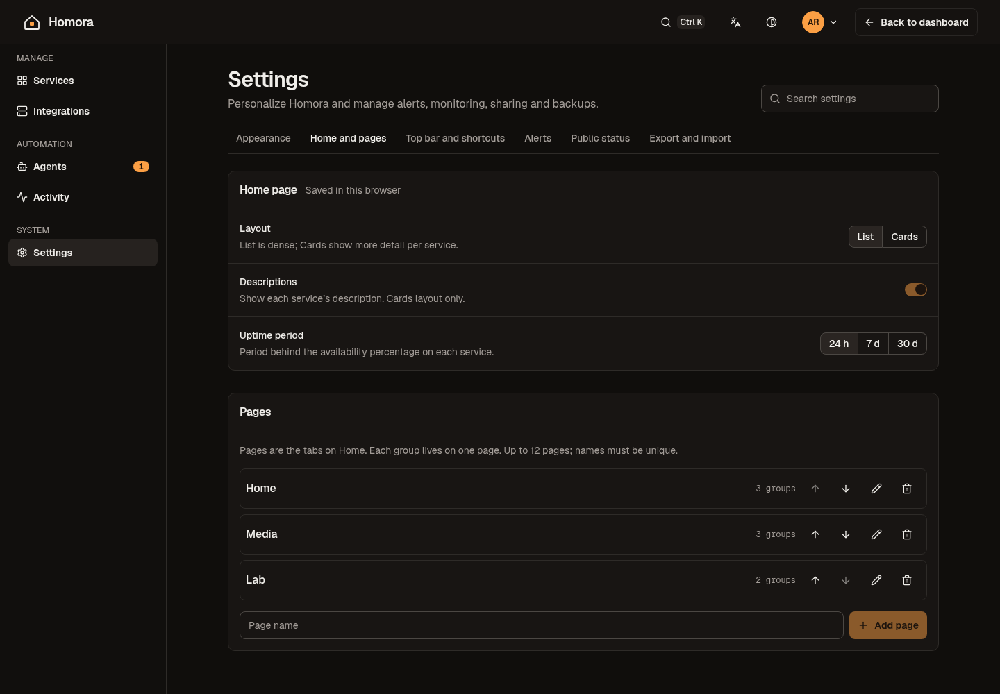

# Appearance and personalization

## Two kinds of settings

| Kind                      | Where it is saved | What it covers                                                                                                   |
| ------------------------- | ----------------- | ---------------------------------------------------------------------------------------------------------------- |
| **Per browser**           | The browser       | Theme (light or dark), language, list or cards layout, descriptions, uptime period, top bar, keyboard shortcuts. |
| **Shared by all devices** | The Homora server | Accent color, page background, card translucency, background image and custom CSS.                               |

Open **Manage → Settings → Appearance** for both. The first card, **Theme and language**, is per browser; **Look for
all devices** is shared.

## Theme and language

- **Theme:** dark (default) or light; the header's contrast button also switches it.
- **Language:** English or Portuguese (Brazil), following your browser by default; the header button switches it.
  Notifications use the language chosen for each channel.

## The look shared by all devices

Under **Look for all devices**:

- **Accent color:** choose Ember, Moss, Sky, Rose, Violet or Slate, or a **Custom** color. It drives buttons, focus rings
  and active items.
- **Page background:** Flat, Dusk, Ember glow, Forest, Ocean or Sand light. Colors only; nothing is loaded from other
  sites.
- **Advanced:** card **translucency** and blur, and an optional **background image**.
- A preview shows a card before you save, and **Reset to default** restores the original look.

**Readability is enforced.** Homora refuses to save a combination that would be hard to read: in both themes, text must
reach 4.5:1 contrast on the card and the page (every gradient stop) and the accent 3:1 on the card.

### Background image

- JPEG, PNG or WebP up to 2 MB. Animated images are rejected.
- The server removes metadata, applies the EXIF rotation, resizes to at most 1920 px and stores a WebP next to the
  database (`<database>.background`), and computes the minimum dimming that keeps text readable.
- `bun run backup` includes it; see [Import, export and backup](import-export-backup.md). Phones cannot upload or edit it.

## Custom CSS

**Custom CSS** adds your own stylesheet (up to 20 KB), validated in the browser and on the server and served from Homora.
To keep the interface safe and private these are rejected: `@import`, any address with a scheme or starting with `//`,
script-like features (`expression`, `behavior`, `-moz-binding`, `javascript:`), `<`, control characters and unbalanced
braces.

### Safe mode

If a stylesheet makes the interface unusable, turn it off **without losing the text**:

- Open any page with `?safe=1`, for example `http://localhost:8080/?safe=1`, **or**
- run `bun run css:reset` on the server. With Docker Compose: `docker compose exec backend bun scripts/css-reset.mjs`.

## Pages and the home layout

Create, rename, reorder and delete pages in **Settings → Home and pages** (up to 12, unique names); keys `1` to `9`
switch between them. The same screen holds the layout, descriptions and uptime period, saved in the browser.

## Top bar and shortcuts

**Settings → Top bar and shortcuts**:

- **Keyboard shortcuts:** turn single-key shortcuts on or off (`Ctrl/⌘ K` and `Ctrl/⌘ B` always work).
- **Command palette:** optionally add "Search the web" (off by default; only the text you type is sent).
- **Top bar:** the date, the time and CPU, memory and disk usage from a Proxmox connection.

## Search for any setting

The **Search settings** box at the top of the Settings page finds a setting by name from anywhere in Settings.
