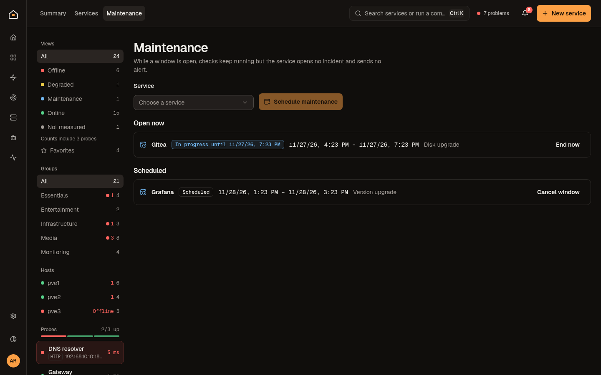
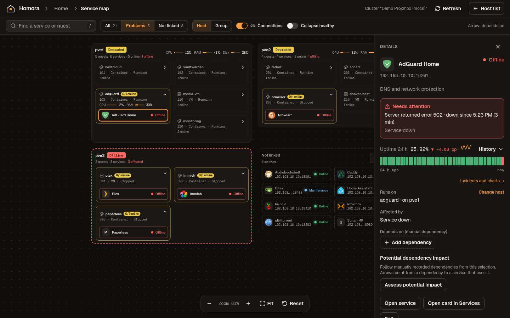
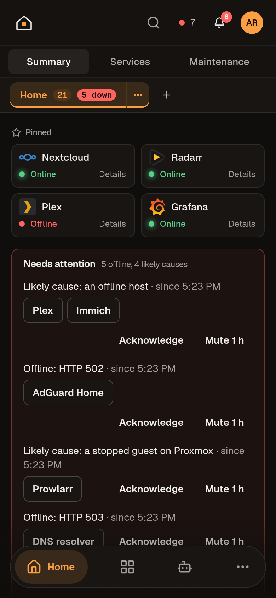

# The dashboard

Homora has three views of your homelab:

| View            | Address        | What it is for                                                              |
| --------------- | -------------- | --------------------------------------------------------------------------- |
| **Summary**     | `/`            | The Home: what needs attention, how healthy everything is, and your pins.   |
| **Services**    | `/services`    | Your cards grouped into pages, with filters, layouts, the map and Organize. |
| **Maintenance** | `/maintenance` | Every window that is open or scheduled, and the way to schedule a new one.  |

## Getting around

On a computer or tablet, an icon **rail** on the left opens **Home**, **Services**, **Map**, **Probes**,
**Integrations**, **Agents**, **Activity** and **Settings**, with the theme button and your account menu at its end.
Rest the pointer on an icon, or focus it, to read its name. The header shows **Summary**, **Services** and
**Maintenance** on those views (a path back on the others), the command palette, the health pill, the notification bell
and **New service**.

The account menu holds **Account**, **Toggle theme**, **What's new**, **GitHub**, the version and **Sign out**.

## The Summary

The Summary reads from top to bottom:

- **Pinned** services, one click away.
- **Needs attention**: the likely causes of what is offline, then what is slow. When nothing is wrong it says so, and it
  says **Nothing is reported offline** when some states are unknown or out of date.
- **Health figures**: average uptime, incidents, mean time to recover and certificates close to expiry.
- **Services by state**: select a state to open Services filtered by it.
- **Availability target** and **Latency now** (slowest first, with each service's slow limit).
- **Upcoming maintenance**, and the page's widgets.

On wide screens (from 1280 px) a left column adds the views, groups, Proxmox hosts and probes, and a right column shows
**All services at a glance**, one small window per service, with the details of the selected one and a link to agent
proposals waiting for review. On narrower screens the details open in a drawer.

## Maintenance

Choose a service and press **Schedule maintenance**. Windows are listed under **Open now** and **Scheduled**, where you
can end or cancel them. While a window is open, checks keep running but the service opens no incident and sends no
alert.

## The health pill

The health pill, in the header of every page, answers "is everything fine?": a colored dot and a few words (**All up**, **2 problems**, **Partly
monitored**, **No data** or **Cannot measure**); on a phone it shrinks to the dot and the number of problems (a check mark when all is
well, a question mark when the state is unknown). When the total mixes offline services, offline probes and slow ones,
the panel says how many of each. Select it to see which services are down
and for how long, plus:

| Figure                    | Meaning                                                                          |
| ------------------------- | -------------------------------------------------------------------------------- |
| **Average uptime · 24 h** | Availability across the monitored services, and how many that is.                |
| **Incidents · 7 d**       | Outages opened in the last week, compared with the week before.                  |
| **Mean time to recover**  | Average outage length over 30 days, plus the longest stretch without an outage.  |
| **Availability target**   | Progress against a 99.9% target over 30 days, with the remaining "error budget". |

Services not authorized for private-network monitoring appear as _not monitored_, not as failures.

**Needs attention** comes first in the panel, above the figures. At the end, each service has a small window colored by
state, grouped under the state's name and count; select one to open its details. When there are more than 40 in a
state, the rest are counted.

When most checks fail for the same reason, the pill says **Cannot measure**, and the affected cards, tabs and counts
show **Not measured** instead of down.

If the page stops getting statuses from Homora, a notice says how old they are and offers **Try again**, and the pill
reads **Out of date**.

## Needs attention

When services are offline, **Needs attention** groups them by what they probably share: a stopped guest or offline host
(from a linked Proxmox connection), the same error starting within ten minutes, or an address that does not answer. The
wording always says _likely_; Homora never names a fix. The causes also appear in the health pill's popover.

Each group can be **Acknowledged** (quiet until that incident ends) or **Muted 1 h**, and undone from the toast or with
**Show again**. This only quiets the dashboard: checks, incidents and notifications do not change. Each action is
recorded in the audit log.

## Status filters

On wide screens, the left column of Summary, Services and Maintenance has **Views** (**All**, **Offline**,
**Degraded**, **Maintenance**, **Online** and **Not measured**), **Groups** with each group's health, **Probes**, and,
when a connected Proxmox runs some of your cards, **Hosts** with each node's state and card count. Choosing a view or a
group opens Services with that filter. The view counts also include probes, and the column says how many. On smaller
screens Services shows the views as chips (or inside **Options** on a phone). Counts are live. **Degraded** means online
but slower than the limit you set (see [Services and monitoring](services-and-monitoring.md#alerts-and-states)).

## Alerts bell

The bell counts unread notifications about confirmed outages and recoveries of services and probes. Open it to review
history and mark items as read; reading is independent of acknowledging or muting. The inbox keeps up to 90 days and
10,000 entries. See [Notifications and status page](notifications-and-status-page.md#in-app-notifications).

## Pages, groups and cards

- **Pages** sit in their own bar under the header on Summary and Services, for example _Home_, _Media_ and _Lab_, each with its service count and
  how many are down. The bar scrolls sideways when there are many pages. The list button at its end opens **All pages**
  (a bottom sheet on phones), with a search field when you have more than six, a `⋯` menu per page, and an **Add page**
  button. The `⋯` on the selected tab renames, moves or deletes it (a page with groups or widgets asks where they go
  first), and `+` creates one. Press `1` to `9` to switch. You can have up to 12 pages with unique names, also managed in **Settings →
  Home and pages**.
- **Groups** organize cards inside a page. Choose one in the **Groups** list to filter to it. Each group has 1 to 6
  columns, so a short group can use two wide columns while a long one uses six.
- **Cards** show the icon, name, address, state, latency and availability. A failing card is highlighted with why and
  since when.

## Layouts and views

Open **Display** to choose how cards look. The choice is saved in your browser; **Compact** is the default.

| Choice      | What you get                                                                                                                                                                                                         |
| ----------- | -------------------------------------------------------------------------------------------------------------------------------------------------------------------------------------------------------------------- |
| **Compact** | A small tile per service: icon, name, host, state and a thin bar. Healthy groups can collapse, and problem groups and offline cards can come first (**Settings → Home and pages**). The `i` button opens the drawer. |
| **List**    | A dense row per service. Best for many services.                                                                                                                                                                     |
| **Cards**   | Larger cards with the description, the uptime bar and a **Details** link that opens the drawer.                                                                                                                      |
| **Group**   | Cards organized by your groups (the default).                                                                                                                                                                        |
| **Host**    | Cards organized by the machine or guest they run on, for services linked to a host.                                                                                                                                  |
| **Map**     | Hosts and the services running on them. See [linking a card to a host](services-and-monitoring.md#where-a-service-runs-and-what-it-needs).                                                                           |

**Host** lists services under the node and guest they run on, with the latest latency and a pencil button to edit each
one, and flags those that a failing dependency may affect.
**Map** shows the same relationships as boxes, and you can drag an unlinked service onto a guest.

### Service map

The map answers four questions in order: is everything fine, where is the problem, what depends on it, and how do I
place the services that have no host. It is read-only: nothing here restarts a guest or a service, opens logs, or
changes Proxmox. The only things it saves are Homora's own host links and the **External** mark.

- **Toolbar.** Search a service, address or guest (`/` focuses it, `Esc` clears it; accents are ignored). **All**,
  **Problems** and **Not linked** show how many each holds. **Host** or **Group** arranges the same tiles by the machine
  they run on or by your dashboard groups. **Connections** shows or hides the arrows for the dependencies you recorded
  (the choice is remembered in this browser). **Collapse healthy** uses the same setting as Services.
- **Hosts and guests.** Each node shows its state in words (**Online**, **Degraded**, **Offline**), a summary such as
  _5 online · 1 offline_, and CPU, RAM and disk meters. A guest shows its type, id, state and CPU and RAM. A meter is
  left out when Proxmox did not report it (a stopped guest, an older Proxmox): it is never drawn as 0 %. A guest with
  a failing service or a stopped guest gets an _x/y online_ chip, and the chevron collapses it to its header.
- **Services.** Each tile has the service icon, its name, a status light and, when healthy, the latency. The state is
  always written in words too, never shown by color alone.
- **Connections.** Arrows point from a service to what it depends on. Selecting a service highlights its chain, and an
  arrow turns red when what it points to is down.
- **Minimap and zoom.** When part of the map is off screen, a small map in the corner shows the part you are looking at; press
  or drag on it to move.
  **Fit** and **Reset** sit beside the zoom buttons, and the map fits itself when it opens, shrinking when it
  would not fit or growing up to 120 % on a wide screen.

#### Finding a problem

**Problems** collapses and mutes every guest that is fine and keeps the ones with a failing or slow service, a stopped
guest or an offline host in focus. Nothing is removed: a collapsed guest still lists its services in the **Host** view
and in the details panel. When nothing is wrong, the map says so.

Select a tile to open the details on the right (a sheet at the bottom on narrow windows). For a failing service the
panel opens with **Needs attention**: the reason of the last check, how long it has been down and why (host offline,
guest stopped, service not responding). It also shows uptime, where it runs, **Reached through** (the chain of
dependencies in front of it) and read-only actions: **Open service**, **Open card in Services**, **Change host** and
**See uptime and incidents**. Selecting a guest shows its load and its services.

#### Services without a host

**Not linked** lists the services that run on no guest yet.

- Drag a service onto a guest, or select it and use **Change host**; both save exactly the same link.
- **Find matches** reads guest configurations once, on request, and shows the suggestion on each tile with how strong
  it is and the evidence behind it (the same rules as [suggested hosts](services-and-monitoring.md#where-a-service-runs-and-what-it-needs)).
  **Link N suggested** links only the strong, unambiguous ones, and a toast offers **Undo**. A weaker match can be
  accepted or dismissed from the details panel.
- **Mark as external** is for services that run nowhere in your infrastructure (a cloud service, a VPN). They move to
  **External**, leave the suggestions, and appear in the **Host** view too. **Move to Not linked** undoes it, and so
  does dropping a service on **External**.

**Display** also sets descriptions and the uptime period (24 h, 7 d or 30 d), also in **Settings → Home and pages**.

### Details drawer

The `i` button, **Details**, a health-pill window or a name in **Needs attention** shows the service in the right
column on wide screens, and otherwise opens a side panel (a bottom sheet on a phone) with the state, **Open** and **Copy address**, availability, latency, recent incidents and a link to the full
page. When an offline host or a stopped guest explains the failure, the panel names it, says how many services it
affects and links to the map. For a card that is not monitored because it lacks permission, **Review the monitoring
permission** opens the form on the **Access** tab; a loopback address is explained instead, since it cannot be allowed.
A short history is stated as such. `Esc` closes it.

### Favorites

**Pin** a service from its details to show it in the **Pinned** row on the Summary and above the groups on Services, on
every page. **Favorites** in the left column shows only pinned services. Pins are included in export and import.

### Widget panel

On screens wider than 1440 px, a page's widgets sit in the right column of Services, under the selected service; **Hide
widget panel** moves them below your groups, after the probes. A widget that cannot refresh keeps its last reading and
says how old it is.

## Search: the command palette

Press `Ctrl K` (`⌘ K` on macOS) or `/` from anywhere.

- Type part of a name, group, description or host. Matching tolerates accents and missing letters.
- Filter with prefixes: `status:down` (also `up`, `online`, `unknown`) and `group:Media` or `group:"Developer tools"`.
  Combine them with text, such as `status:down plex`.
- Sort by **Relevance**, **Name** or **Status**.
- `Enter` opens the service; `Shift Enter` jumps to its card.
- **Go to** lists settings pages and actions, such as Import / Export.
- Extra addresses of a service show under it while you search.

### Web search (optional)

Turn it on in **Settings → Top bar and shortcuts** to add "Search the web" to the palette. It is off by default.
Nothing is sent until you choose it, and then only the text after the prefix goes to the engine.

| Prefix  | Engine     | Prefix | Engine    |
| ------- | ---------- | ------ | --------- |
| `!g`    | Google     | `!w`   | Wikipedia |
| `!ddg`  | DuckDuckGo | `!gh`  | GitHub    |
| `!b`    | Brave      | `!yt`  | YouTube   |
| `!bing` | Bing       |        |           |

For example, `!w jellyfin`. The selected engine is named in the action. Select the action to open a new tab; typing alone sends nothing.

### Ask an AI (optional)

In **Settings → Top bar and shortcuts**, enable **Ask an AI** and choose a preferred service. When you type in the palette, the preferred service appears first, followed by the other available destinations: ChatGPT, Claude, v0 and Scira. Selecting one opens its website in a new tab with the free text in the URL; service and group filters are removed. No Homora data is added automatically. The preference is saved only in this browser.

The external service receives the text, and URLs may appear in browser history or other logs. Avoid entering secrets. Depending on the service and login state, you may need to sign in or submit the prefilled question yourself. This shortcut does not connect the AI to Homora or its MCP server.

## Keyboard shortcuts

Press `?` to see the list in the app. Single-key shortcuts can be turned off in **Settings → Top bar and shortcuts**;
`Ctrl`/`⌘ K` always works.

| Keys         | Action                            |
| ------------ | --------------------------------- |
| `Ctrl/⌘ K`   | Open or close the command palette |
| `/`          | Open the palette                  |
| `?`          | Show all shortcuts                |
| `g` then `h` | Go to the Home                    |
| `g` then `p` | Show what is offline              |
| `g` then `i` | Go to Integrations                |
| `g` then `a` | Go to Agents                      |
| `g` then `t` | Go to Activity                    |
| `g` then `s` | Go to Settings                    |
| `n`          | Add a service (Home and Services) |
| `1` to `9`   | Switch page (Home and Services)   |

## Organize cards and groups

Press **Organize** on the Services toolbar (on a phone, inside **Options**). This is also where you edit and delete
services and groups.

- **Drag** a row by its handle to reorder, or use the **up and down arrows** (they work from the keyboard).
- The **⋯** menu on a row moves a service to the top or to another group, edits it, or removes it after confirmation.
- **Add service** opens the new service form (as do `n` and the command palette).
- **New group** creates a group; the controls beside a group name move or rename it.
- Press **Done** when finished.

Everything you can do by dragging also works with buttons and menus.

## Widgets on the dashboard

**Page widgets** (a clock, monitoring summaries, live readings from an integration) appear on the Summary and on Services: in the right column of Services on wide screens, and below the content otherwise. A page holds up
to 12. The dashed **Add widget** tile (on a phone, shown in **Organize**) opens a searchable gallery; each widget's **⋯** menu edits, moves or removes it, and
you can drag to reorder. When a widget offers sizes, **wide** uses two columns below the groups when there is room; the
right panel and small screens use normal width. Widgets can also be attached _inside_ a card. See
[Integrations and widgets](integrations-and-widgets.md) and the [widget gallery](widget-gallery.md).

## Other addresses (Links)

A service can be reachable more than one way, such as by domain and by LAN IP. In the service form, open **Other
addresses** and add up to 10. Each can have:

- a name;
- a type: a colored label such as _LAN_ or _Admin_, shared by all services and saved immediately;
- its own **Open in** setting (new or same tab), otherwise the service's.

Services with extra addresses show a **Links** button on the card and in lists, with the main address first and a copy
button on each (a bottom sheet on a phone). Only the main address is monitored.

## Service details

Click **Details** or **Incidents and charts** on a card (or choose a service in the palette) to open its page at
`/services/<id>`.

It shows uptime for 24 hours and 7, 30 and 90 days with the change from the previous period (or how long has actually
been measured, when the history is shorter than the period), a latency chart with
median and p95 lines and incident markers, a 90-day heatmap, and a breakdown of why checks failed. **Schedule
maintenance** pauses checks for a planned window. See [Services and monitoring](services-and-monitoring.md) for how
the numbers are calculated.

## On a phone

The layout collapses to one column. A floating bar at the bottom, on every page, opens **Home**, **Services** and
**Agents**; **More** holds **Maintenance**, **Map**, **Probes**, **Integrations**, **Activity**, **Settings** and
**New service**. The header keeps the search, the health pill, the bell and your account menu, and **Summary**,
**Services** and **Maintenance** share a row under it. On Services, **Options** holds the state filter, the arrangement,
the layout, **Organize** and the suggested hosts. Background-image editing needs a larger screen, and the service map
points to the host list.

