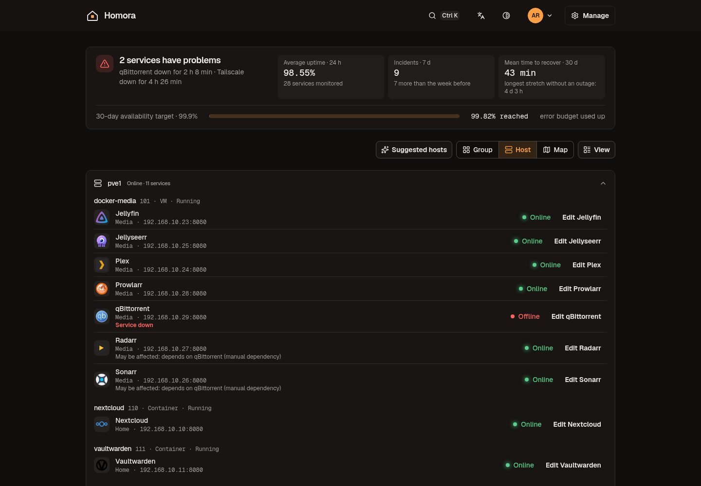

# The dashboard

The dashboard (`/`) shows your cards grouped into pages, plus any widgets you added. Health lives in the header, so the
page itself stays about your services.

## The health pill

The header pill answers "is everything fine?": a colored dot and a few words (**All up**, **2 problems**, **Partly
monitored**, **No data** or **Cannot measure**); on a phone only the dot shows. Select it to see which services are down
and for how long, plus:

| Figure                    | Meaning                                                                          |
| ------------------------- | -------------------------------------------------------------------------------- |
| **Average uptime · 24 h** | Availability across the monitored services, and how many that is.                |
| **Incidents · 7 d**       | Outages opened in the last week, compared with the week before.                  |
| **Mean time to recover**  | Average outage length over 30 days, plus the longest stretch without an outage.  |
| **Availability target**   | Progress against a 99.9% target over 30 days, with the remaining "error budget". |

Services not authorized for private-network monitoring appear as _not monitored_, not as failures.

Each service has a small window colored by state; select one to open its details. When every check fails for the same
reason, the pill says **Cannot measure** instead of listing every service as down.

## Needs attention

When services are offline, **Needs attention** groups them by what they probably share: a stopped guest or offline host
(from a linked Proxmox connection), the same error starting within ten minutes, or an address that does not answer. The
wording always says _likely_; Homora never names a fix. The causes also appear in the health pill's popover.

Each group can be **Acknowledged** (quiet until that incident ends) or **Muted 1 h**, and undone from the toast or with
**Show again**. This only quiets the dashboard: checks, incidents and notifications do not change. Each action is
recorded in the audit log.

## Status filters

On wide screens, the left rail has **Views** (**All**, **Offline**, **Degraded**, **Maintenance**), **Groups** with each
group's health, and, when a connected Proxmox runs some of your cards, **Hosts** with each node's state and card count.
On smaller screens the views become chips under the header (or **Options** on a phone). Counts are live. **Degraded**
means online but slower than the limit you set (see [Services and monitoring](services-and-monitoring.md#alerts-and-states)).

## Alerts bell

The bell counts unread notifications about confirmed outages and recoveries of services and probes. Open it to review
history and mark items as read; reading is independent of acknowledging or muting. The inbox keeps up to 90 days and
10,000 entries. See [Notifications and status page](notifications-and-status-page.md#in-app-notifications).

## Pages, groups and cards

- **Pages** sit in their own bar under the header, for example _Home_, _Media_ and _Lab_, each with its service count and
  how many are down. The bar scrolls sideways when there are many pages. The list button at its end opens **All pages**
  (a bottom sheet on phones), with a search field when you have more than six, a `⋯` menu per page, and an **Add page**
  button. The `⋯` on the selected tab renames, moves or deletes it (a page with groups or widgets asks where they go
  first), and `+` creates one. Press `1` to `9` to switch. You can have up to 12 pages with unique names, also managed in **Settings →
  Home and pages**.
- **Groups** organize cards inside a page. Choose one in the **Groups** list to filter to it. Each group has 1 to 6
  columns, so a short group can use two wide columns while a long one uses six.
- **Cards** show the icon, name, address, state, latency and availability. A failing card is highlighted with why and
  since when.

## Layouts and views

Open **Display** to choose how cards look. The choice is saved in your browser; **Compact** is the default.

| Choice      | What you get                                                                                                                                                                                                         |
| ----------- | -------------------------------------------------------------------------------------------------------------------------------------------------------------------------------------------------------------------- |
| **Compact** | A small tile per service: icon, name, host, state and a thin bar. Healthy groups can collapse, and problem groups and offline cards can come first (**Settings → Home and pages**). The `i` button opens the drawer. |
| **List**    | A dense row per service. Best for many services.                                                                                                                                                                     |
| **Cards**   | Larger cards with the description, the uptime bar and a **Details** link that opens the drawer.                                                                                                                      |
| **Group**   | Cards organized by your groups (the default).                                                                                                                                                                        |
| **Host**    | Cards organized by the machine or guest they run on, for services linked to a host.                                                                                                                                  |
| **Map**     | Hosts and the services running on them. See [linking a card to a host](services-and-monitoring.md#where-a-service-runs-and-what-it-needs).                                                                           |

**Host** lists services under the node and guest they run on and flags those that a failing dependency may affect.
**Map** shows the same relationships as boxes, and you can drag an unlinked service onto a guest.

**Display** also sets descriptions and the uptime period (24 h, 7 d or 30 d), also in **Settings → Home and pages**.

### Details drawer

The `i` button, **Details**, a health-pill window or a name in **Needs attention** opens a side panel (a bottom sheet on a
phone) with the state, **Open** and **Copy address**, availability, latency, recent incidents and a link to the full
page. `Esc` closes it.

### Favorites

**Pin** a service from its drawer to show it in the **Pinned** row above the groups, on every page. **Favorites** in
the left rail shows only pinned services. Pins are included in export and import.

### Widget panel

On screens wider than 1440 px, a page's widgets sit in a panel on the right; **Hide widget panel** moves them above your
groups. A widget that cannot refresh keeps its last reading and says how old it is.

## Search: the command palette

Press `Ctrl K` (`⌘ K` on macOS) or `/` from anywhere.

- Type part of a name, group, description or host. Matching tolerates accents and missing letters.
- Filter with prefixes: `status:down` (also `up`, `online`, `unknown`) and `group:Media` or `group:"Developer tools"`.
  Combine them with text, such as `status:down plex`.
- Sort by **Relevance**, **Name** or **Status**.
- `Enter` opens the service; `Shift Enter` jumps to its card.
- **Go to** lists settings pages and actions, such as Import / Export.
- Extra addresses of a service show under it while you search.

### Web search (optional)

Turn it on in **Settings → Top bar and shortcuts** to add "Search the web" to the palette. It is off by default.
Nothing is sent until you choose it, and then only the text after the prefix goes to the engine.

| Prefix  | Engine     | Prefix | Engine    |
| ------- | ---------- | ------ | --------- |
| `!g`    | Google     | `!w`   | Wikipedia |
| `!ddg`  | DuckDuckGo | `!gh`  | GitHub    |
| `!b`    | Brave      | `!yt`  | YouTube   |
| `!bing` | Bing       |        |           |

For example, `!w jellyfin`.

## Keyboard shortcuts

Press `?` to see the list in the app. Single-key shortcuts can be turned off in **Settings → Top bar and shortcuts**;
the two `Ctrl`/`⌘` shortcuts always work.

| Keys         | Action                            |
| ------------ | --------------------------------- |
| `Ctrl/⌘ K`   | Open or close the command palette |
| `/`          | Open the palette                  |
| `?`          | Show all shortcuts                |
| `g` then `h` | Go to the dashboard and services  |
| `g` then `p` | Show what is offline              |
| `g` then `i` | Go to Integrations                |
| `g` then `a` | Go to Agents                      |
| `g` then `t` | Go to Activity                    |
| `g` then `s` | Go to Settings                    |
| `n`          | Add a new service                 |
| `1` to `9`   | Switch to that page               |
| `Ctrl/⌘ B`   | Show or hide the sidebar          |

## Organize cards and groups

Press **Organize** on the Home toolbar. This is also where you add, edit and delete services and groups; there is no
separate list under Manage.

- **Drag** a row by its handle to reorder, or use the **up and down arrows** (they work from the keyboard).
- The **⋯** menu on a row moves a service to the top or to another group, edits it, or removes it after confirmation.
- **Add service** opens the new service form (as do `n` and the command palette).
- **New group** creates a group; the controls beside a group name move or rename it.
- Press **Done** when finished.

Everything you can do by dragging also works with buttons and menus.

## Widgets on the dashboard

**Page widgets** (a clock, monitoring summaries, live readings from an integration) sit above your groups. A page holds up
to 12. The dashed **Add widget** tile opens a searchable gallery; each widget's **⋯** menu edits, moves or removes it, and
you can drag to reorder. When a widget offers sizes, **wide** uses two columns above the groups when there is room; the
right panel and small screens use normal width. Widgets can also be attached _inside_ a card. See
[Integrations and widgets](integrations-and-widgets.md) and the [widget gallery](widget-gallery.md).

## Other addresses (Links)

A service can be reachable more than one way, such as by domain and by LAN IP. In the service form, open **Other
addresses** and add up to 10. Each can have:

- a name;
- a type: a colored label such as _LAN_ or _Admin_, shared by all services and saved immediately;
- its own **Open in** setting (new or same tab), otherwise the service's.

Services with extra addresses show a **Links** button on the card and in lists, with the main address first and a copy
button on each (a bottom sheet on a phone). Only the main address is monitored.

## Service details

Click **Details** or **Incidents and charts** on a card (or choose a service in the palette) to open its page at
`/services/<id>`.

It shows uptime for 24 hours and 7, 30 and 90 days with the change from the previous period, a latency chart with
median and p95 lines and incident markers, a 90-day heatmap, and a breakdown of why checks failed. **Schedule
maintenance** pauses checks for a planned window. See [Services and monitoring](services-and-monitoring.md) for how
the numbers are calculated.

## On a phone

The layout collapses to one column. The Home has no bottom bar: notifications are in the header, **Manage** is in the
avatar menu, and theme and language live in **Manage → Settings**. In the management area, a floating bottom bar shows
icons and **More**, which opens the rest and a way back to the dashboard. Background-image editing needs a larger
screen, and the service map points to the host list.

