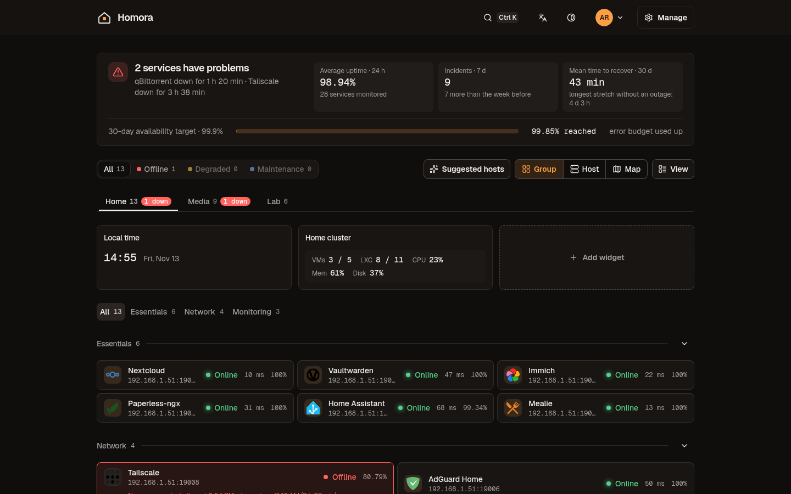
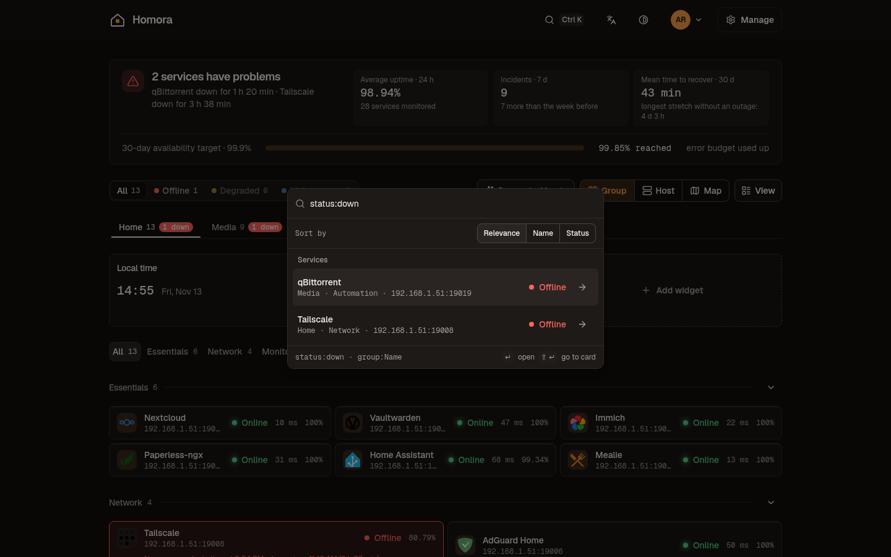
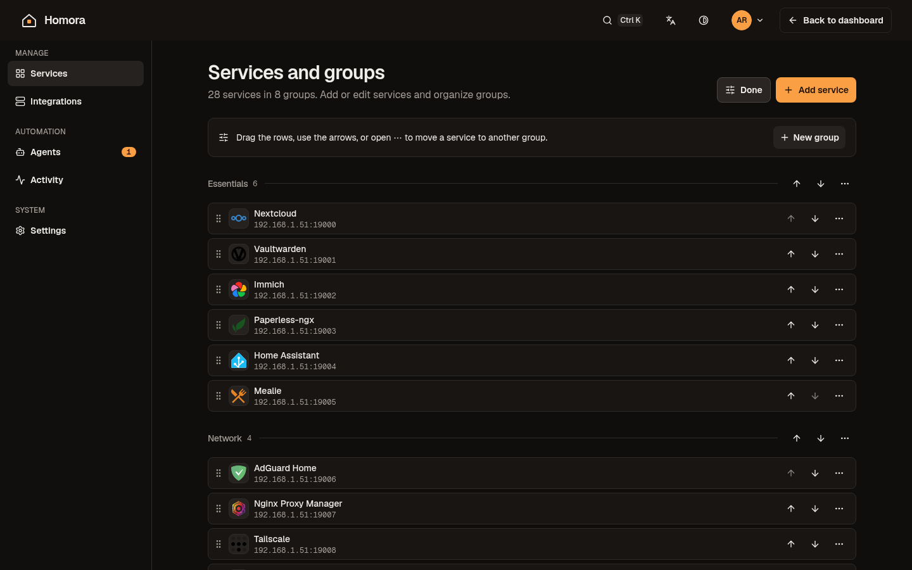

# The dashboard

The dashboard (`/`) is the page you will see most. It shows your cards grouped and organized in pages, a health
summary, and any widgets you added. This guide explains each part and the ways to reach a service quickly.

## The health banner

The banner on top answers "is everything fine?" at a glance. When something is wrong it names the services and
how long they have been down. It also summarizes:

| Figure                    | Meaning                                                                          |
| ------------------------- | -------------------------------------------------------------------------------- |
| **Average uptime · 24 h** | Availability across the services that are being monitored, and how many that is. |
| **Incidents · 7 d**       | How many outages opened in the last week, compared with the week before.         |
| **Mean time to recover**  | Average outage length over 30 days, plus the longest stretch without an outage.  |
| **Availability target**   | Progress against a 99.9% target over 30 days, with the remaining "error budget". |

Services you have not authorized for private-network monitoring are reported in the banner as _not monitored_
rather than as failures.

## Status filters

Below the banner, the chips **All**, **Offline**, **Degraded** and **Maintenance** narrow the view to services in
that state. The numbers beside them are live counts. **Degraded** is an online service that answers slower than
the limit you set for it (see [Services and monitoring](services-and-monitoring.md#alerts-and-states)).

## Pages, groups and cards

- **Pages** are the tabs along the top of the dashboard. Use them to separate concerns, for example _Home_,
  _Media_ and _Lab_. Each shows how many of its services are down. Press `1` to `9` to switch pages. Manage pages in
  **Settings → Home and pages** (up to 12, with unique names).
- **Groups** organize cards inside a page. The tabs under the widgets filter to one group. Each group has a column
  count from 1 to 6, so a short group can sit in two wide columns while a long one uses six.
- **Cards** show the icon, name, address, current state, latency and the availability for the selected period.
  A failing card is highlighted and explains why it failed and since when.

## Layouts and views

Open **View** to choose how cards look. This is saved in your browser.

| Choice    | What you get                                                                                                                                        |
| --------- | --------------------------------------------------------------------------------------------------------------------------------------------------- |
| **List**  | A dense row per service. Best for many services.                                                                                                    |
| **Cards** | Larger cards with the description, a 24-hour uptime bar and a link to incidents and charts.                                                         |
| **Group** | Cards organized by your groups (the default).                                                                                                       |
| **Host**  | Cards organized by the machine or guest they run on, for services you have linked to a host.                                                        |
| **Map**   | A map of hosts and the services running on them. See [linking a card to a host](services-and-monitoring.md#where-a-service-runs-and-what-it-needs). |

You can also change the layout, whether descriptions show, and the uptime period (24 h, 7 d or 30 d) in
**Settings → Home and pages**.

## Searching: the command palette

Press `Ctrl K` (`⌘ K` on macOS) or `/` from anywhere to open the palette.

- Type part of a name, group, description or host. Matches tolerate accents and missing letters.
- Filter with prefixes: `status:down` (also `up`, `online`, `unknown`) and `group:Media` or `group:"Developer tools"`.
  Combine them with free text, for example `status:down plex`.
- Sort results by **Relevance**, **Name** or **Status**.
- Press `Enter` to open the service, or `Shift Enter` to jump to its card on the dashboard.
- The palette also lists settings pages and actions under **Go to**, such as Import / Export.
- Optional **web search**: turn it on in **Settings → Top bar and shortcuts** to add "Search the web" to the
  palette. It is off by default; nothing is sent until you choose it, and then only the text you typed goes to the search engine.

## Keyboard shortcuts

Press `?` to see the list in the app. Single-key shortcuts can be turned off in
**Settings → Top bar and shortcuts**; the two `Ctrl`/`⌘` shortcuts always work.

| Keys         | Action                            |
| ------------ | --------------------------------- |
| `Ctrl/⌘ K`   | Open or close the command palette |
| `/`          | Open the palette                  |
| `?`          | Show all shortcuts                |
| `g` then `h` | Go to the dashboard and services  |
| `g` then `i` | Go to Integrations                |
| `g` then `a` | Go to Agents                      |
| `g` then `t` | Go to Activity                    |
| `g` then `s` | Go to Settings                    |
| `n`          | Add a new service                 |
| `1` to `9`   | Switch to that page               |
| `Ctrl/⌘ B`   | Show or hide the sidebar          |

## Organizing cards and groups

Open **Manage → Services** and press **Organize**.

- **Drag** a row by its handle to reorder, or use the **up and down arrows**, which work from the keyboard.
- Open the **⋯** menu on a row to move a service to another group.
- Use **New group** to create a group, and the controls beside a group name to move or rename it.
- Press **Done** when you are finished.

Everything you can do by dragging is also possible with buttons and menus.

## Widgets on the dashboard

Between the banner and your groups, the dashboard can show **page widgets**: a clock, or live readings from an
integration such as Proxmox. The dashed **Add widget** tile after the last widget opens a searchable gallery.
Each widget has a **⋯** menu to edit it, move it earlier or later, move it to another page or remove it, and widgets
can be dragged to reorder. Widgets can also be attached _inside_ a card. See
[Integrations and widgets](integrations-and-widgets.md).

## Service details

Click the **Details** or **Incidents and charts** link on a card (or choose a service in the palette) to open its page
at `/services/<id>`.

You will find uptime for 24 hours, 7, 30 and 90 days with the change from the previous period, a latency chart with
median and p95 lines and incident markers, a 90-day heatmap, and a breakdown of why checks failed. The
**Schedule maintenance** button pauses checks for a planned window. See
[Services and monitoring](services-and-monitoring.md) for how these numbers are calculated.

## On a phone

The interface is responsive. The layout collapses to one column and, in the management area, navigation moves
to a bottom bar with the main sections and a **More** menu. Background-image editing is only available on larger screens, and the
service map shows a notice with a link to the host list on narrow screens.

