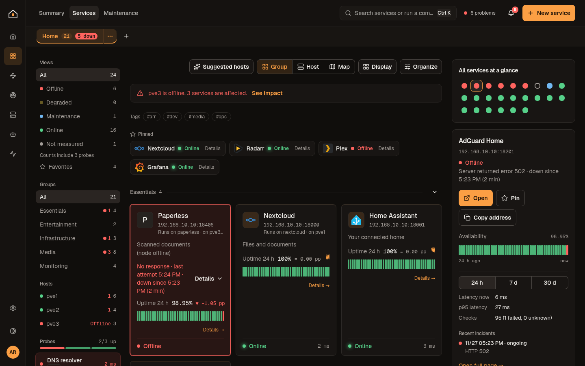
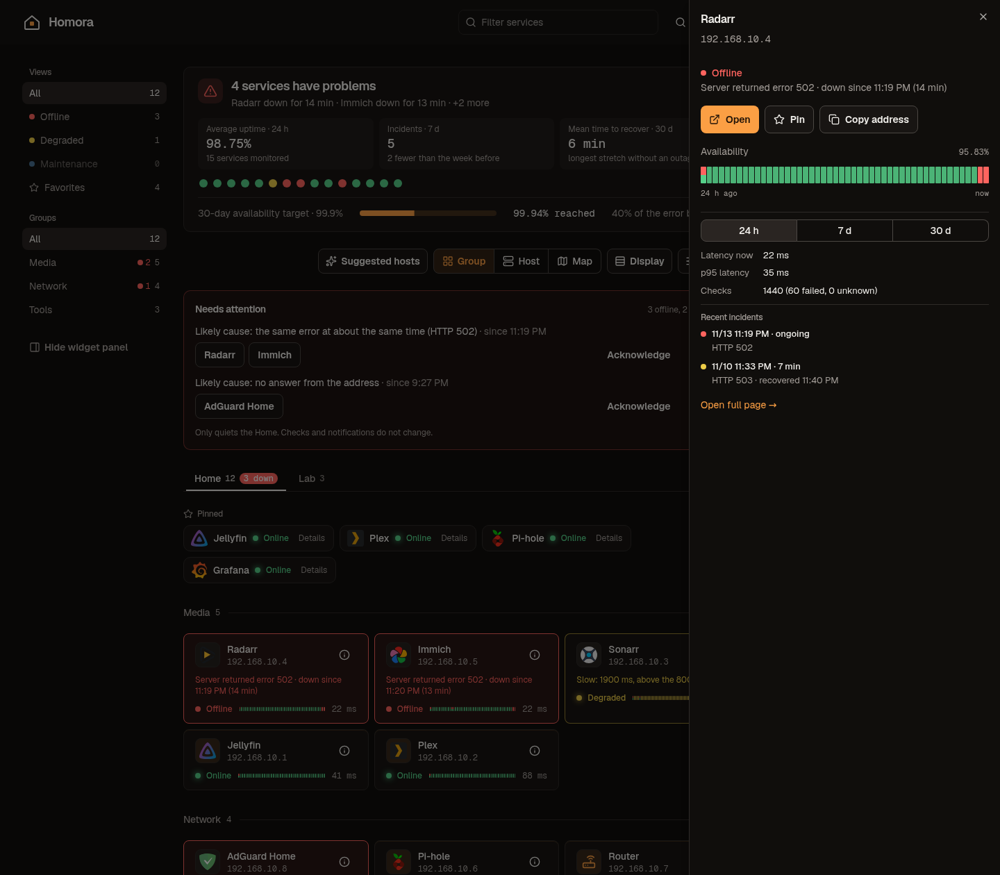

# The dashboard

The dashboard (`/`) is the page you will see most. It shows your cards grouped and organized in pages, a health
summary, and any widgets you added. This guide explains each part and the ways to reach a service quickly.

## The health banner

The banner on top answers "is everything fine?" at a glance. When something is wrong it names the services and
how long they have been down. It also summarizes:

| Figure                    | Meaning                                                                          |
| ------------------------- | -------------------------------------------------------------------------------- |
| **Average uptime · 24 h** | Availability across the services that are being monitored, and how many that is. |
| **Incidents · 7 d**       | How many outages opened in the last week, compared with the week before.         |
| **Mean time to recover**  | Average outage length over 30 days, plus the longest stretch without an outage.  |
| **Availability target**   | Progress against a 99.9% target over 30 days, with the remaining "error budget". |

Services you have not authorized for private-network monitoring are reported in the banner as _not monitored_
rather than as failures.

Under the headline there is one small window per service, colored by state and named for screen readers.
Clicking a window opens that service's details.

## Needs attention

When services are offline, **Needs attention** groups them by what they probably share: a stopped guest or an
offline host (from a linked Proxmox connection), the same error starting within ten minutes, or an address that does
not answer. The wording always says _likely_: Homora only reads what it already knows and never names a fix. The panel starts as one line (how many services are offline and how many causes);
**Show causes** opens the list, and the browser remembers the choice so the services stay on screen.

For each group you can **Acknowledge** it (you saw it; it stays quiet until that incident ends, and a new incident
speaks up again) or **Mute 1 h**. Both can be undone from the toast or with **Show again**. This only quiets the
dashboard: checks, incidents and notifications do not change. Each action is recorded in the
audit log.

## Status filters

On wide screens the **Views** list in the left rail has **All**, **Offline**, **Degraded** and **Maintenance**, and
the **Groups** list shows the health of each group. On smaller screens the same filters are chips under the banner
(or in **Options** on a phone). The numbers beside them are live counts. **Degraded** is an online service that answers slower than
the limit you set for it (see [Services and monitoring](services-and-monitoring.md#alerts-and-states)).

## Alerts bell

The bell counts unread notifications about confirmed service outages and recoveries. Open it to review the
history and mark one or all as read. Reading is independent of acknowledging or muting an incident; **Activity**
remains available for auditing. The inbox retains up to 90 days and 10,000 entries, and does not include probes.
See [Notifications and status page](notifications-and-status-page.md#in-app-notifications).

## Pages, groups and cards

- **Pages** are the tabs along the top of the dashboard. Use them to separate concerns, for example _Home_,
  _Media_ and _Lab_. Each shows how many of its services are down. The `⋯` button next to the selected tab renames it,
  moves it earlier or later, or deletes it (a page with groups or widgets asks where they go first). Press `1` to `9` to switch pages. Manage pages in
  **Settings → Home and pages** (up to 12, with unique names).
- **Groups** organize cards inside a page. The **Groups** list in the left rail (chips on smaller screens) filters to one group. Each group has a column
  count from 1 to 6, so a short group can sit in two wide columns while a long one uses six.
- **Cards** show the icon, name, address, current state, latency and the availability for the selected period.
  A failing card is highlighted and explains why it failed and since when.

## Layouts and views

Open **Display** to choose how cards look. This is saved in your browser. **Compact** is the default.

| Choice      | What you get                                                                                                                                                                                                                                                            |
| ----------- | ----------------------------------------------------------------------------------------------------------------------------------------------------------------------------------------------------------------------------------------------------------------------- |
| **Compact** | A small tile per service: icon, name, host, the state in words and a thin bar for the period. Groups with only healthy services can collapse, and groups with problems can come first (both in **Settings → Home and pages**). The `i` button opens the details drawer. |
| **List**    | A dense row per service. Best for many services.                                                                                                                                                                                                                        |
| **Cards**   | Larger cards with the description, the uptime bar for the period and a **Details** link that opens the drawer (history, incidents and charts live there).                                                                                                               |
| **Group**   | Cards organized by your groups (the default).                                                                                                                                                                                                                           |
| **Host**    | Cards organized by the machine or guest they run on, for services you have linked to a host.                                                                                                                                                                            |
| **Map**     | A map of hosts and the services running on them. See [linking a card to a host](services-and-monitoring.md#where-a-service-runs-and-what-it-needs).                                                                                                                     |

The **Host** view lists services under the node and guest they run on, and flags the ones that may be affected by a
failing dependency. The **Map** shows the same relationships as boxes, and you can drag an unlinked service onto a guest.

The **Display** popover also sets whether descriptions show and the uptime period (24 h, 7 d or 30 d); the same
options are in **Settings → Home and pages**. **Organize** is a button on the Home toolbar; it is also where you add, edit and delete services.

### Details drawer

The `i` button on a tile, **Details** on a card, a Pulse window or a name in **Needs attention** opens a side panel
(a bottom sheet on a phone) with the state, **Open** and **Copy address**, the availability bar, latency, recent
incidents, and a link to the full page. Escape closes it.

### Favorites

**Pin** a service from its drawer to show it in the **Pinned** row above the groups, the same on every page.
**Favorites** in the left rail shows only pinned services. Pins are included in export and import.

### Widget panel

On screens wider than 1440 px the widgets of the page sit in a panel on the right; **Hide widget panel** (left rail)
puts them back in a row under the banner. A widget that cannot refresh keeps its last reading and says how old it is,
and a widget whose connection is missing says so.

## Searching: the command palette

Press `Ctrl K` (`⌘ K` on macOS) or `/` from anywhere to open the palette.

- Type part of a name, group, description or host. Matches tolerate accents and missing letters.
- Filter with prefixes: `status:down` (also `up`, `online`, `unknown`) and `group:Media` or `group:"Developer tools"`.
  Combine them with free text, for example `status:down plex`.
- Sort results by **Relevance**, **Name** or **Status**.
- Press `Enter` to open the service, or `Shift Enter` to jump to its card on the dashboard.
- The palette also lists settings pages and actions under **Go to**, such as Import / Export.
- The **Filter services** field in the top bar narrows the dashboard as you type (Escape clears it); the palette is still
  the way to jump to a service, a setting or an action.
- Optional **web search**: turn it on in **Settings → Top bar and shortcuts** to add "Search the web" to the
  palette. It is off by default; nothing is sent until you choose it, and then only the text you typed goes to the search engine.
  With it on, a prefix picks the engine: `!g` Google, `!ddg` DuckDuckGo, `!b` Brave, `!bing` Bing, `!w` Wikipedia, `!gh` GitHub,
  `!yt` YouTube (for example `!w jellyfin`). Only the text after the prefix is sent.

## Keyboard shortcuts

Press `?` to see the list in the app. Single-key shortcuts can be turned off in
**Settings → Top bar and shortcuts**; the two `Ctrl`/`⌘` shortcuts always work.

| Keys         | Action                            |
| ------------ | --------------------------------- |
| `Ctrl/⌘ K`   | Open or close the command palette |
| `/`          | Open the palette                  |
| `?`          | Show all shortcuts                |
| `g` then `h` | Go to the dashboard and services  |
| `g` then `p` | Show what is offline              |
| `g` then `i` | Go to Integrations                |
| `g` then `a` | Go to Agents                      |
| `g` then `t` | Go to Activity                    |
| `g` then `s` | Go to Settings                    |
| `n`          | Add a new service                 |
| `1` to `9`   | Switch to that page               |
| `Ctrl/⌘ B`   | Show or hide the sidebar          |

## Organizing cards and groups

Press **Organize** on the Home toolbar. The same mode is where you manage services and groups; there is no separate
list under Manage.

- **Drag** a row by its handle to reorder, or use the **up and down arrows**, which work from the keyboard.
- Open the **⋯** menu on a row to move a service to the top or to another group, **Edit** it, or **Remove** it (the
  row asks you to confirm the removal).
- **Add service** opens the new service form (the `n` key and the command palette do the same).
- Use **New group** to create a group, and the controls beside a group name to move or rename it.
- Press **Done** when you are finished.

Everything you can do by dragging is also possible with buttons and menus.

## Widgets on the dashboard

Between the banner and your groups, the dashboard can show **page widgets**: a clock, or live readings from an
integration such as Proxmox. A page holds up to 12 widgets; at the limit the **Add widget** tile says so and the
other pages in **Move to page** that are full are disabled. The dashed **Add widget** tile after the last widget opens a searchable gallery.
Each widget has a **⋯** menu to edit it, move it earlier or later, move it to another page or remove it, and widgets
can be dragged to reorder. Widgets can also be attached _inside_ a card. See
[Integrations and widgets](integrations-and-widgets.md).

## Other addresses (Links)

A service can be reached more than one way, for example through its domain and through its LAN IP when the tunnel or
DNS is down. In the service form, open **Other addresses** and add up to 10 extra addresses. Each can have a name, a
type (a colored label such as _LAN_ or _Admin_ that you create on the spot, rename, recolor or delete) and its own
**Open in** setting (new tab or same tab, otherwise the service's). Types are shared by all services and saved as soon
as you change them.

Services with extra addresses show a **Links** button on the card and in lists. It lists the main address first, then the
others, with a copy button on each; on a phone it opens as a bottom sheet. The command palette shows the extra addresses
under each service while you search. Only the main address is monitored.

## Service details

Click the **Details** or **Incidents and charts** link on a card (or choose a service in the palette) to open its page
at `/services/<id>`.

You will find uptime for 24 hours, 7, 30 and 90 days with the change from the previous period, a latency chart with
median and p95 lines and incident markers, a 90-day heatmap, and a breakdown of why checks failed. The
**Schedule maintenance** button pauses checks for a planned window. See
[Services and monitoring](services-and-monitoring.md) for how these numbers are calculated.

## On a phone

The interface is responsive. The layout collapses to one column and the header keeps a single row (in the management
area and on the account page, the back arrow takes the place of the logo). Navigation is a floating bar at the bottom:
only the current item shows its name, the others are icons. The dashboard's bar has **Home**, **Search** (opens the
palette) and **Manage** (the notifications bell stays in the header). In the management area it has the main sections and
**More**, which opens a sheet with the rest and a way back to the dashboard. Background-image editing is only available on larger screens, and the
service map shows a notice with a link to the host list on narrow screens.

