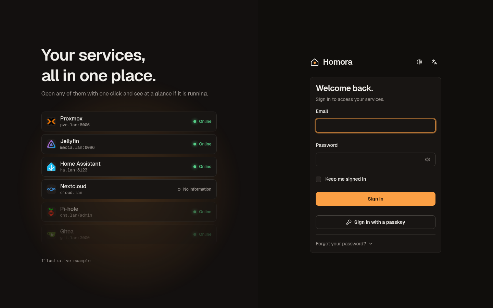
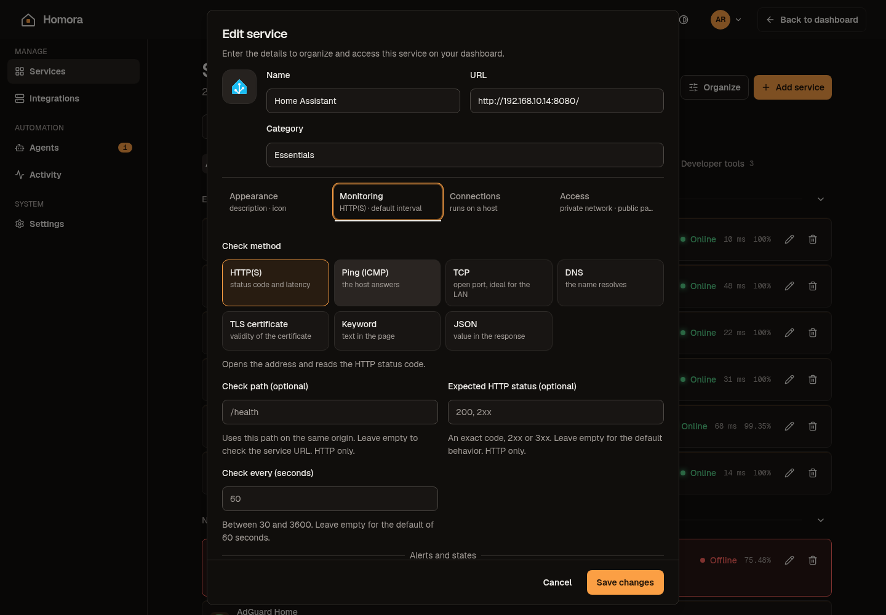
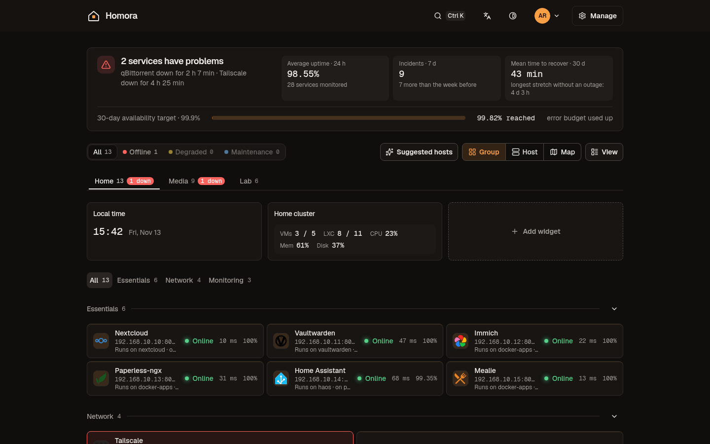

# Getting started

A ten-minute tour: install Homora, create your account, add a first card, see it monitored, and get your first
alert. Every step works without Proxmox and without an AI agent.

## Before you begin

- **Docker with Compose** on a machine you control (a laptop, a mini PC, a NAS or a VM).
- A modern browser. Homora is responsive, so the same interface works on a phone.
- To monitor addresses on your local network (such as `192.168.1.20`), you will opt in per service later in this guide.

## 1. Install

```bash
git clone https://github.com/JhonatanMedeiros/homora.git
cd homora
docker compose up -d --build
```

Open <http://localhost:8080>. The port is bound to `127.0.0.1`, so only the machine itself can reach it. Your data
lives in the `homora-data` Docker volume.

> **Do the first setup from the machine itself.** Until the first administrator account exists, anyone who can
> reach the port can create it. To reach Homora from other devices, put an HTTPS reverse proxy in front of it as
> described in [Deployment and upgrades](deployment.md); plain HTTP from other machines is refused by design.

## 2. Create the administrator account

On the first visit Homora asks for a name, an email and a password of at least 8 characters. The email is only
your sign-in name: Homora never sends email. Afterwards you sign in at `/login`; tick **Keep me signed in** to stay
signed in for up to 30 days instead of 8 hours.



## 3. Add your first service

1. Press **Add your first service** (or press `n` on the dashboard).
2. Fill in the essentials: a **name**, the **URL** you open the service at, and a **category**, which is the
   group the card lives in. Typing a new category creates the group.
3. Pick an **icon**. Type a service name and Homora suggests the matching brand logo, for example
   `brand:jellyfin`. You can also use an emoji, a built-in icon such as `lucide:server`, or an image URL.
4. If the service lives on your local network, open the **Access** tab and allow **private network**
   monitoring. Without it Homora will not probe private addresses, and the card reads **Not monitored** ("Destination not authorized for monitoring").
5. Press **Save service**.



Within a minute the card shows **Online**, **Offline** or **Waiting**, with the latency of the last check. A
redirect or a login prompt counts as Online; a failing card explains why (not found, server error, no response)
and opens a **Details** panel with the recent checks.

> **Tip:** if you already use Homepage or Dashy, skip the typing. Import your existing file from
> **Settings → Export and import**. See [Import, export and backup](import-export-backup.md).

## 4. Know your way around



| Where                     | What it is                                                                             |
| ------------------------- | -------------------------------------------------------------------------------------- |
| **Dashboard** (`/`)       | Your cards, grouped and organized in pages. The banner at the top summarizes health.   |
| **Search** (`Ctrl K`)     | Jump to any card, filter by status or group, and reach any settings page.              |
| **Organize** (Dashboard)  | Add, edit, organize and delete cards and groups, right on the Home.                    |
| **Manage → Integrations** | Connect Proxmox and other tools, attach widgets to cards, and set up Docker discovery. |
| **Manage → Agents**       | Create AI agent identities and review their proposals.                                 |
| **Manage → Activity**     | A log of sign-ins, proposals, approvals and settings changes.                          |
| **Manage → Settings**     | Appearance, pages, top bar, alerts, the public status page, and export or import.      |
| **Account** (avatar menu) | Password, two-step verification and passkeys.                                          |

The avatar menu also links to the Homora repository on GitHub.
It includes **What's new**, where you can search recent release notes and see whether a newer stable
version is available. The indicator requires an identified release image; source builds without a
release tag do not claim to be up to date. The server requests public release information from GitHub when you sign in and every six hours while the page remains open. GitHub receives the server's public IP address; the request includes no Homora credentials, hostname, services or inventory. If GitHub is unavailable,
the rest of Homora keeps working.

Press `?` anywhere to see every keyboard shortcut.

## 5. Get alerted when something breaks

1. Go to **Settings → Alerts** and add a channel: Telegram, ntfy, Discord or a webhook.
2. Press **Send test** to confirm the message arrives.
3. Optionally, on a card's **Monitoring** tab, set how many failed checks open an incident, so a single blip does not wake you.

Details are in [Notifications and the public status page](notifications-and-status-page.md).

## Where to go next

- Learn the dashboard: [Dashboard](dashboard.md).
- Tune your checks: [Services and monitoring](services-and-monitoring.md).
- Show live data from Proxmox, Jellyfin and others: [Integrations and widgets](integrations-and-widgets.md).
- Let an agent help: [AI agents and MCP](agents-and-mcp.md).
- Make it look like yours: [Appearance and personalization](appearance.md).
- Protect your data: [Import, export and backup](import-export-backup.md) and [Accounts and security](accounts-and-security.md).
- Not sure where to start? Browse the [use cases](use-cases.md).

## Common questions

**Can I use Homora without Proxmox?** Yes. Proxmox, the other integrations and AI agents are all optional.

**A card says "Not monitored".** Local network addresses are monitored only after you allow
**private network** on that service. Loopback addresses such as `127.0.0.1` are always blocked. Also check that the
path and expected status on the Monitoring tab match what the service really returns.

**I forgot my password.** Run `pnpm auth:reset` on the server; see [Accounts and security](accounts-and-security.md).

**How do I update?** Back up, pull the new version and run `docker compose up -d --build`. See
[Deployment and upgrades](deployment.md#upgrade).
