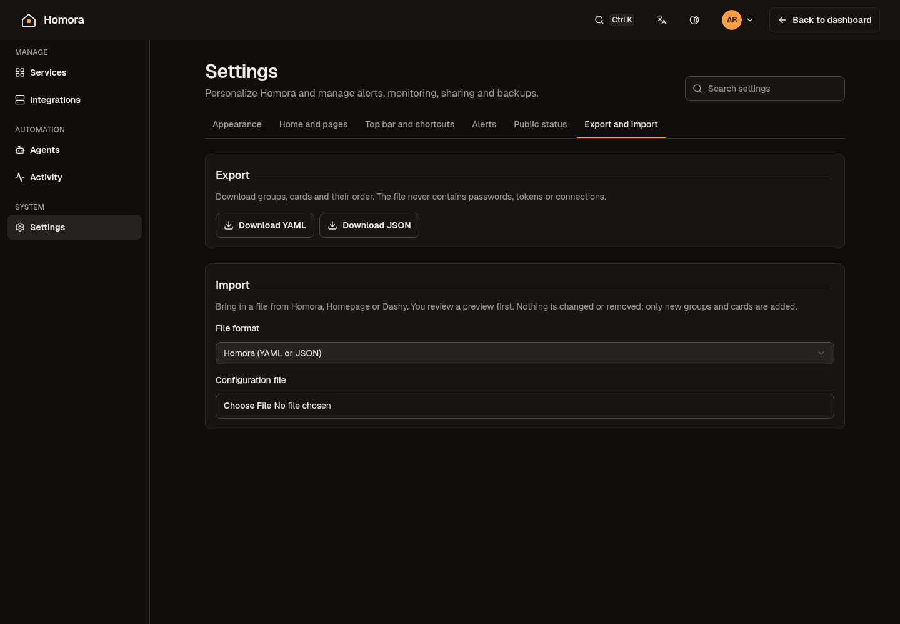

# Import, export and backup

| Tool       | What it does                                                                |
| ---------- | --------------------------------------------------------------------------- |
| **Export** | Produces a portable file of your cards and layout.                          |
| **Import** | Brings in cards from Homora, Homepage or Dashy.                             |
| **Backup** | Copies the whole database, including the account and encrypted connections. |



## Export

In **Settings**, download your groups, cards and their order as YAML or JSON (`GET /api/config/export`).

- The file never contains passwords, tokens, connections or IDs. It can contain page widget names and connection names,
  so review it before sharing.
- Since file version 7, each page's widgets include the Summary's own, and customized
  [Summaries](dashboard.md#customize-the-summary) are exported per page in the optional `summaryLayouts` field. A page
  that holds only untouched Summary widgets takes the file's widgets and arrangement. A page you already changed keeps
  its arrangement and does not receive a second copy of a Summary widget it has with the same name and options. Older files still import, and their new
  pages start with the default Summary. An invalid arrangement is ignored with a warning. A file may list up to 500
  widgets.
- Extra addresses (Links) are exported with their type name and color, and pinned favorites as `pinned: true`. Older
  files still import.

## Import

Pick the format (Homora, Homepage or Dashy) and a file. Homora previews what will be added, what already exists and what
was ignored, and writes nothing until you confirm.

- A file that is not valid YAML or JSON, or not a configuration, shows an error instead of a preview.
- Import only adds: nothing is overwritten or removed.
- Imported cards cannot monitor your private network unless you tick that option for a Homora file you trust.
- Clock widgets are imported. Connected widgets appear as skipped in the preview and must be recreated with a
  connection you choose.
- Icons from other dashboards are kept only when Homora has an equivalent; the others are left empty with a warning.
- Widgets, monitoring settings and Docker links from Homepage and Dashy are not imported.

The formats were checked against those projects' documentation; real files may vary.

## Backup and restore

Create a consistent copy of the database (existing files are never overwritten):

```bash
pnpm backup data/homora.sqlite backups/homora.sqlite
```

### What to keep

The database holds your cards, the administrator account (with its sessions) and encrypted connection credentials.
Copy these files next to it into a protected backup, and restore them under the same names:

| File                        | Purpose                                                                                                      |
| --------------------------- | ------------------------------------------------------------------------------------------------------------ |
| `<database>.key`            | The encryption key. Without it you must configure credentials again.                                         |
| `<database>.session-secret` | Needed to restore two-step verification. Absent if you set `HOMORA_SESSION_SECRET`; keep that value instead. |
| `<database>.proxmox`        | Used by the original Proxmox integration. May not exist.                                                     |
| `<database>.background`     | The background image. May not exist. `pnpm backup` already copies it next to the database copy.              |

A `.auth` file from earlier versions is no longer read and can be deleted. Keep the key as protected as the database.

### Restore

Stop Homora, keep the current database and use the backup as the source of a new file, for example
`pnpm backup backups/homora.sqlite data/restored.sqlite`. Point `HOMORA_DATABASE_PATH` at it and restart. Do a test
restore before relying on a backup.

### With Docker Compose

Use a new protected directory on the host (the commands do not overwrite backups):

```bash
mkdir -p backups/backup-2026-11-10
docker compose exec backend node scripts/backup.mjs /app/data/homora.sqlite /app/data/backup.sqlite
docker compose cp backend:/app/data/backup.sqlite backups/backup-2026-11-10/homora.sqlite
docker compose cp backend:/app/data/homora.sqlite.key backups/backup-2026-11-10/homora.sqlite.key
docker compose cp backend:/app/data/homora.sqlite.session-secret backups/backup-2026-11-10/homora.sqlite.session-secret
docker compose cp backend:/app/data/homora.sqlite.proxmox backups/backup-2026-11-10/homora.sqlite.proxmox
```

Skip a copy if the file does not exist. Copy `homora.sqlite.background` the same way if you use a background image.
