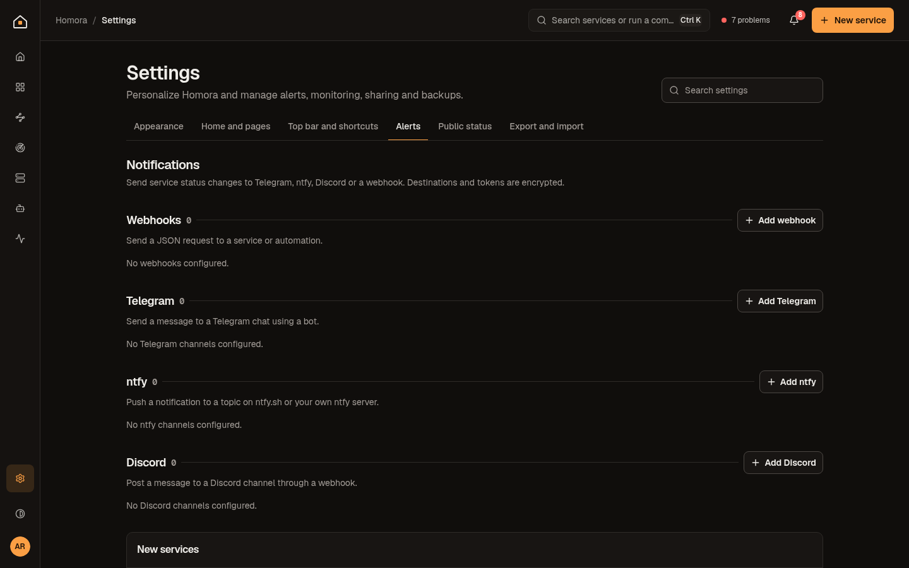
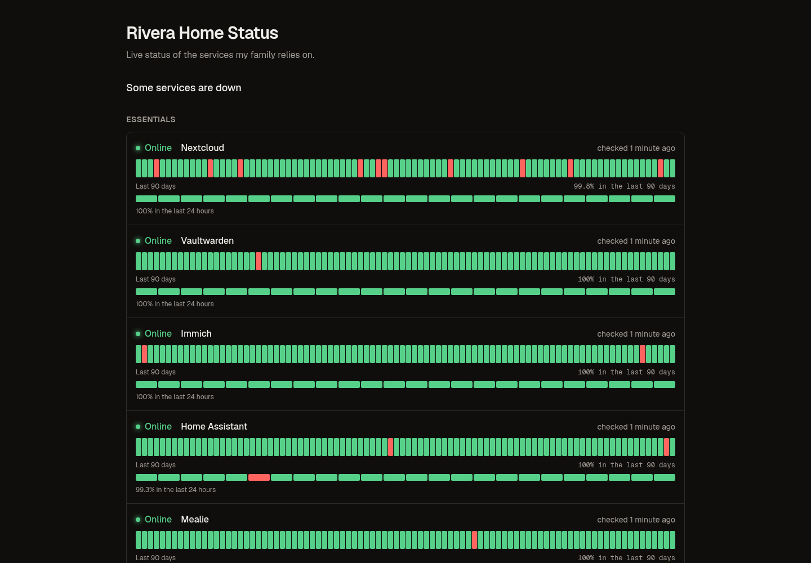

# Notifications and the public status page

Two ways to tell people (including yourself) that something is down: push alerts to the channels you already use, and
an optional read-only status page for visitors.

## Notifications

In **Settings → Alerts**, add a Telegram, ntfy or Discord channel, or an HTTPS webhook, and use **Send test** to verify
delivery. A test sends a real message. Each channel shows its last successful send, last error and consecutive failed
attempts.

- Messages use the language selected for each channel. New channels start with the interface language; channels that
  existed before this setting stay in English. Webhook JSON uses language-independent fields and values.
- The webhook URL, bot token and chat ID are encrypted with the integration vault key, and saved values cannot be
  viewed again. Keep the database and its `.key` backup together.
- Webhook destinations on private networks need explicit opt-in. Loopback, link-local and other forbidden ranges stay
  blocked. TLS certificates are validated and redirects are not followed.

### Telegram

1. Create a bot with BotFather and copy its token.
2. Start a conversation with the bot (or add it to a group) and send it a message.
3. Call `https://api.telegram.org/bot<TOKEN>/getUpdates` and note the message's `chat.id`.
4. Enter the token and the numeric chat ID in Homora.

Protect the token, and avoid saving that URL in shell history or logs.

### Webhook payload

A webhook receives a JSON `POST` with:

| Field              | Value                                                                      |
| ------------------ | -------------------------------------------------------------------------- |
| `event`            | `down` or `up`                                                             |
| `service`          | `id`, `name`, `category` (the URL only if you explicitly enable it)        |
| `status`           | The service status                                                         |
| `reason`           | Why the check failed, if it did                                            |
| `httpStatus`       | The HTTP status code, if any                                               |
| `latencyMs`        | The check latency                                                          |
| `at`               | When it happened                                                           |
| `outageDurationMs` | Time from the first observed failure to confirmed recovery, when available |

Human-readable alerts include the reason, HTTP status and response time when available. Recovery messages include the time from the first observed failure to confirmed recovery when known; outages already in progress before this feature may not have a duration. The optional URL is the service link.

### When messages are sent

- An initial failed check emits `down`, and recovery after a notified outage emits `up`.
- An unknown result alone emits nothing and does not erase the last known state.
- Repeated outages within five minutes are suppressed, and so are their recoveries.
- Changing a service's monitoring configuration starts a new baseline.
- Each delivery gets up to three attempts with a five-second timeout. A retry can duplicate a message when the
  destination received the request but its response was lost.
- Transition state survives restarts, but the bounded in-memory delivery queue does not, so queued messages may be lost
  during shutdown.

### In-app notifications

The bell shows unread service and probe outage and recovery notifications, even without an external channel. Open it
to review events and mark one or all as read. Reading does not acknowledge or mute an incident. The inbox keeps up to
90 days and 10,000 events (older entries are removed, unread ones included) and starts empty after upgrading. The
Activity page remains available for auditing.

## Public status page (optional, read-only)

Homora can publish a minimal, read-only page at `/status`, so others can see what is up without signing in. It is
**closed by default**: nothing is public until an administrator enables it in **Settings** and marks each service with
**Show on the public status page** in its form.

### What visitors see

Anonymous visitors receive only the service name, group, online/offline/unknown state, last check time, 24 hourly bars
and the 24-hour uptime percentage. Never URLs, descriptions, addresses, latency, HTTP codes, failure reasons or
internal IDs.

### How it works

- The page calls only `GET /api/public/status`, the one anonymous API path (exact match, never a prefix). It is limited
  to 60 requests per minute per client address and cached for 15 seconds.
- With the page disabled or no public service, the endpoint answers `404 not-found`, like a route that does not exist.
- Importing a configuration and agent proposals never make a service public. The MCP only reports
  `publicStatusEnabled`.

### Settings

Settings shows the page address (with copy and open buttons), an optional short description under the title (up to
160 characters, visible to anyone with the link) and a preview of exactly what visitors will see. Enabling or disabling
the page, changing its title or description and marking a service are recorded in the activity feed.

### Behind a proxy or gateway

- The per-client limit needs the real client address. Keep `HOMORA_TRUST_PROXY=true` behind a proxy that overwrites
  `X-Forwarded-For` (see [Deployment](deployment.md#deployment-scenarios)), or every visitor shares one limit.
- Behind Cloudflare Access or a similar gateway, `/status` and `/api/public/status` need a separate hostname or a bypass
  policy, or visitors are still asked to sign in.
- Exposing the page to the internet is your decision: review what is marked public first.
