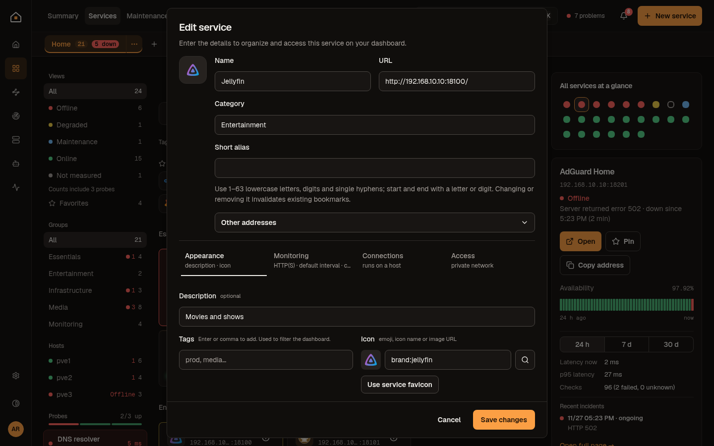
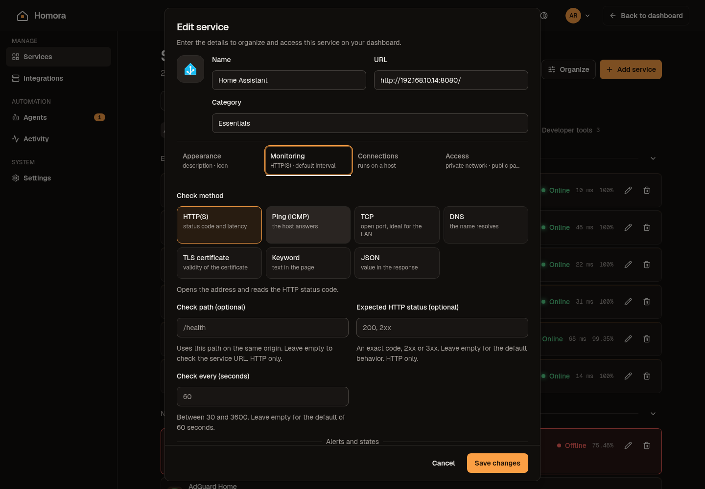

# Services and monitoring

A **service** is a card on your dashboard. It has an address to open and, optionally, a scheduled check that tells you
whether it is healthy. This guide covers the service form, the check types, how failures, incidents and uptime are
calculated, and maintenance.

## The service form

Open it from **Organize → Add service** on the Home, from **Edit** in a row's menu in Organize mode, with `n`, or at
`/manage/services/new` and `/manage/services/:id/edit`. The essentials are always visible; the rest is in four tabs,
each with a one-line summary of what it holds.

### Essentials

| Field        | Notes                                                                                                                                                                              |
| ------------ | ---------------------------------------------------------------------------------------------------------------------------------------------------------------------------------- |
| **Name**     | Shown on the card and searched by the palette.                                                                                                                                     |
| **URL**      | An `http` or `https` address. Every check type uses it, so a card always has something to open.                                                                                    |
| **Category** | The group the card belongs to. A new name creates the group.                                                                                                                       |
| **Icon**     | An emoji, a built-in icon (`lucide:server`), a bundled brand logo (`brand:plex`) or an image URL. The form suggests the logo matching the name; the search button browses all 164. |

### Appearance tab

- **Description:** optional text shown in the Cards layout.
- **Tags:** press `Enter` or type a comma to add one. Tags filter the dashboard.
- **Open link:** a **new tab** (default) or the **same tab**.

### Monitoring tab

Choose a **check method**, how often it runs, and how Homora interprets the results.

### Connections tab

Link the card to the **host** it runs on and record the services it **depends on**. See
[Where a service runs and what it needs](#where-a-service-runs-and-what-it-needs).

### Access tab

- **Allow monitoring on a private network** lets Homora probe local addresses such as `192.168.x.x`, for this service
  only. See [The destination policy](#the-destination-policy).
- **Skip TLS verification for this service** is an exception for HTTP and TLS checks on permitted private addresses.
  It can let an attacker impersonate the service and may show an expired certificate as healthy, so the card displays
  **TLS not verified** while it is on. Prefer installing your private CA in **Settings → Alerts**.
- **Show on the public status page** includes the service on the optional public page. See
  [Notifications and the public status page](notifications-and-status-page.md#public-status-page-optional-read-only).

## Check types

Every type goes through the same destination policy. Pick the one that answers your question.

| Type                | Asks...                                      | Use it for                                                                                            |
| ------------------- | -------------------------------------------- | ----------------------------------------------------------------------------------------------------- |
| **HTTP(S)**         | Does the address answer with a good status?  | Most web interfaces. Reports the status code and latency.                                             |
| **Ping (ICMP)**     | Does the host answer ping?                   | A machine or appliance with no web page. It says nothing about the service itself.                    |
| **TCP**             | Is the port open?                            | Databases, SSH, MQTT and anything on the LAN that does not speak HTTP. Uses the URL's host and port.  |
| **DNS**             | Does the name resolve?                       | Checking that a host name still points somewhere.                                                     |
| **TLS certificate** | Is the certificate valid, and for how long?  | Reports `expired` or `invalid` as unavailable and `expiring` (within 14 days) while still available.  |
| **Keyword**         | Does the page still contain some text?       | A site that returns 200 even when broken. Case-insensitive, in the first megabyte of a 2xx response.  |
| **JSON**            | Does the response contain an expected value? | An API health endpoint, for example `status=ok`. A bare path means "exists and is not null or false". |

Homora never stores response bodies. A keyword or JSON mismatch is recorded only as the reason `content-mismatch`.

### HTTP options

All of these are on the Monitoring tab, are included in Homora exports, and are subject to the destination policy and
the service's private-network permission.

- **Check URL** sets a separate, complete HTTP or HTTPS address for monitoring, for example a LAN health endpoint when
  the card opens a public address behind Cloudflare Access. It takes precedence over **Check path** for all check
  types (host checks use its host and port). Credentials, query strings and fragments are not accepted. It is also
  included in agent proposal reviews.
- **Check path** replaces the path and query of the card URL for the HTTP probe, keeping its origin. For example, use
  `/health` while the card opens `/dashboard`. It must start with a single `/`, and a query string is allowed. Leave
  it empty to check the full card URL.
- **Expected HTTP status** accepts an exact code such as `200` or `302`, or `2xx` / `3xx`. Any other response is
  unavailable, with the received and expected codes. Leave it empty for the default classification.

Check path and expected status are kept when you switch to ping but only apply to HTTP checks.

Checks are anonymous and do not follow redirects, so a login page or access proxy can answer successfully while the
service behind it is down. Use an anonymous health endpoint when there is one.

### Private TLS trust

For private HTTPS origins, **Settings → Alerts** accepts a PEM or CRT bundle of up to ten currently valid
certificates (64 KB total). The extra trust applies only to HTTP and TLS checks whose authorized address is private,
and certificate and hostname validation stay on. Uploading replaces the bundle. Certificate trust and per-service TLS
exceptions are local to this installation and are not included in configuration export.

### Check interval

**Check every (seconds)** accepts 30 to 3600; empty means 60. Checks run from the Homora backend, so they reflect what
_Homora_ can reach, not your browser.

### The destination policy

Every check resolves the address and pins it, so a name cannot be switched to a forbidden address mid-check.

- Loopback (`127.0.0.0/8`), link-local and other special ranges are **always blocked**.
- Private LAN addresses are monitored only when **Allow monitoring on a private network** is on for that service.
- **Settings → Alerts → New services allow private network** only sets the starting value of that checkbox in the
  new-service form. Existing services, imports, Docker discovery and agent proposals are unaffected.
- A card whose destination is not authorized reads **Not monitored** and does not count as a failure.

## States, alerts and incidents

### Alerts and states

**Alerts and states**, in the lower part of the Monitoring tab, controls how results are interpreted. These settings
never change the check itself, so changing them never erases history. They are set only in the web interface, never
by imports or agent proposals.

| Setting                                     | Effect                                                                              |
| ------------------------------------------- | ----------------------------------------------------------------------------------- |
| **Failures before it counts as down**       | Consecutive failed checks needed to open an incident and send an alert (default 1). |
| **Successes before it counts as recovered** | Consecutive successful checks needed to close it (default 1).                       |
| **Degraded when slower than (ms)**          | An online service slower than this reads **Degraded**. Off by default.              |

Raise the failure threshold to ignore isolated blips. Notifications use the same thresholds, so a long outage sends
**one** alert, not one per check.

### The states a card can show

| State              | Meaning                                                                                                                                    |
| ------------------ | ------------------------------------------------------------------------------------------------------------------------------------------ |
| **Online**         | The last check succeeded. A redirect or login prompt counts as online.                                                                     |
| **Offline**        | The check failed. The card says why: no response, error status, content mismatch, certificate problem.                                     |
| **Degraded**       | Online, but slower than the limit you set.                                                                                                 |
| **Maintenance**    | Inside a scheduled window. Checks are paused.                                                                                              |
| **Waiting**        | No result yet.                                                                                                                             |
| **No information** | Homora cannot say, for example after you change a service's settings and before the next check. Unknown checks never count against uptime. |
| **Not monitored**  | The destination is not authorized. See [the destination policy](#the-destination-policy).                                                  |

### Incidents

An **incident** is a period of consecutive failed checks. It opens when a service reaches its failure threshold (its
start time is the first failed check of the streak) and closes at the first run of successes that reaches the recovery
threshold. Unknown checks change nothing.

Incidents feed the dashboard banner and the markers on the latency chart. Failure reasons use Homora's own vocabulary
(`no-response`, `error-status` with the HTTP code, and so on); response bodies are never shown.

## Uptime and history

- Raw checks are kept for **30 days**, one row per check. Hourly counts are kept for about **100 days**, which powers
  the 90-day heatmap and the comparison with the previous period.
- Uptime is shown for **24 hours, 7, 30 and 90 days**. It counts only the current check configuration: if you change
  how a service is checked, older results are not mixed in, and the page says the service was reconfigured.
- Unknown checks are excluded, and no percentage appears until five up or down checks exist.
- The latency chart shows the median (p50) and the 95th percentile (p95). Long ranges are summarized in at most 120
  buckets.
- The **availability target** is 99.9% over 30 days; the remaining allowance is the error budget.
- **Mean time to recover** is the average incident length over 30 days.

Deleting a service deletes its history.

## Scheduled maintenance

On a service's detail page, choose **Schedule maintenance**, pick a start and an end (1 minute to 30 days) and add an
optional note, such as "Disk swap". While a window is open Homora does not probe the service and records _unknown_
with the reason `maintenance`, so uptime, incidents and alerts ignore the period.

- Entering or leaving a window takes effect at the next monitor pass, not the next interval.
- An incident open when maintenance starts stays open until the first success afterwards.
- Windows cannot overlap. You can **End now** or cancel one.
- Only the signed-in person schedules windows, never imports or agents, and each is recorded in the activity log.
- The public status page and notifications do not yet show maintenance as its own state.

## Where a service runs and what it needs

The **Connections** tab models your infrastructure without touching it.

- **Runs on:** link a card to the Proxmox VM or container it runs on by choosing the connection, node and guest. Only
  identifiers are stored, so a renamed guest keeps working. If the guest disappears the card shows _Host not found_;
  if the inventory cannot be read, _Host unavailable_. Neither is ever "offline".
- **Suggested hosts:** on the dashboard, **Suggested hosts** proposes links when it finds independent evidence: the
  card's address in the guest's configuration, reported by the QEMU guest agent, or reported by a Docker source tied to
  that guest. A name match alone never counts. You accept or dismiss each one.
- **Depends on:** record the services this one needs. These links are manual, and Homora refuses one that would create
  a cycle.
- **Impact:** a service whose host or dependency is impaired is flagged as _may be affected_. It is worded as manual
  and as "may", never as a measured fact.

The **Host** view and **Map** arrange services by host; see the [dashboard guide](dashboard.md#layouts-and-views).

All of this is Homora's own data. It never writes to Proxmox or any other external system, and links and dependencies
are not carried by export and import.

## Tips

- Use a dedicated anonymous health endpoint (such as `/health`) with an **Expected HTTP status**.
- Prefer **Keyword** or **JSON** for apps that return 200 even when degraded.
- Add a **TLS certificate** check to anything exposed over HTTPS to hear about expiry two weeks ahead.
- Use **TCP** for LAN services that are not web interfaces.
- Set **Failures before it counts as down** to 2 or 3 for flaky links.
