# Widget and integration gallery

Homora can show live information from the tools you already run, and from its own monitoring, right on your
dashboard. This page shows what is available and how to add your first widget.

::: tip About the images
Every image on this page comes from a demo installation with **invented data**: the numbers, names and addresses are
examples, not a benchmark, and no real service or account appears. See [how the screenshots are made](../screenshots/README.md).
:::

## Add your first widget in five minutes

You do not need any integration to start. Pick whichever path fits.

**Without connecting anything.** On the dashboard, press the dashed **Add widget** tile, search the gallery and
pick a widget that needs no connection: **Clock**, **Calendar**, **Countdown**, **Note**, **Quick links**, or any of the
[monitoring widgets](#monitoring-widgets), which read Homora's own checks. Adjust the options, preview it and save.

**With one of your tools** (for example Pi-hole):

1. Open **Integrations** and press **Add connection**.
2. Choose the type, then enter a name, the address and a read-only credential. Use HTTPS, and enable **private
   network** if the tool lives on your local network.
3. Press **Save and test**. The card reports whether the credentials worked, or a short reason when they did not.
4. Back on the dashboard, press **Add widget**, choose the widget that your connection offers and save. To show it
   on a service card instead, open **Integrations → Widgets** and attach it to the card.

Each widget loads on its own, so a tool that is down never breaks the rest of the page. The details, limits and
security rules are in [Integrations and widgets](integrations-and-widgets.md).

## Integrations

Integrations are optional and read-only. Homora asks, and never changes anything in the other tool.

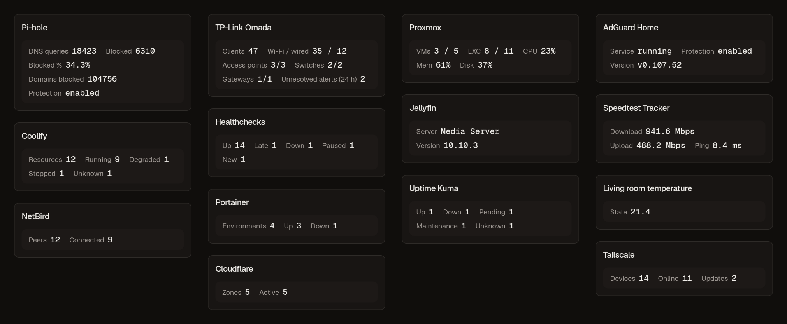

| Integration           | Preview                                                                           | What it shows                                                                 |
| --------------------- | --------------------------------------------------------------------------------- | ----------------------------------------------------------------------------- |
| **Proxmox VE**        | 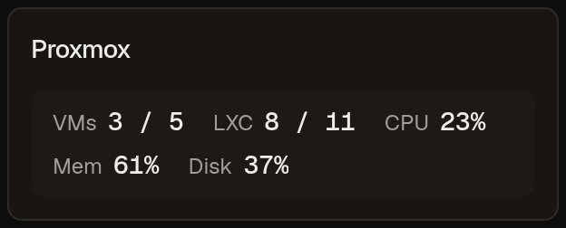                 | Running and total VMs and containers, CPU, memory and disk                    |
| **Pi-hole**           | 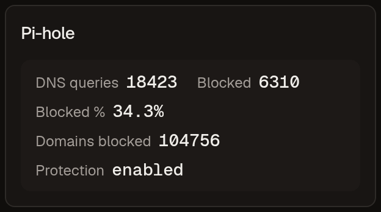                 | DNS queries, blocked queries and percentage, blocklist size, protection state |
| **AdGuard Home**      | 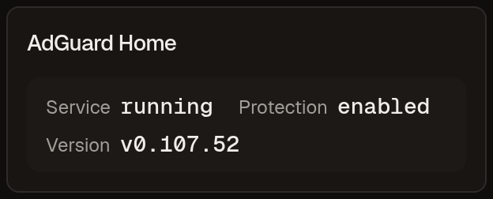            | Whether the service runs, whether protection is on, and the version           |
| **Jellyfin**          | 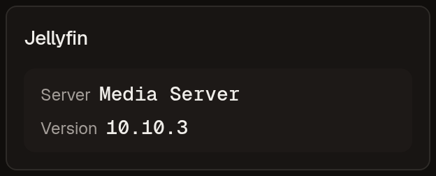                | Server name and version                                                       |
| **Home Assistant**    | 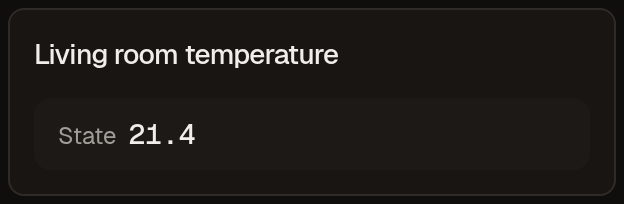 | One entity on a card, or up to 8 selected entity states in a page widget      |
| **Speedtest Tracker** | 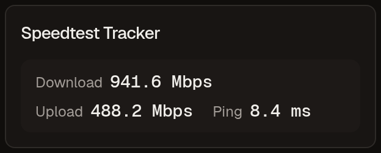       | Latest download, upload and ping                                              |
| **Portainer**         | 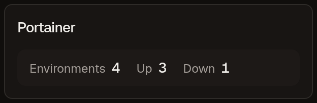               | Environments, and how many are up or down                                     |
| **NetBird**           | 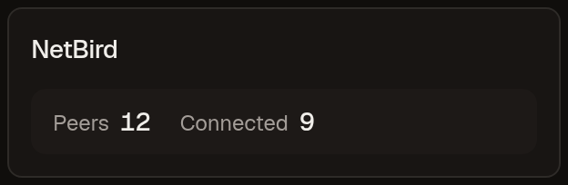                 | Peers, and how many are connected                                             |
| **Tailscale**         | 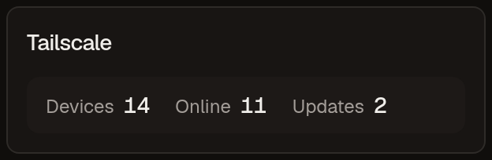               | Devices, how many are online, and how many have an update                     |
| **Cloudflare**        | 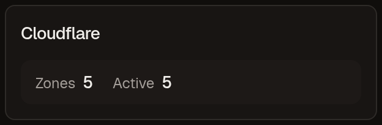              | Zones, and how many are active                                                |
| **Healthchecks**      | 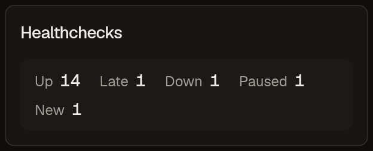            | Scheduled-job checks that are up, late, down, paused or new                   |
| **Coolify**           | 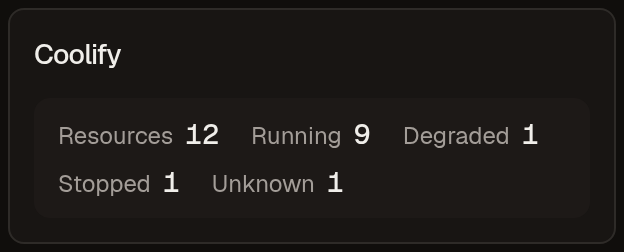                 | Resources, and how many are running, degraded, stopped or unknown             |
| **TP-Link Omada**     | 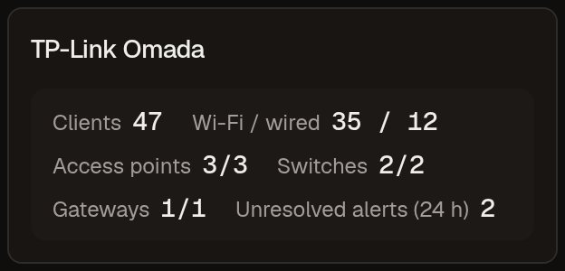           | Clients, access points, switches, gateways and unresolved alerts              |
| **Uptime Kuma**       | 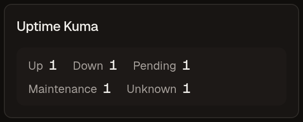             | Counts of monitors that are up, down, pending, in maintenance or unknown      |

Several integrations also offer a list widget that names each item: **Uptime Kuma monitors** and **Coolify resources**.

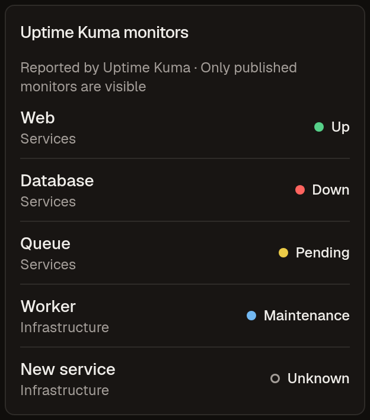
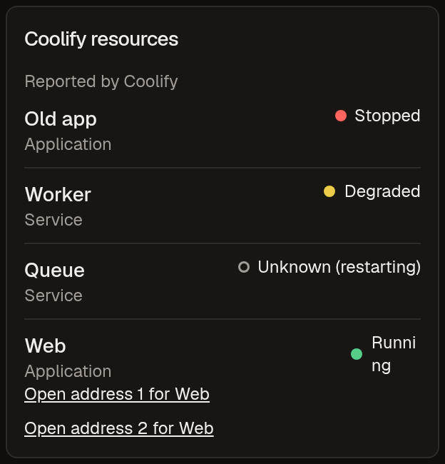

The **Home Assistant entities** page widget lets you enter up to 8 entity IDs and shows each state
and last-updated time. It uses a saved Home Assistant connection; attributes are not returned to the
browser. Its real-service validation is pending.

::: warning Check each one in your environment
The integrations were validated with mocks and documented sample responses, and TP-Link Omada is experimental. The
requirements and the validation status of each one are in the [integration reference](../integrations.md#integration-status).
:::

## Page widgets that need no connection

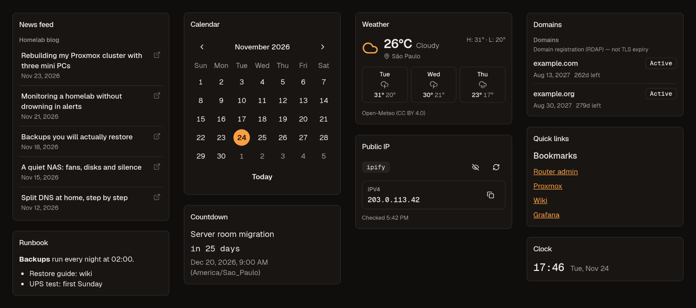

| Widget                | What it does                                                      | Good to know                                 |
| --------------------- | ----------------------------------------------------------------- | -------------------------------------------- |
| **Clock**             | Time and date, 12 or 24 hours, optional seconds and any time zone | Also available in the top bar                |
| **Calendar**          | The current month, with your choice of first weekday              | Runs on the device clock                     |
| **Countdown**         | Time left until a named event                                     | Pick the event's time zone                   |
| **Note**              | Short text with basic Markdown, up to 4,000 characters            | Good for runbooks and reminders              |
| **Quick links**       | Up to 12 links to your own tools                                  | Only HTTP(S) links                           |
| **Weather**           | Current conditions and a short forecast for a place you choose    | Asks a weather provider; see below           |
| **RSS / Atom feed**   | Recent entries from an RSS or Atom feed                           | Fetched by the backend, never by the browser |
| **Public IP**         | Your public IP address, masked by default                         | Asks an outside service, so you must opt in  |
| **Domain expiration** | When your domain registrations expire                             | Registration expiry, not the TLS certificate |

Weather, the news feed, the public IP and domain expiry contact outside services from the Homora backend. Read their
notes in [Integrations and widgets](integrations-and-widgets.md) before enabling them.

## Monitoring widgets

These widgets use the checks Homora already runs, so they need no connection and no credentials.

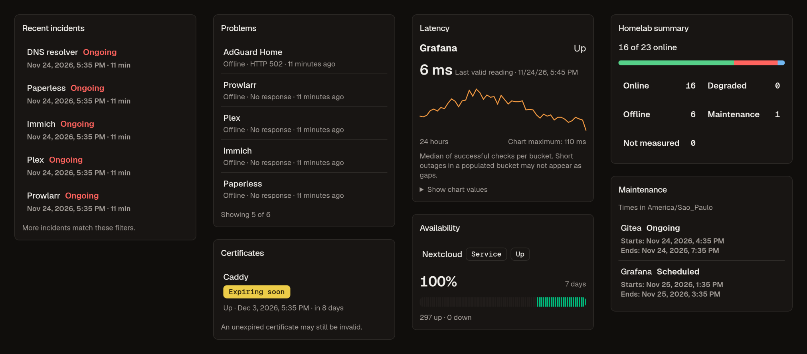

| Widget                   | What it shows                                                                   |
| ------------------------ | ------------------------------------------------------------------------------- |
| **Homelab summary**      | How many monitors are online, degraded, offline, in maintenance or not measured |
| **Current problems**     | The services that are offline or slow right now, oldest first                   |
| **Recent incidents**     | Outages from the last day, week or month, with ongoing ones first               |
| **Availability**         | Uptime for one service over a period, with a bar of recent days                 |
| **Latency history**      | A response-time chart for one service                                           |
| **Certificate expiry**   | Certificates that are close to expiring                                         |
| **Maintenance schedule** | Maintenance windows happening now or coming up                                  |

Most monitoring widgets can be limited to chosen pages or groups.

## Make your own

Missing a tool? Anyone can add an integration or a widget. Start with
[Writing an integration adapter](../adapters.md) or [Create a widget](../create-widget.md).

The **Healthchecks jobs** page widget lists individual checks and their reported states using an existing connection. A successful check does not establish that a backup can be restored. Live-service validation remains pending.
